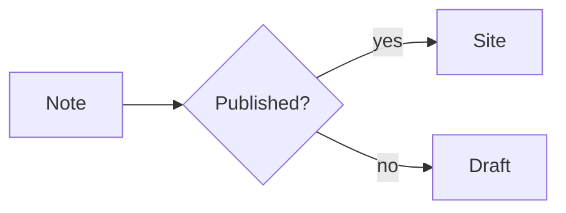
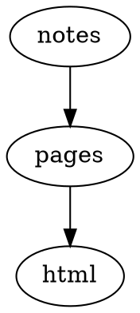
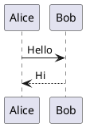

# 図表

## Mermaid (Pele)：[`mermaid-pele`](../mermaid-pele.ja.md)

### ソース

````md

````

### 実行例


## Mermaid（headless browser）：[`mermaid`](../mermaid.ja.md)

`mermaid` プラグインは同じ `mermaid` フェンスをビルド時に headless browser で SVG に変換します。このサイトでは Chromium を必要としない Mermaid (Pele) を使っています。

## D2：[`d2`](../d2.ja.md)

### ソース

````md
```d2
site: Riebeckite
content -> build -> deploy
```
````

### 実行例

```d2
site: Riebeckite
content -> build -> deploy
```

## Graphviz / DOT：[`graphviz`](../graphviz.ja.md)

### ソース

````md

````

### 実行例


## Chart.js：[`chartjs`](../chartjs.ja.md)

### ソース

````md
```chart
{
  "type": "bar",
  "data": {
    "labels": ["Mon", "Tue", "Wed"],
    "datasets": [{ "label": "Visits", "data": [12, 19, 8] }]
  }
}
```
````

### 実行例

```chart
{
  "type": "bar",
  "data": {
    "labels": ["Mon", "Tue", "Wed"],
    "datasets": [{ "label": "Visits", "data": [12, 19, 8] }]
  }
}
```

## Vega-Lite：[`vega-lite`](../vega-lite.ja.md)

### ソース

````md
```vega-lite
{
  "title": "Revenue",
  "data": { "values": [{ "category": "A", "value": 28 }, { "category": "B", "value": 55 }] },
  "mark": "bar",
  "encoding": {
    "x": { "field": "category", "type": "nominal" },
    "y": { "field": "value", "type": "quantitative" }
  }
}
```
````

### 実行例

```vega-lite
{
  "title": "Revenue",
  "data": { "values": [{ "category": "A", "value": 28 }, { "category": "B", "value": 55 }] },
  "mark": "bar",
  "encoding": {
    "x": { "field": "category", "type": "nominal" },
    "y": { "field": "value", "type": "quantitative" }
  }
}
```

## WaveDrom：[`wavedrom`](../wavedrom.ja.md)

### ソース

````md
```wavedrom
{ "signal": [
  { "name": "clk", "wave": "p......" },
  { "name": "bus", "wave": "x.34.5x", "data": "head body tail" }
] }
```
````

### 実行例

```wavedrom
{ "signal": [
  { "name": "clk", "wave": "p......" },
  { "name": "bus", "wave": "x.34.5x", "data": "head body tail" }
] }
```

## Markmap：[`markmap`](../markmap.ja.md)

### ソース

````md
```markmap
# Project

## Design

### Notation
### Rendering

## Delivery
```
````

### 実行例

```markmap
# Project

## Design

### Notation
### Rendering

## Delivery
```

## Marp slides：[`marp`](../marp.ja.md)

### ソース

````md
```marp title="Intro deck"
# First slide

- a bullet

---

# Second slide
```
````

### 実行例

```marp title="Intro deck"
# First slide

- a bullet

---

# Second slide
```

## Maps：[`map`](../map.ja.md)

静的な fallback を先に表示し、JavaScript が有効な環境では interactive map に拡張します。

### ソース

````md
```map
center: 35.6812, 139.7671
zoom: 13
label: Tokyo Station
markers:
  - 35.6812, 139.7671 | Tokyo Station
  - 35.6586, 139.7454 | Tokyo Tower
```
````

### 実行例

```map
center: 35.6812, 139.7671
zoom: 13
label: Tokyo Station
markers:
  - 35.6812, 139.7671 | Tokyo Station
  - 35.6586, 139.7454 | Tokyo Tower
```

## QR codes：[`qr-code`](../qr-code.ja.md)

Build 時に inline SVG として生成します。

### ソース

````md
```qr
# caption: Project page
https://example.com/
```
````

### 実行例

```qr
# caption: Project page
https://example.com/
```

## PlantUML：[`plantuml`](../plantuml.ja.md)

図はビルド時に PlantUML サーバーの画像 URL へ変換されます。表示にはそのサーバーへ到達できる必要があります。

### ソース

````md

````

### 実行例


## Canvas：[`canvas`](../canvas.ja.md)

JSON Canvas をコードフェンスへ直接書くか、`![[diagram.canvas]]` で Canvas ファイルを埋め込みます。

### ソース

````md
```canvas
{
  "nodes": [
    { "id": "note", "type": "text", "x": 0, "y": 0, "width": 240, "height": 100, "text": "Note" }
  ],
  "edges": []
}
```
````

### 実行例

```canvas
{
  "nodes": [
    { "id": "note", "type": "text", "x": 0, "y": 0, "width": 240, "height": 100, "text": "Note" }
  ],
  "edges": []
}
```
