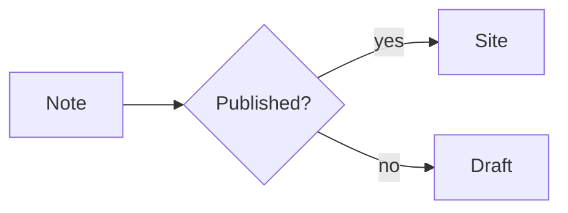
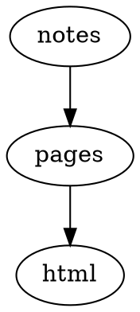
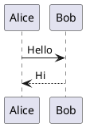

# Diagrams

## Mermaid (Pele) — [`mermaid-pele`](../mermaid-pele.md)

### Source

````md

````

### Rendered


## Mermaid (headless browser) — [`mermaid`](../mermaid.md)

The `mermaid` plugin renders the same `mermaid` fence to SVG with a headless browser at build time. This site uses Mermaid (Pele) instead, so the build does not need Chromium.

## D2 — [`d2`](../d2.md)

### Source

````md
```d2
site: Riebeckite
content -> build -> deploy
```
````

### Rendered

```d2
site: Riebeckite
content -> build -> deploy
```

## Graphviz / DOT — [`graphviz`](../graphviz.md)

### Source

````md

````

### Rendered


## Chart.js — [`chartjs`](../chartjs.md)

### Source

````md
```chart
{
  "type": "bar",
  "data": {
    "labels": ["Mon", "Tue", "Wed"],
    "datasets": [{ "label": "Visits", "data": [12, 19, 8] }]
  }
}
```
````

### Rendered

```chart
{
  "type": "bar",
  "data": {
    "labels": ["Mon", "Tue", "Wed"],
    "datasets": [{ "label": "Visits", "data": [12, 19, 8] }]
  }
}
```

## Vega-Lite — [`vega-lite`](../vega-lite.md)

### Source

````md
```vega-lite
{
  "title": "Revenue",
  "data": { "values": [{ "category": "A", "value": 28 }, { "category": "B", "value": 55 }] },
  "mark": "bar",
  "encoding": {
    "x": { "field": "category", "type": "nominal" },
    "y": { "field": "value", "type": "quantitative" }
  }
}
```
````

### Rendered

```vega-lite
{
  "title": "Revenue",
  "data": { "values": [{ "category": "A", "value": 28 }, { "category": "B", "value": 55 }] },
  "mark": "bar",
  "encoding": {
    "x": { "field": "category", "type": "nominal" },
    "y": { "field": "value", "type": "quantitative" }
  }
}
```

## WaveDrom — [`wavedrom`](../wavedrom.md)

### Source

````md
```wavedrom
{ "signal": [
  { "name": "clk", "wave": "p......" },
  { "name": "bus", "wave": "x.34.5x", "data": "head body tail" }
] }
```
````

### Rendered

```wavedrom
{ "signal": [
  { "name": "clk", "wave": "p......" },
  { "name": "bus", "wave": "x.34.5x", "data": "head body tail" }
] }
```

## Markmap — [`markmap`](../markmap.md)

### Source

````md
```markmap
# Project

## Design

### Notation
### Rendering

## Delivery
```
````

### Rendered

```markmap
# Project

## Design

### Notation
### Rendering

## Delivery
```

## Marp slides — [`marp`](../marp.md)

### Source

````md
```marp title="Intro deck"
# First slide

- a bullet

---

# Second slide
```
````

### Rendered

```marp title="Intro deck"
# First slide

- a bullet

---

# Second slide
```

## Maps — [`map`](../map.md)

A static fallback renders first, then expands to an interactive map where JavaScript is available.

### Source

````md
```map
center: 35.6812, 139.7671
zoom: 13
label: Tokyo Station
markers:
  - 35.6812, 139.7671 | Tokyo Station
  - 35.6586, 139.7454 | Tokyo Tower
```
````

### Rendered

```map
center: 35.6812, 139.7671
zoom: 13
label: Tokyo Station
markers:
  - 35.6812, 139.7671 | Tokyo Station
  - 35.6586, 139.7454 | Tokyo Tower
```

## QR codes — [`qr-code`](../qr-code.md)

Generated as inline SVG at build time.

### Source

````md
```qr
# caption: Project page
https://example.com/
```
````

### Rendered

```qr
# caption: Project page
https://example.com/
```

## PlantUML — [`plantuml`](../plantuml.md)

The diagram becomes an image URL pointing at a PlantUML server at build time. Viewing it requires reaching that server.

### Source

````md

````

### Rendered


## Canvas — [`canvas`](../canvas.md)

Write JSON Canvas directly in a code fence, or embed a Canvas file with `![[diagram.canvas]]`.

### Source

````md
```canvas
{
  "nodes": [
    { "id": "note", "type": "text", "x": 0, "y": 0, "width": 240, "height": 100, "text": "Note" }
  ],
  "edges": []
}
```
````

### Rendered

```canvas
{
  "nodes": [
    { "id": "note", "type": "text", "x": 0, "y": 0, "width": 240, "height": 100, "text": "Note" }
  ],
  "edges": []
}
```
