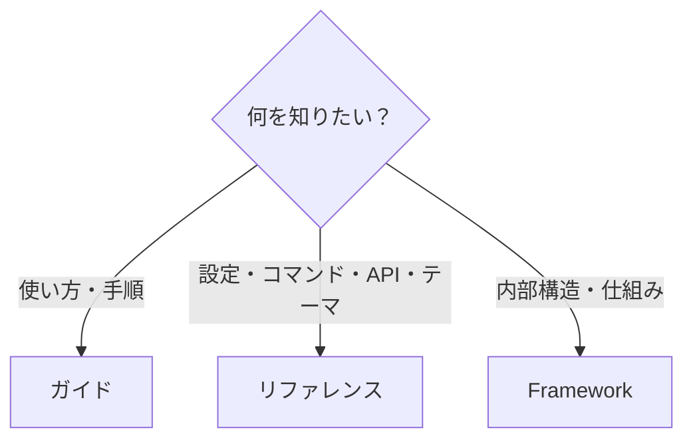
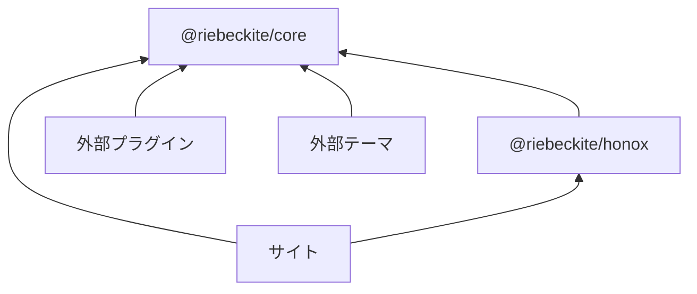
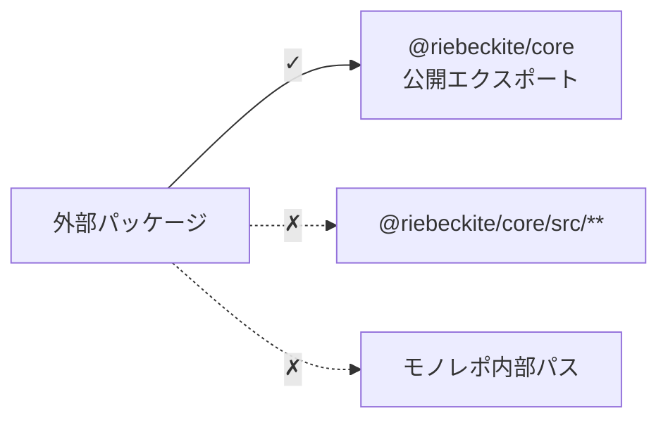
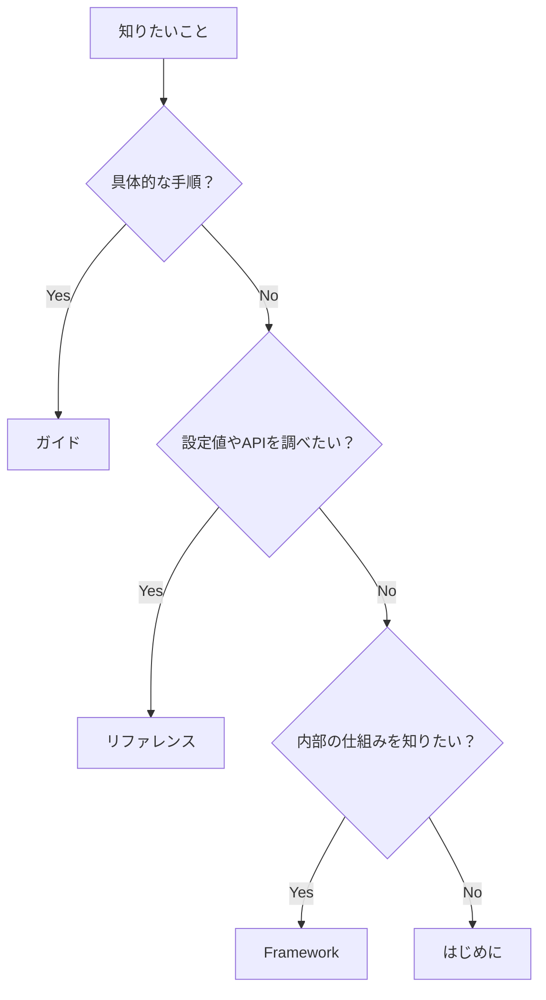

# リファレンス

リファレンスは、事実を調べるための章です。設定値、CLI コマンド、公開エクスポート、プラグイン API、テーマ API、テーマのカスタマイズ、内部構造を扱います。手順を知りたい場合は [ガイド](../guides/README.ja.md) を参照してください。



リファレンスは最初から順番に読む必要はありません。設定項目や API を確認したくなったときに、必要なページを開いてください。

## 調べたいことからページを選ぶ

| 知りたいこと | ページ |
| --- | --- |
| `riebeckite.config.ts`、ルート、コンテンツ、テーマ、プラグインの設定 | [設定](./configuration.ja.md) |
| `riebeckite.config.ts` の全フィールド、型、既定値 | [設定リファレンス](./configuration-reference.ja.md) |
| `dev`、`check`、`doctor`、`build`、`profile`、`inspect` | [CLI](./cli.ja.md) |
| `definePlugin`、ライフサイクルフック、アセット、エンドポイント、診断 | [Plugin API](./plugin-api.ja.md) |
| `defineTheme`、CSS の取り決め、トークン、カラーモード、パッケージの形 | [Theme API](./theme-api.ja.md) |
| Riebeckite の内部構造 | [Framework](../framework/README.ja.md) |
| テーマの作り方 | [テーマ](../themes/README.ja.md) |

### 設定項目を調べる

[設定](./configuration.ja.md) では、次の設定とその解決方法を確認できます。

- `site`
- `content`
- `markdown`
- `theme`
- `plugins`
- `appRoot`
- `configRoot`
- `contentRoot`

### CLI コマンドを調べる

[CLI](./cli.ja.md) では、次の各コマンドとその役割を確認できます。

```text
init
dev
check
doctor
build
profile
inspect
```

### プラグインの公開 API を調べる

[Plugin API](./plugin-api.ja.md) では、プラグインが利用できる次の公開の取り決めを確認できます。

- `definePlugin`
- ライフサイクルフック
- コンテンツフック
- Renderer
- Page Type
- Assets
- Client Entry
- Endpoint
- Diagnostics

プラグインの仕組みそのものを理解したい場合は [Plugin System](../framework/plugin-system.ja.md) を参照してください。

### テーマの公開 API を調べる

[Theme API](./theme-api.ja.md) では、テーマが利用できる次の公開の取り決めを確認できます。

- `defineTheme`
- デザイントークン
- カラーモード
- タイポグラフィ
- 記事レイアウト
- CSS の取り決め
- テーマパッケージ

テーマの設計思想や仕組みを理解したい場合は [Theme System](../framework/theme-system.ja.md) を参照してください。

## 公開パッケージ

外部のプラグイン、テーマ、サイトは、**公開パッケージと公開エクスポートだけ**に依存してください。

主なパッケージは次のとおりです。

| パッケージ | 公開するもの |
| --- | --- |
| `@riebeckite/core` | `defineConfig`、`definePlugin`、`defineTheme`、コンテンツ API、パイプライン API、診断、可観測性の型 |
| `@riebeckite/cli` | `riebeckite` CLI |
| `@riebeckite/honox` | HonoX / Vite との統合とスキャフォールド。`server` subpath に route / SSG helper（`resolveRiebeckiteRoute`、`resolveRiebeckiteContentRequest`、`resolveRiebeckiteHomeRequest`、`contentRouteSsgParams`、`riebeniteSsgParams`）、`ui` subpath に article / site の UI primitive（`Article`、`ArticleBody`、`PageBody`、`ArticleContent` と各種 Props 型）を公開 |
| `@riebeckite/test` | テストヘルパー（`assertGolden`、`assertGoldenJson`）。`e2e` subpath に packed tarball の外部サイトエンジン |
| `@riebeckite/plugin-*` | プラグインのファクトリと、ドキュメント化された subpath エクスポート |
| `@riebeckite/theme-*` | テーマのファクトリと CSS エクスポート |

依存関係は概ね次のようになります。



外部パッケージから Riebeckite モノレポの内部実装へ直接依存しないことが重要です。

## 公開 API と内部 API

外部パッケージでは、パッケージの公開エクスポートを利用します。

たとえば、次のようにインポートします。

```ts
import {
  definePlugin,
  escapeHtml,
} from "@riebeckite/core";
```

一方、次のようなインポートは使用しないでください。

```ts
import {
  something,
} from "@riebeckite/core/src/...";
```

また、次のような Riebeckite モノレポ内部のパスにも依存しないでください。

```text
../../../../packages/core/...
```



公開 API は外部利用を前提とした取り決めです。`src/**` やモノレポ内部のパスは実装の詳細であり、パッケージの更新によって変更される可能性があります。

## `@riebeckite/core` が公開するもの

`@riebeckite/core` は、Riebeckite のフレームワークに依存しない公開 API を提供します。

### 主なエクスポート

- 設定: `defineConfig`、`resolveConfig`、`resolveConfigModule`、`isPublished`、`isExcluded`
- コンテンツ: `ContentManager`、`ContentCollection`、`ContentGraph`、`ContentQuery`、`buildContentCollections`、`fingerprintContentEntries`、`resolveDefaultContentLocation`
- プラグイン: `definePlugin`、`resolvePlugins`、`defineEndpoint`、`createStyleAsset`、`createClientEntry`、`createPluginMemo`、`stableStringify`
- テーマ: `defineTheme`、`RiebeckiteTheme`、`ThemeDesignTokens`、`ThemeColorMode`、`ThemeTypographyPreset`、`ThemeArticleLayoutPreset`
- パイプライン: `Pipeline`、`MarkdownPipeline`、`HtmlPipeline`
- ユーティリティ: `escapeHtml`、`escapeHtmlAttribute`、`normalizeTag`、`calculateReadingTime`、`stripHtml`
- 可観測性: `Logger`、`Tracer`、`TraceSpan`、`TraceSink`

### 設定

```text
defineConfig
resolveConfig
resolveConfigModule
isPublished
isExcluded
```

設定の宣言と解決、公開ポリシーに使用します。詳しくは [設定](./configuration.ja.md) を参照してください。

### コンテンツ

```text
ContentManager
ContentCollection
ContentGraph
ContentQuery
buildContentCollections
fingerprintContentEntries
resolveDefaultContentLocation
```

コンテンツの読み込みと解決、コレクション、コンテンツグラフ、クエリ、公開ロケーションに使用します。仕組みについては [Content System](../framework/content-system.ja.md) を参照してください。

### プラグイン

```text
definePlugin
resolvePlugins
defineEndpoint
createStyleAsset
createClientEntry
createPluginMemo
stableStringify
```

プラグインの定義と解決、エンドポイントなどに使用します。プラグインを作成する場合は [Plugin API](./plugin-api.ja.md) と [プラグイン作成の詳細](../framework/plugin-system.ja.md) を参照してください。

### テーマ

```text
defineTheme
RiebeckiteTheme
ThemeDesignTokens
ThemeColorMode
ThemeTypographyPreset
ThemeArticleLayoutPreset
```

テーマの定義とプレゼンテーションの取り決めに使用します。テーマを作成する場合は [Theme API](./theme-api.ja.md) と [テーマ作成の詳細](../framework/theme-system.ja.md) を参照してください。

### パイプライン

```text
Pipeline
MarkdownPipeline
HtmlPipeline
```

Markdown / HTML の処理パイプラインを拡張するときに使用します。通常のサイト利用で直接扱う必要はありません。

### ユーティリティ

```text
escapeHtml
escapeHtmlAttribute
normalizeTag
calculateReadingTime
stripHtml
```

プラグインやインテグレーションから利用できる共通のユーティリティです。

### 可観測性

```text
Logger
Tracer
TraceSpan
TraceSink
```

ログやトレースをフレームワークと統合するための型です。詳しくは [Observability](../framework/observability.ja.md) を参照してください。

## どのドキュメントを読むべきか

迷った場合は、次の基準で選んでください。



簡単に分けると、次のようになります。

```text
サイトを作り始めたい
  → はじめに

具体的な作業手順を知りたい
  → ガイド

設定・CLI・APIを調べたい
  → リファレンス

Riebeckiteの内部構造を理解したい
  → Framework
```

リファレンスは **API の使い方を調べるための索引**です。設計思想や内部実装は Framework、実際の作業手順はガイドが担当します。
