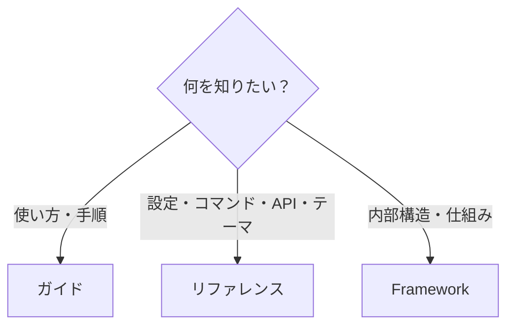
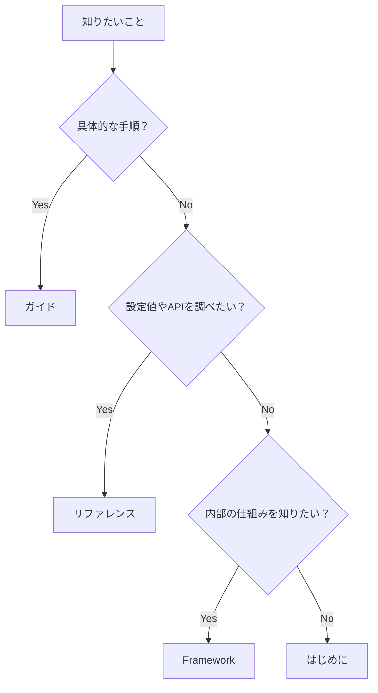

# リファレンス

リファレンスは、事実を調べるための章です。設定値、CLI コマンド、公開エクスポート、プラグイン API、テーマ API、テーマのカスタマイズ、内部構造を扱います。手順を知りたい場合は [ガイド](../guides/README.ja.md) を参照してください。



リファレンスは最初から順番に読む必要はありません。設定項目や API を確認したくなったときに、必要なページを開いてください。

## このページの構成

- [公開パッケージ](./packages.ja.md)
- [Core API](./core-api.ja.md)
- [プレビュー API](./preview.ja.md)

## 調べたいことからページを選ぶ

| 知りたいこと | ページ |
| --- | --- |
| `riebeckite.config.ts`、ルート、コンテンツ、テーマ、プラグインの設定 | [設定](./configuration.ja.md) |
| `riebeckite.config.ts` の全フィールド、型、既定値 | [設定リファレンス](./configuration-reference.ja.md) |
| `init`、`create`、`dev`、`check`、`doctor`、`build`、`clean`、`deploy`、`publish`、`content`、`migrate`、`upgrade`、`profile`、`inspect`、`help`、`completion`、`theme preview`、`plugin dev`、`plugin verify` | [CLI](./cli.ja.md) |
| 型付きコマンド定義、プラグインのCLIコマンド、JSONとエラーの取り決め、補完 | [CLI拡張API](./cli-extension.ja.md) |
| `definePlugin`、ライフサイクルフック、アセット、エンドポイント、診断 | [Plugin API](./plugin-api.ja.md) |
| プレビューの実行、フィクスチャ、埋め込み | [プレビュー API](./preview.ja.md) |
| `defineTheme`、CSS の取り決め、トークン、カラーモード、パッケージの形 | [Theme API](./theme-api.ja.md) |
| Riebeckite の内部構造 | [Framework](../framework/README.ja.md) |
| テーマの作り方 | [テーマ](../themes/README.ja.md) |

### 設定項目を調べる

[設定](./configuration.ja.md) では、次の設定とその解決方法を確認できます。

- `site`
- `content`
- `markdown`
- `theme`
- `plugins`
- `appRoot`
- `configRoot`
- `contentRoot`

### CLI コマンドを調べる

[CLI](./cli.ja.md) では、次の各コマンドとその役割を確認できます。

```text
init
create
theme preview
plugin dev
plugin verify
dev
check
doctor
upgrade --check
build
clean
deploy
publish
content
migrate
profile
inspect
```

コンテンツを安全に書き込む方法と、バージョン付きの一括変更については、[コンテンツ変更](../framework/content-mutation.ja.md) と [コンテンツ移行](../framework/content-migration.ja.md) を参照してください。

### プラグインの公開 API を調べる

[Plugin API](./plugin-api.ja.md) では、プラグインが利用できる次の公開の取り決めを確認できます。

- `definePlugin`
- ライフサイクルフック
- コンテンツフック
- Renderer
- Page Type
- Assets
- Client Entry
- Endpoint
- Diagnostics

プラグインの仕組みそのものを理解したい場合は [Plugin System](../framework/plugin-system.ja.md) を参照してください。

### テーマの公開 API を調べる

[Theme API](./theme-api.ja.md) では、テーマが利用できる次の公開の取り決めを確認できます。

- `defineTheme`
- デザイントークン
- カラーモード
- タイポグラフィ
- 記事レイアウト
- CSS の取り決め
- テーマパッケージ

テーマの設計思想や仕組みを理解したい場合は [Theme System](../framework/theme-system.ja.md) を参照してください。

## どのドキュメントを読むべきか

迷った場合は、次の基準で選んでください。



簡単に分けると、次のようになります。

```text
サイトを作り始めたい
  → はじめに

具体的な作業手順を知りたい
  → ガイド

設定・CLI・APIを調べたい
  → リファレンス

Riebeckiteの内部構造を理解したい
  → Framework
```

リファレンスは **API の使い方を調べるための索引**です。設計思想や内部実装は Framework、実際の作業手順はガイドが担当します。
