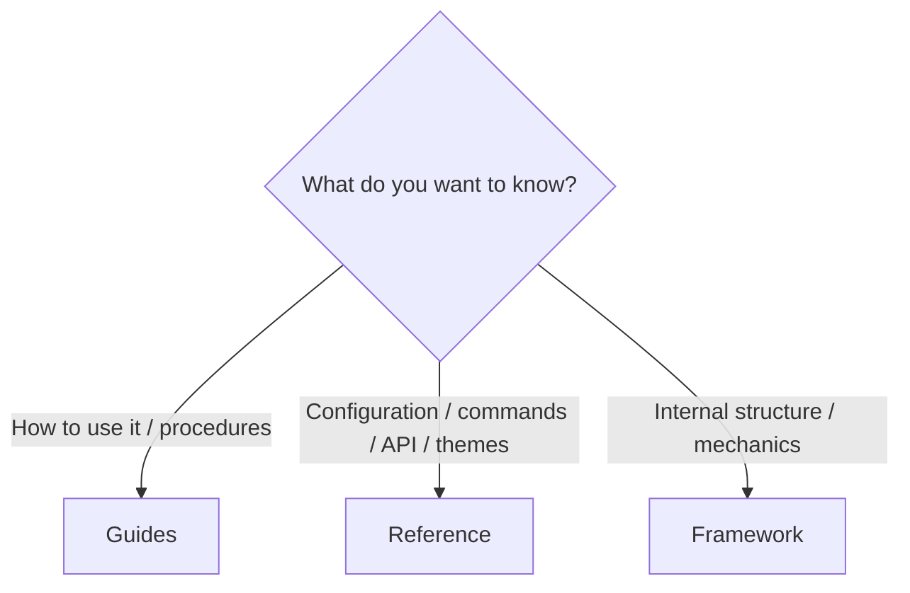
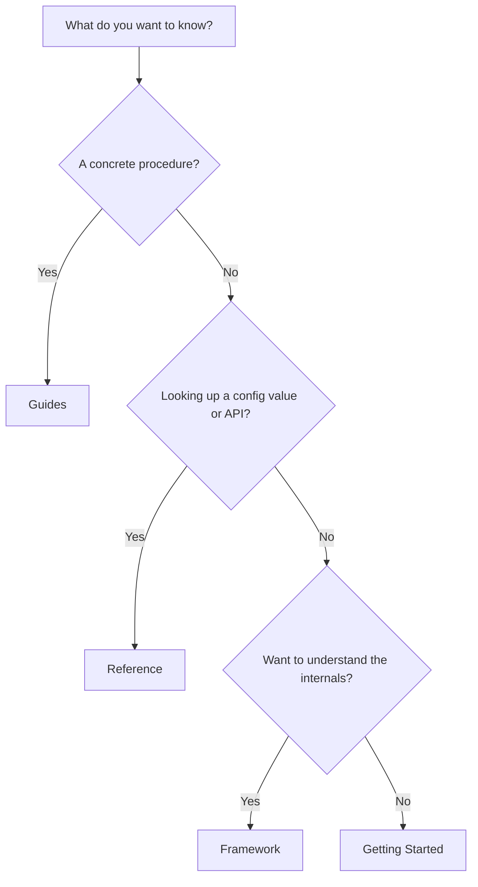

# Reference

Reference is for factual lookup: configuration keys, CLI commands, public exports, Plugin API, Theme API, Theme customization, and internal architecture. Use [Guides](../guides/README.md) when you want a task-oriented walkthrough.



You do not have to read Reference from start to finish. When you want to check a configuration field or an API, open the page you need.

## In this section

- [Packages](./packages.md)
- [Core API](./core-api.md)

## Reference pages

| Page | Use it for |
| --- | --- |
| [Configuration](./configuration.md) | `riebeckite.config.ts`, roots, content, theme, plugins |
| [Configuration reference](./configuration-reference.md) | Every `riebeckite.config.ts` field, its type, and its default |
| [CLI](./cli.md) | `init`, `create`, `dev`, `check`, `doctor`, `build`, `clean`, `deploy`, `upgrade`, `profile`, `inspect`, `theme preview`, `plugin dev`, `plugin verify` |
| [Plugin API](./plugin-api.md) | `definePlugin`, lifecycle hooks, assets, endpoints, diagnostics |
| [Theme API](./theme-api.md) | `defineTheme`, CSS contract, tokens, color mode, package shape |
| [Framework](../framework/README.md) | Riebeckite's internal structure |
| [Themes](../themes/README.md) | How to build a theme |

### Configuration

In [Configuration](./configuration.md) you can check Riebeckite's settings and how they are resolved, including:

- `site`
- `content`
- `markdown`
- `theme`
- `plugins`
- `appRoot`
- `configRoot`
- `contentRoot`

### CLI

In [CLI](./cli.md) you can check each command and its role:

```text
init
create
theme preview
plugin dev
plugin verify
dev
check
doctor
upgrade --check
build
clean
deploy
profile
inspect
```

### Plugin API

In [Plugin API](./plugin-api.md) you can check the public contracts a plugin can use:

- `definePlugin`
- Lifecycle hooks
- Content hooks
- Renderer
- Page Type
- Assets
- Client Entry
- Endpoint
- Diagnostics

To understand how plugins work, see [Plugin System](../framework/plugin-system.md).

### Theme API

In [Theme API](./theme-api.md) you can check the public contracts a theme can use:

- `defineTheme`
- Design tokens
- Color Mode
- Typography
- Article Layout
- CSS contract
- Theme package

To understand the design philosophy and mechanics of themes, see [Theme System](../framework/theme-system.md).

## Which documentation should you read?

When in doubt, use the following criteria.



Put simply:

```text
Want to start building a site
  → Getting Started

Want a concrete procedure
  → Guides

Want to look up configuration, CLI, or API
  → Reference

Want to understand Riebeckite's internals
  → Framework
```

Reference is an **index for looking up how to use the API**, while design philosophy and internal implementation live in Framework, and concrete procedures live in Guides.
