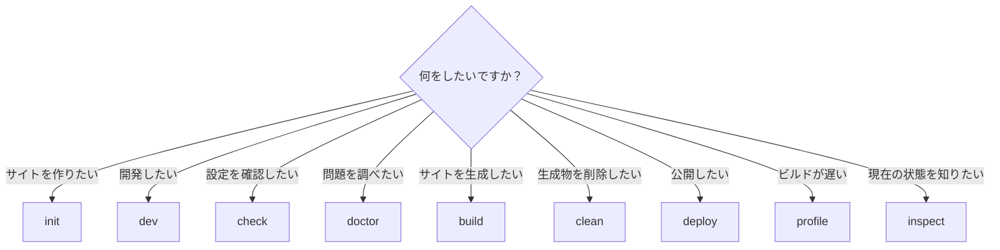
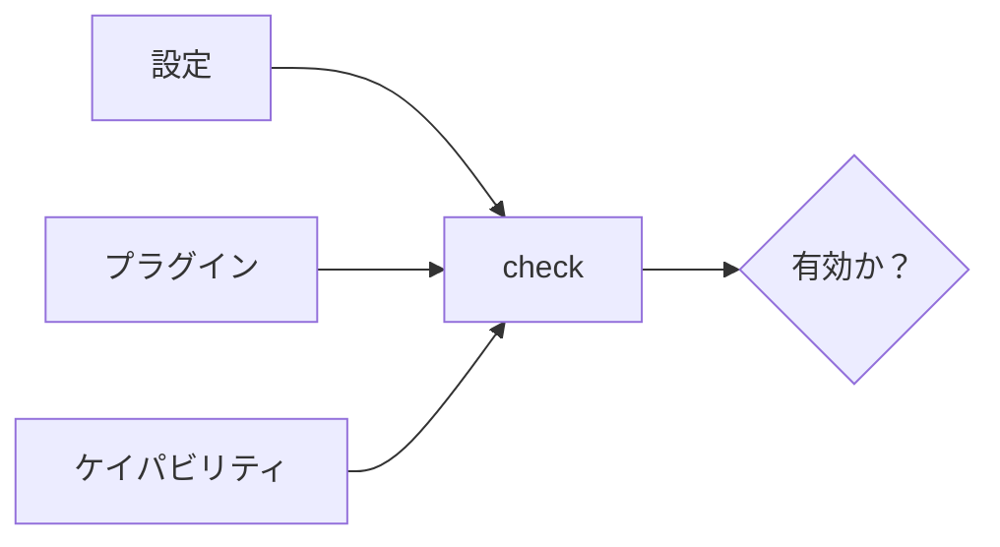
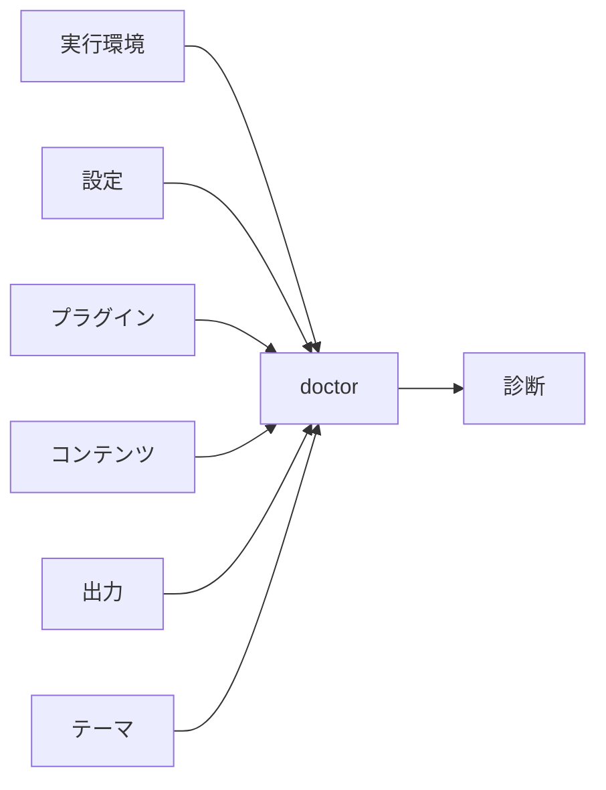
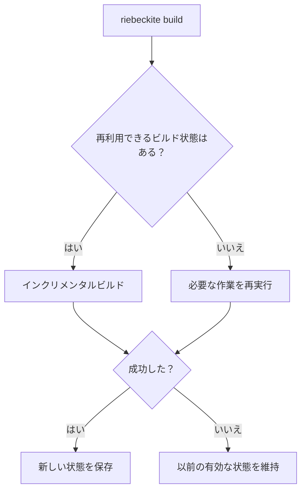
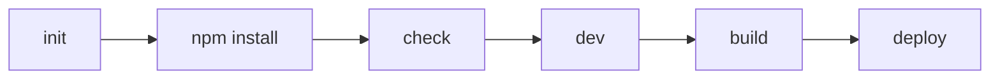
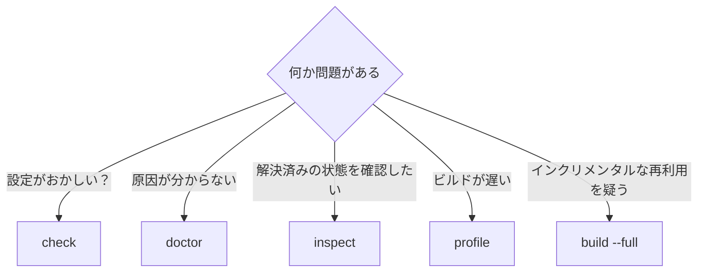

# CLI リファレンス

コマンドはアプリケーションディレクトリで実行します。CLI はカレントワーキングディレクトリからアプリケーションルートを解決し、コマンドのエラーを安全に報告して 0 以外の終了コードで終了します。

```sh id="vgst3p"
npm exec riebeckite <command>
```

## コマンド一覧

```text id="7uw50m"
riebeckite init [directory] [--preset <name>] [--features <names>] [--utilities <names>] [--force] [--list-presets] [--github-actions | --cloudflare-workers] [--content-repository <owner/repo>] [--site-repository <owner/repo>]
riebeckite create [site | plugin | theme | page-type | component]
riebeckite theme preview <name> [--port <port>] [--no-open]
riebeckite plugin dev <path> [--port <port>] [--no-open]
riebeckite dev
riebeckite check
riebeckite doctor [--explain | --json | --fix [--dry-run]]
riebeckite upgrade --check --to <version|latest> [--json]
riebeckite build [--full]
riebeckite clean [--output | --all]
riebeckite deploy [--dry-run | setup | domain]
riebeckite profile [--full]
riebeckite inspect [config | plugins | content [--list] | graph | build]
```

## 各コマンドの役割とビルド状態への影響

| コマンド | 目的 | ビルド状態を書き込むか |
| --- | --- | --- |
| `init` | プリセットから自己完結したサイトを生成する | いいえ |
| `create` | サイト、プラグイン、テーマ、PageType、コンポーネントのジェネレーターを選ぶ | ジェネレーターによる |
| `theme preview` | ローカルのテーマを隔離された HonoX 環境でプレビューする | 一時ファイルのみ |
| `plugin dev` | ローカルのプラグインを隔離された HonoX 環境でプレビューする | 一時ファイルのみ |
| `dev` | 統合が提供する開発ワークフローを開始する | 統合による |
| `check` | アプリの設定、コンテンツルートの可用性、プラグインオプション、ケイパビリティの解決を検証する | いいえ |
| `doctor` | 実行環境、設定、プラグイン、コンテンツ、出力、テーマに関する共通の診断を報告する | いいえ |
| `upgrade --check` | Riebeckite パッケージを更新する前に、隔離した baseline と候補版のビルドを比較する | いいえ |
| `build` | ビルドを実行する。`--full` はインクリメンタルな再利用を回避する | 成功時に書き込む |
| `clean` | Riebeckite が管理する状態を削除する（`--all` はビルド出力も削除し、`--output` はビルド出力だけを削除する） | いいえ |
| `deploy` | 既存のビルド出力を Wrangler 経由で Cloudflare Workers に公開する。`--dry-run` はアップロードせずに検証する。`setup` は GitHub Actions による継続的デプロイを準備する。`domain` は Cloudflare Workers の Custom Domain を追加する | いいえ |
| `profile` | トレースに基づくパフォーマンスレポートを実行する。`--full` はフルパスを使う | ビルドによる |
| `inspect` | 解決済みの実際の状態を表示する | いいえ |

## 目的別のコマンドの選び方

目的から選ぶと、コマンドの違いが分かりやすくなります。



`check`、`doctor`、`inspect`、`build` はとくに混同しやすいコマンドです。役割は次のように分かれます。

```text id="1djofm"
check
  → 設定は正しいか

doctor
  → 問題はないか

inspect
  → 現在の状態はどうなっているか

build
  → 実際に出力を生成する
```

## `upgrade --check`

Upgrade Lab は更新前の check-only 検証です。プロジェクト、lockfile、`node_modules`、`dist`、`.riebeckite` は更新しません。プロジェクトを一時ディレクトリへ二つ複製し、ライフサイクルスクリプトと pnpmfile を無効にして、現行の依存関係と指定した Riebeckite バージョンを比較します。

```sh
pnpm exec riebeckite upgrade --check --to 0.0.33
pnpm exec riebeckite upgrade --check --to latest --json
```

レポートでは依存関係・peerDependencies・Node engines の解決、`tsconfig.json` がある場合の TypeScript 検査、`riebeckite check`、diagnostics、フルの本番ビルド、生成 URL、出力ファイルを比較します。`READY` は両環境が成功し、URL と出力ファイルに差分がない状態です。候補版の失敗または差分は `REVIEW REQUIRED`、隔離した依存関係の解決失敗は `BLOCKED`、baseline の失敗や安全に実行できない検査は `UNVERIFIED` です。

対応するのは `package-lock.json` または `pnpm-lock.yaml` の片方だけがある npm / pnpm プロジェクトです。symlink とプロジェクト外の content root は複製せず、境界を越える代わりに `UNVERIFIED` を返します。install scripts、pnpmfile、デプロイ、ブラウザー E2E は実行しません。一時ディレクトリはセキュリティ sandbox ではなく、ビルドはサイト自身の設定とプラグインを実行します。子プロセスには実行に必要な PATH、OS の一時ディレクトリ変数、一時的なホームディレクトリ変数、および隔離した npm cache と user config だけを渡します。これにより環境変数の秘密情報が意図せず渡ることは抑えられますが、未信頼のビルドコードを安全に実行できるわけではありません。

## `init`

`init` は、設定、Vite/HonoX のアプリケーションシェル、ルート、スタイルシート、スターターコンテンツを含む自己完結したサイトを、対象ディレクトリに生成します。対象ディレクトリの既定値はカレントディレクトリです。生成されたサイトは、Riebeckite モノレポに依存しない自己完結したアプリケーションです。

```sh id="18r7wl"
npm exec riebeckite init
```

別の場所にサイトを作る場合は、ディレクトリを指定します。

```sh id="81jmbp"
npm exec riebeckite init my-site
```

依存関係をインストールしてから、生成したサイトで `check` と `build` を実行してください。

### プリセットの選び方

構成は `--preset <name>` で選びます（既定値: `starter`）。

```sh id="vt7gdb"
npm exec -- riebeckite init my-site --preset starter
```

`--list-presets` を実行すると、利用できるプリセットとその説明を確認できます。

```sh id="b0n6ph"
npm exec -- riebeckite init --list-presets
```

### Feature Packを追加する

`--features <names>` には、任意の Pack をカンマ区切りで指定します。指定できるのは `knowledge`、`diagrams`、`media`、`i18n` です。`none` は Pack を追加しません。プリセットがすでに選んだ Plugin と重複する Pack はエラーになります。

```sh
npm exec -- riebeckite init my-site --preset portfolio --features diagrams,i18n
```

### プロジェクトファイルの選び方

プロジェクトファイルはプリセットとは別に、`--utilities <names>` で選びます。値には `gitignore`、`editorconfig`、`gitattributes`、`biome`、`npmrc`、`vscode` をカンマ区切りで指定します。

```sh id="pf8k21"
npm exec -- riebeckite init my-site --utilities editorconfig,npmrc,vscode
```

| 名前 | ファイル |
| --- | --- |
| `gitignore` | `.gitignore` |
| `editorconfig` | `.editorconfig` |
| `gitattributes` | `.gitattributes` |
| `biome` | `biome.json` |
| `npmrc` | `.npmrc` |
| `vscode` | `.vscode/settings.json` |

既定値は `gitignore,editorconfig,gitattributes,biome` で、`none` を指定すると何も書き込みません。対話モードでは、`Extra project files` の質問で既定のセットがあらかじめ選択されています。

### 生成先にファイルがすでにある場合

`init` は、生成対象のファイルがすでにあるディレクトリには、`--force` を指定しない限り書き込みません。

```sh id="l5kjod"
npm exec -- riebeckite init my-site --force
```

`--force` は既存ファイルに影響するため、使用する前に内容を確認してください。

### `create-riebeckite`

`create-riebeckite` パッケージを使うと、`npx create-riebeckite` から同じジェネレーターを実行できます。`--preset`、`--features`、`--list-presets` フラグも同じように受け付けます。

```sh id="kyw0rx"
npx create-riebeckite
```

対話モードでは、コンテンツソースを尋ねたあと、デプロイ方法を尋ねます。

| 選択肢 | 生成されるもの |
| --- | --- |
| `Cloudflare Workers` | Wrangler の依存関係と `wrangler.jsonc`。依存関係のインストール後、`Deploy now?` を尋ねる |
| `GitHub Actions` | `wrangler.jsonc` と `.github/workflows/deploy.yml` |
| `Not now` | デプロイ用のファイルを生成しない |

`Deploy now?` で `Yes` を選ぶと、雛形の生成直後にビルドと `riebeckite deploy` が実行されます。`Later` を選ぶとサイトの生成だけを行い、次のコマンドで公開します。

```sh
npm run build
npm exec riebeckite deploy
```

サイトを生成したら、依存関係をインストールして設定を確認します。

```sh id="gzg1my"
npm install
npm exec riebeckite check
npm exec riebeckite build
```

## `create`

`create` はジェネレーターの統一エントリポイントです。TTY では、サイト、プラグイン、テーマ、PageType、コンポーネントのどれを作成するかを尋ね、生成ロジックを重複させずに対応するジェネレーターへ処理を委譲します。

```sh
riebeckite create
riebeckite create site my-site --preset starter
riebeckite create plugin reading-time --features transform
riebeckite create theme my-theme --template blog --register
riebeckite create page-type glossary --path /glossary/ --with-tests
riebeckite create component note-card --target site --with-styles
riebeckite create --help
```

スクリプトからは対象を明示してください。`create site` は引数を `create-riebeckite` に渡します。`create plugin` と `create theme` は既存のオプションと非 TTY での検証を維持します。`create page-type` はプラグインの PageType を作成し、`create component` はサイト、プラグイン、テーマの責務境界を守ります。

## `theme preview`

通常のサイトが使う Riebeckite サイトと HonoX/Vite の経路をそのまま使って、生成済みのローカルのテーマをプレビューします。

```sh
riebeckite theme preview my-theme
riebeckite theme preview my-theme --port 4173 --no-open
```

プレビューは `themes/` 配下の一時サイトから、毎回同じ内容の Home、Article、Documentation、Components のフィクスチャページを配信します。設定済みの Vault、ビルド出力、`riebeckite.config.ts` は読み取りも変更もしません。Ctrl+C で停止すると、一時サイトは削除されます。テーマの CSS は実際のテーマ定義を通じて読み込まれ、CSS の変更は Vite が反映します。`index.ts` を編集すると開発サーバーが再起動し、開いているページが再読み込みされます。レスポンシブな表示サイズとシステムの配色設定は、ブラウザの開発者ツールで確認してください。テーマは信頼済みのローカルアプリケーションコードです。プレビュー設定の読み込み中に、テーマのモジュールが実行されます。

## `plugin dev`

ローカルのプラグインを、一時的な Riebeckite サイトと実際の HonoX/Vite 開発サーバーでプレビューします。

```sh
riebeckite plugin dev ./extensions/my-plugin
riebeckite plugin dev ../my-plugin --port 4321 --no-open
```

パスにはプラグインのディレクトリ、またはその `package.json` を指定できます。ディレクトリには、サポートされるエントリポイントを持つ有効な `package.json` が必要です。エントリポイントとして使えるのは、`source`、`import`、`module`、`default` のいずれかの条件を持つ `exports["."]`、`main`、または慣例的な `index.ts` です。CLI は依存関係をインストールしません。プレビューを開始する前に、プラグイン側のプロジェクトで依存関係をインストールしてください。

コマンドはシステムの一時ディレクトリに隔離されたフィクスチャサイトを作成し、ローカルのプラグインをそこにリンクして、フィクスチャのパスを表示します。設定済みの Vault、サイト設定、ビルド出力は読み取りも変更もしません。フィクスチャには毎回同じ内容の Markdown が含まれるため、コンテンツを編集せずにプラグインを確認できます。

プレビュー中は、次のように変更が反映されます。

- CSS の変更は Vite の HMR で反映されます。
- クライアントスクリプトの変更はプレビューを再読み込みします。
- Markdown フィクスチャの変更は描画ページに反映されます。
- プラグインのエントリポイントの変更は開発サーバーを再起動します。

プラグインの読み込み、コンパイル、初期化で発生したエラーはターミナルに出力され、コマンドは 0 以外のステータスで終了します。一時サイトは Ctrl+C、正常終了、起動失敗のいずれでも削除されます。プロセスを強制終了した場合は、起動時に表示されたフィクスチャのパスを削除してください。

### `theme preview` との違い

`theme preview` は `themes/` 配下の固定されたコンテンツフィクスチャでテーマをプレビューします。`plugin dev` はシステムの一時ディレクトリにある一時サイトで、1 つのローカルのプラグインをプレビューします。どちらも実際の Riebeckite/HonoX/Vite の経路を使いますが、対象とする拡張ポイントが異なり、フィクスチャのライフサイクルも別々です。

### セキュリティ

`plugin dev` は信頼済みのローカル開発向けコマンドです。指定したパスのプラグインエントリとクライアントスクリプトを実行します。信頼できるプラグインだけを実行し、このコマンドを信頼できないユーザーに公開しないでください。コマンドがパッケージを自動でインストールすることはありません。

### トラブルシューティング

- `Could not find a plugin`: パスを確認してください。相対パスはカレントディレクトリから解決されます。
- `Could not find package.json`: パッケージのルート、またはその `package.json` を指定してください。
- `Could not find the plugin entry point`: `exports["."]` か `main` を宣言するか、`index.ts` を追加してください。
- コンパイルや初期化のエラー: プラグインの依存関係をインストールし、ターミナルの出力を確認してください。
- ポートがすでに使用されている: 別の `--port` を指定してください。

## `dev`

開発環境を起動します。

```sh id="ujiy7q"
npm exec riebeckite dev
```

Riebeckite の統合が提供する開発ワークフローでサイトを起動します。実際の開発サーバーとビルド状態の扱いは、使用している統合によって異なります。通常の HonoX サイトでは、開発中のページ確認にこのコマンドを使います。

## `check`

`check` は、設定、プラグイン、ケイパビリティが正しく構成されているかを検証します。

```sh id="5a2lrf"
npm exec riebeckite check
```

たとえば、次のことを確認します。

- 設定の形式が有効であること
- プラグインの設定が有効であること
- 必要なケイパビリティが解決されていること



`check` が確認するのはプロジェクトの基本的な妥当性であり、出力がビルド済みか、デプロイ済みかということではありません。`check` が保証するのは、設定が有効であることです。

### プラグインオプションの検証

プラグインオプションの検証は `check` の一部として実行されます。各プラグインの `validateOptions` は設定の有効性に寄与します。たとえばアナリティクスプラグインは、プロバイダーとコレクター URL を検証します。そのため、プラグインの設定が不正であれば、ビルドが始まる前に `check` が失敗します。

## `doctor`

`doctor` は、毎回同じ内容になる共通の開発診断レポートを出力します。サイトをビルドしたり、ビルド状態を変更したりしません。

```sh id="zruccx"
npm exec riebeckite doctor
npm exec -- riebeckite doctor --explain
npm exec -- riebeckite doctor --json
```

`--explain` は原因、詳細、推奨される修正を含めます。`--json` はツール向けにシリアライズ可能なレポートだけを出力します。`--fix` は安全な自動修正に限定され、該当する修正がなければ何も変更しません。`--dry-run` はファイルを変更せずにそのことを確認します。

`doctor` は、観測できる範囲で、実行環境、設定、プラグイン、コンテンツ、出力計画、テーマの参照を確認します。観測できない項目は推測せず、スキップとして表示します。



`doctor` は可能な限り独立したチェックを続行し、ヘルスチェックが失敗した場合は 0 以外の終了コードで終了します。

`riebeckite dev` の実行中、編集可能なコントロールの外で <kbd>Ctrl</kbd>+<kbd>Alt</kbd>+<kbd>R</kbd> を押すと、Development Inspector が開きます。`doctor` と同じレポートを使い、Vite の更新に合わせて更新されます。本番のクライアント出力やエンドポイントには含まれません。Overview、Diagnostics、Plugins の各タブは、診断レポートの準備ができ次第、それを表示します。Dependencies と Output タブは別に読み込まれ、ビルド状態を書き込んだりサイトをビルドしたりせずに、現在のコンテンツと出力計画を読み取ります。

## `build`

`build` はサイトをビルドします。

```sh id="iznhhd"
npm exec riebeckite build
```

通常はインクリメンタルな状態を再利用し、再利用できる作業を省略します。



ビルド状態が更新されるのは、ビルドが成功したときだけです。失敗したビルドが以前の正常な状態を壊すことはありません。

### フルビルド

インクリメンタルな状態の再利用を避けるには、次のコマンドを実行します。

```sh id="wpr38p"
npm exec -- riebeckite build --full
```

ビルドを再現するときや、インクリメンタルな動作の問題を切り分けるときに使います。詳しくは [ビルドシステム](../framework/build-system.ja.md) を参照してください。

## `clean`

`clean` は、ユーザーのコンテンツではなく、Riebeckite が管理する成果物を削除します。

```sh id="cln001"
npm exec riebeckite clean
```

オプションを指定しない場合は、管理対象の状態ルート（アプリケーションディレクトリ配下の `.riebeckite/`）を削除します。この中には、ビルド状態、プラグインキャッシュ、永続コンテンツキャッシュ、SSG 出力キャッシュが含まれます。

ビルド出力ディレクトリだけを削除するには、次のコマンドを実行します。

```sh id="cln002"
npm exec -- riebeckite clean --output
```

管理対象の状態とビルド出力の両方を削除するには、次のコマンドを実行します。

```sh id="cln003"
npm exec -- riebeckite clean --all
```

出力の場所はハードコードではなくプロジェクト設定から解決されるため、統合が定義した場所もそのまま使われます。削除対象が存在しなくてもエラーにならないので、`clean` は CI やトラブルシューティング用スクリプトからの繰り返し実行にも安全です。コンテンツ、設定、テーマやプラグインのソース、`public/` のアセット、Git のメタデータを削除することはありません。アプリケーションディレクトリの外にあるものは削除しません。シンボリックリンクやジャンクションはリンクとして削除するため、リンク先が削除されることはありません。`app/.riebeckite/` 配下の生成ソースは、統合が次の `dev` または `build` で再生成するため、そのまま残します。

インクリメンタルな状態、永続キャッシュ、以前の出力に依存せずにサイトを再現するには、コールドビルドを実行します。

```sh id="cln004"
npm exec -- riebeckite clean --all
npm exec riebeckite build
```

ビルドが遅いときや、インクリメンタルな再利用が疑わしいときにも役立ちます。既定のレイアウトでは、これらのキャッシュは `.riebeckite/` 配下にあります。別の場所にキャッシュディレクトリを設定している場合、そのディレクトリは `clean` では削除されません。

## `deploy`

`deploy` は、`build` が生成した `dist/` を、Wrangler を呼び出して Cloudflare Workers に公開します。`wrangler.jsonc` がない場合はサイトのフォルダー名から作成し、初回実行時には Wrangler のログインを開きます。`--dry-run` はそのまま渡され、アップロードせずに検証が行われます。

`deploy` はコンテンツを再ビルドしないため、先に `npm exec riebeckite build` を実行してください。

Cloudflare に接続せずに設定とアセットを検証するには、次のコマンドを実行します。

```sh
npm exec -- riebeckite deploy --dry-run
```

`npm` はオプション区切りを付けない `--dry-run` を自身のオプションとして解釈するため、`npm exec -- riebeckite deploy --dry-run` のように渡してください。`create-riebeckite` の `Cloudflare Workers` を選んで生成したサイトには、Wrangler の依存関係と `wrangler.jsonc` がすでに含まれています。

push のたびに自動でデプロイするには、GitHub Actions を使います。詳しくは [デプロイ](../guides/deployment/README.ja.md) を参照してください。

### `deploy setup`

`deploy setup` は、すでに Git リポジトリになっており、Local-first で公開しているプロジェクトに、GitHub Actions への継続的デプロイを用意します。

```sh id="k4n8ws"
npm exec riebeckite deploy setup
```

Git リポジトリと GitHub のリモートを検出し、GitHub CLI（`gh`）と Wrangler のログインを確認します。`create-riebeckite` と同じテンプレートから `.github/workflows/deploy.yml` を作成し、Wrangler のログイン情報から Cloudflare アカウントを読み取ります（複数ある場合は選択を求めます）。そして、`CLOUDFLARE_ACCOUNT_ID` と `CLOUDFLARE_API_TOKEN` をリポジトリのシークレットとして登録します。トークンは非表示のプロンプト、または環境変数 `CLOUDFLARE_API_TOKEN` から読み取られ、標準入力経由で `gh secret set` に渡されます。コマンドの引数として渡されたり、ディスクに書き込まれたりすることはありません。コマンドは GitHub リポジトリを作成せず、push もしません。Riebeckite 以外のワークフローが既にある場合は、その旨を報告して変更せず、シークレットを登録する前に停止します。Wrangler はサイトにインストールされている必要があります（Local-first のサイトにはすでに含まれています）。いつでも再実行できます。一致するワークフローと既存のシークレットは検出されてスキップされるため、残りの手順だけが実行されます。別のデプロイワークフローがすでにある場合は、`deploy setup` を再度実行する前に置き換えるか削除してください。

### `deploy domain`

`deploy domain` は、`deploy` が公開する Worker に Cloudflare Workers の Custom Domain を設定します。

```sh id="d0main"
npm exec riebeckite deploy domain
```

最初の `deploy` の後に実行してください。サイト内の既存の Wrangler 設定（`wrangler.jsonc` または `wrangler.json`）を読み取り、`custom_domain: true` を持つ宣言的な `routes` エントリを追加するためです。引数はありません。コマンドは `docs.example.com` のようなホスト名の入力を求め、変更予定の内容を表示して、書き込み前に確認を取ります。`wrangler.toml` は変更しません。Wrangler 設定が存在しない場合や、ターミナルが対話的でない場合は、ヒントを表示して停止します。書き込み後は `Deploy now?` を提示し、そうでなければ `npm exec riebeckite deploy` コマンドを表示します。再実行すると、設定済みのドメインを検出して書き込みをスキップします。

## `profile`

`profile` は、ビルド時間がどこに費やされているかを調査します。

```sh id="5pvcmf"
npm exec riebeckite profile
```

トレースを収集し、ビルドのフェーズとプラグインの処理を対象とするパフォーマンスレポートを表示します。レポートはプラグインキャッシュの動作とコンテンツキャッシュの動作を分けて表示します。コンテンツキャッシュの部分には、ミスまたはバイパスごとの理由も含まれるため、エントリが再利用されなかった理由を確認できます。

インクリメンタルな再利用なしで計測するには、次のコマンドを実行します。

```sh id="mqr87f"
npm exec -- riebeckite profile --full
```

`profile` はパフォーマンス調査のためのコマンドであり、設定の有効性を確認する方法ではありません。

## `inspect`

`inspect` は、Riebeckite が現在認識している状態を表示します。

```sh id="enl4wg"
npm exec riebeckite inspect plugins
```

インスペクターは意図的に読み取り専用です。ビルドを開始したり、キャッシュ、アセット、状態を書き込んだり、Vite/HonoX のビルドを呼び出したり、特殊な成果物を描画したり、問題を自動修正したりしてはいけません。とくに、実行しても次のことは行いません。

- ビルド
- ビルド状態の書き込み
- プラグインキャッシュの書き込み
- アセットの出力
- Vite / HonoX のビルド
- 成果物の描画
- 設定の自動修正

### 設定

```sh id="c3x2ak"
npm exec riebeckite inspect config
```

解決済みの設定を表示します。

### プラグイン

```sh id="wnn5fz"
npm exec riebeckite inspect plugins
```

現在有効なプラグインを表示します。

### コンテンツ

```sh id="qqht5s"
npm exec -- riebeckite inspect content --list
```

現在のコンテンツエントリと、解決済みの正規パーマリンクを表示します。特定の記事がどの URL として認識されているかを確認するのに役立ちます。

### グラフ

```sh id="s8q7lx"
npm exec riebeckite inspect graph
```

コンテンツグラフを表示します。WikiLinks、バックリンク、グラフ拡張を調査するときに使います。

### ビルド

```sh id="y2uc9f"
npm exec riebeckite inspect build
```

現在のインクリメンタルなビルド状態を表示します。状態が存在しない場合や壊れている場合でも、新しい状態を作成せず、その状態と理由を報告します。

インスペクターの設計については [インスペクター](../framework/inspector.ja.md) を参照してください。

## コマンドが失敗したときの表示

コマンドの失敗時には、エラー名とメッセージ、および存在する場合はエラーの `code`、ファイルパス、修正方法の `hint` が表示されます。ネストした原因は `Caused by:` 行として出力されます。

```text id="bf6q65"
Caused by:
```

単に「失敗した」と伝えるのではなく、何が失敗し、どこを確認すべきかを明確にすることを目指しています。

## よく使うワークフロー

壊れた WikiLink、参照先が見つからないアセット、公開境界の警告など、コンテンツの整合性に関する指摘は、ビルド経路または `@riebeckite/plugin-diagnostics` などのプラグインから得られます。Riebeckite が何を読み込んだかを確認するには `inspect content --list` と `inspect graph` を使い、描画後のコンテンツに関する問題には `build` または該当するプラグインの診断を実行してください。

```sh
pnpm exec riebeckite check
pnpm exec riebeckite doctor
pnpm exec riebeckite inspect plugins
pnpm exec riebeckite build
pnpm exec riebeckite deploy
```

新しいサイトでは、次のような流れになります。



`build` の後は、`npm exec riebeckite deploy` で出力を公開します。

問題が発生したときは、目的に応じて `doctor`、`inspect`、`profile` を使います。



項目単位のコンテンツ出力が必要な場合は `inspect content --list`、リンクやグラフ拡張を調査する場合は `inspect graph` を選んでください。診断結果の解釈には [診断](../framework/diagnostics.ja.md)、非推奨 API の移行については [アップグレード](../guides/upgrading.ja.md)、状態の意味については [ビルドシステム](../framework/build-system.ja.md) を参照してください。
