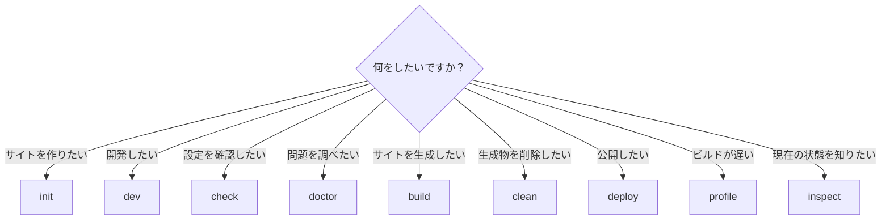
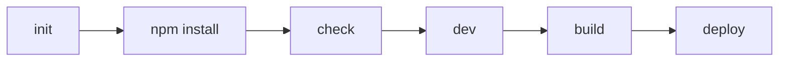
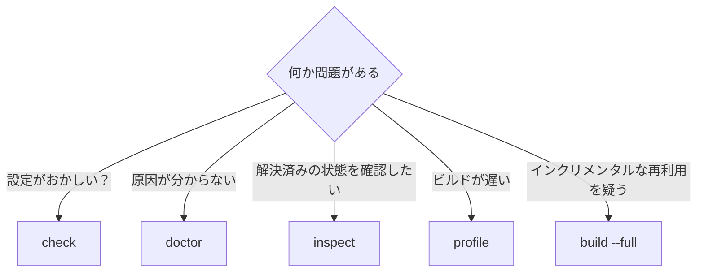

# CLI リファレンス

コマンドはアプリケーションディレクトリで実行します。CLI はカレントワーキングディレクトリからアプリケーションルートを解決し、コマンドのエラーを安全に報告して 0 以外の終了コードで終了します。

```sh id="vgst3p"
npm exec riebeckite <command>
```

## このページの構成

- [セットアップと作成](./cli/setup.ja.md)
- [開発と検証](./cli/development.ja.md)
- [ビルドと検査](./cli/build-and-inspect.ja.md)
- [公開](./cli/publish.ja.md)

## コマンド一覧

```text id="7uw50m"
riebeckite init [directory] [--preset <name>] [--features <names>] [--utilities <names>] [--force] [--list-presets] [--github-actions | --cloudflare-workers] [--content-repository <owner/repo>] [--site-repository <owner/repo>]
riebeckite create [site | plugin | theme | page-type | component]
riebeckite theme preview <name> [--port <port>] [--no-open]
riebeckite plugin dev <path> [--port <port>] [--no-open]
riebeckite plugin verify <path> [--level basic | integration | full] [--json]
riebeckite dev
riebeckite check
riebeckite doctor [--explain | --json | --fix [--dry-run]] [--fail-on <error|warning|info>] [--code <code> ...]
riebeckite upgrade --check --to <version|latest> [--json]
riebeckite build [--full]
riebeckite clean [--output | --all]
riebeckite deploy setup | deploy domain
riebeckite publish plan | status | validate | run [--execute] [--force] | approve <slug...> [--all] | revoke <slug...> [--all] | record --provider <name> | gate --provider <name>
riebeckite content create | edit | delete | move ... [--apply] [--json]
riebeckite content plan create | edit | delete | move ... [--out <name>] [--json]
riebeckite content apply <plan> --apply [--json]
riebeckite content recover <journal> --apply [--json]
riebeckite migrate list | plan [--id <migration>] [--out <path>] | apply [--plan <path>] [--id <migration>] [--apply] | status | history [--limit <n>] | rollback <planId | migrationId> --apply | recover [--journal <path>] --apply [--json]
riebeckite profile [--full]
riebeckite inspect [config | plugins | content [--list] [--path <path-or-permalink>] | graph | build | provenance]
riebeckite help [command...]
riebeckite completion <bash | zsh | powershell> [--project]
```

コマンドは単一の型付きレジストリから解決します。`--help`、`help`、`completion` はコマンドのメタデータだけを読み、ハンドラーを実行しません。有効なプラグインは、既存の `cli` 定義を通じて名前空間付きのコマンドを追加できます。定義API、実行コンテキスト、JSONの取り決め、補完、セキュリティモデルは [CLI拡張API](./cli-extension.ja.md) を参照してください。

## 各コマンドの役割とビルド状態への影響

| コマンド | 目的 | [[glossary/build-state|ビルド状態]]を書き込むか |
| --- | --- | --- |
| `init` | [[glossary/preset|プリセット]]から自己完結したサイトを生成する | いいえ |
| `create` | サイト、[[glossary/plugin|プラグイン]]、[[glossary/theme|テーマ]]、PageType、コンポーネントのジェネレーターを選ぶ | ジェネレーターによる |
| `theme preview` | ローカルのテーマを隔離された [[framework/honox-integration|HonoX]] 環境でプレビューする | 一時ファイルのみ |
| `plugin dev` | ローカルのプラグインを隔離された HonoX 環境でプレビューする | 一時ファイルのみ |
| `plugin verify` | サイトに追加する前に、配布可能なプラグインのパッケージ境界を検査する | いいえ |
| `dev` | 統合が提供する開発ワークフローを開始する | 統合による |
| `check` | アプリの設定、コンテンツルートの可用性、[[glossary/plugin-options|プラグインオプション]]、[[glossary/capability|ケイパビリティ]]の解決を検証する | いいえ |
| `doctor` | 実行環境、設定、プラグイン、コンテンツ、出力、テーマに関する共通の診断を報告する | いいえ |
| `upgrade --check` | Riebeckite パッケージを更新する前に、隔離した baseline ビルドと候補版のビルドを比較する | いいえ |
| `build` | ビルドを実行する。`--full` はインクリメンタルな再利用を回避する | 成功時に書き込む |
| `clean` | Riebeckite が管理する状態を削除する（`--all` はビルド出力も削除し、`--output` はビルド出力だけを削除する） | いいえ |
| `deploy` | Cloudflare の設定補助のみ。`setup` は publish ワークフローとシークレットを準備し、`domain` は Workers の Custom Domain を追加する。デプロイは行わない | いいえ |
| `publish` | 公開計画の作成、状態確認、検証、承認、明示的な実行を行う。`run` は `--execute` がない限り Dry Run | 実行を伴うビルドの後で書き込む |
| `content` | 明示的なコンテンツ変更を計画し、ジャーナル付きで書き込む。書き込みには `--apply` が必要 | いいえ |
| `migrate` | バージョン付きのコンテンツ移行を計画・適用し、状態確認、ロールバック、リカバリーを行う | いいえ |
| `profile` | トレースに基づくパフォーマンスレポートを実行する。`--full` はフルパスを使う | ビルドによる |
| `inspect` | 解決済みの実際の状態を表示する | いいえ |

## 目的別のコマンドの選び方

目的から選ぶと、コマンドの違いが分かりやすくなります。



`check`、`doctor`、`inspect`、`build` はとくに混同しやすいコマンドです。役割は次のように分かれます。

```text id="1djofm"
check
  → 設定は正しいか

doctor
  → 問題はないか

inspect
  → 現在の状態はどうなっているか

build
  → 実際に出力を生成する
```

## コマンドが失敗したときの表示

コマンドの失敗時には、エラー名とメッセージ、および存在する場合はエラーの `code`、ファイルパス、修正方法の `hint` が表示されます。ネストした原因は `Caused by:` 行として出力されます。

```text id="bf6q65"
Caused by:
```

単に「失敗した」と伝えるのではなく、何が失敗し、どこを確認すべきかを明確にすることを目指しています。

## よく使うワークフロー

壊れた [[glossary/wikilink|WikiLink]]、参照先が見つからないアセット、[[glossary/publication-boundary|公開境界]]の警告など、コンテンツの整合性に関する指摘は、ビルド経路または `@riebeckite/plugin-diagnostics` などのプラグインから得られます。Riebeckite が何を読み込んだかを確認するには `inspect content --list` と `inspect graph` を使い、描画後のコンテンツに関する問題には `build` または該当するプラグインの診断を実行してください。

```sh
pnpm exec riebeckite check
pnpm exec riebeckite doctor
pnpm exec riebeckite inspect plugins
pnpm exec riebeckite build
pnpm exec -- riebeckite publish run --execute
```

新しいサイトでは、次のような流れになります。



`build` の後は、`npm exec -- riebeckite publish run --execute` で出力を公開します。

問題が発生したときは、目的に応じて `doctor`、`inspect`、`profile` を使います。



項目単位のコンテンツ出力が必要な場合は `inspect content --list`、リンクやグラフ拡張を調査する場合は `inspect graph` を選んでください。診断結果の解釈には [診断](../framework/diagnostics.ja.md)、非推奨 API の移行については [アップグレード](../guides/upgrading.ja.md)、状態の意味については [ビルドシステム](../framework/build-system.ja.md) を参照してください。
