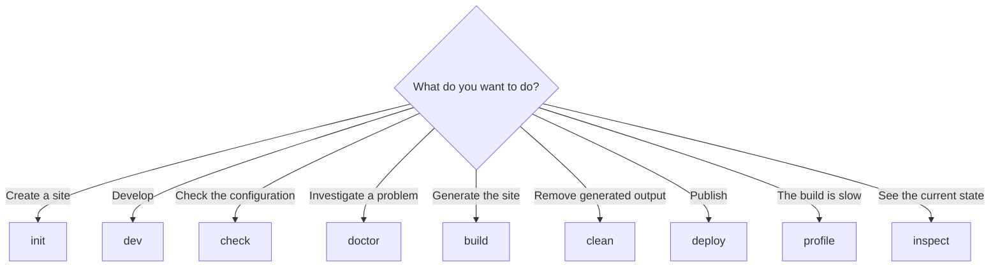
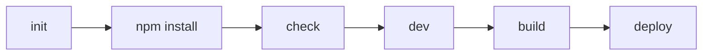
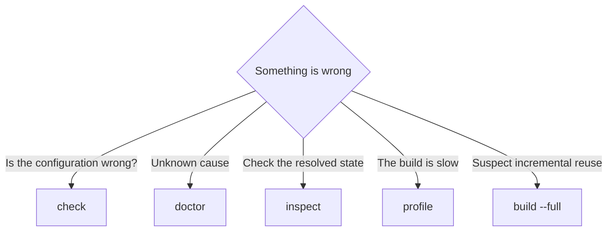

# CLI Reference

Run commands from an application directory. The CLI resolves the application root from the current working directory and reports command errors safely with a non-zero exit code.

```sh
npm exec riebeckite <command>
```

## In this section

- [Setup and creation](./cli/setup.md)
- [Development and checks](./cli/development.md)
- [Build and inspection](./cli/build-and-inspect.md)
- [Publishing](./cli/publish.md)

## Command list

```text
riebeckite init [directory] [--preset <name>] [--features <names>] [--utilities <names>] [--force] [--list-presets] [--github-actions | --cloudflare-workers] [--content-repository <owner/repo>] [--site-repository <owner/repo>]
riebeckite create [site | plugin | theme | page-type | component]
riebeckite theme preview <name> [--port <port>] [--no-open]
riebeckite plugin dev <path> [--port <port>] [--no-open]
riebeckite plugin verify <path> [--level basic | integration | full] [--json]
riebeckite dev
riebeckite check
riebeckite doctor [--explain | --json | --fix [--dry-run]] [--fail-on <error|warning|info>] [--code <code> ...]
riebeckite upgrade --check --to <version|latest> [--json]
riebeckite build [--full]
riebeckite clean [--output | --all]
riebeckite deploy setup | deploy domain
riebeckite publish plan | status | validate | run [--execute] [--force] | approve <slug...> [--all] | revoke <slug...> [--all] | record --provider <name> | gate --provider <name>
riebeckite content create | edit | delete | move ... [--apply] [--json]
riebeckite content plan create | edit | delete | move ... [--out <name>] [--json]
riebeckite content apply <plan> --apply [--json]
riebeckite content recover <journal> --apply [--json]
riebeckite migrate list | plan [--id <migration>] [--out <path>] | apply [--plan <path>] [--id <migration>] [--apply] | status | history [--limit <n>] | rollback <planId | migrationId> --apply | recover [--journal <path>] --apply [--json]
riebeckite profile [--full]
riebeckite inspect [config | plugins | content [--list] [--path <path-or-permalink>] | graph | build | provenance]
riebeckite help [command...]
riebeckite completion <bash | zsh | powershell> [--project]
```

Commands are resolved from one typed registry. `--help`, `help`, and `completion` read command metadata and never run a command handler. Enabled Plugins can add namespaced commands through their existing `cli` definition. See [CLI Extension API](./cli-extension.md) for the definition API, context, JSON contract, completion, and security model.

## Command contracts

| Command | Purpose | Writes build state? |
| --- | --- | --- |
| `init` | scaffold a self-contained site from a preset | no |
| `create` | choose a Site, [[glossary/plugin|Plugin]], [[glossary/theme|Theme]], PageType, or Component generator | generator-dependent |
| `theme preview` | run an isolated [[framework/honox-integration|HonoX]] preview of a local Theme | temporary files only |
| `plugin dev` | run an isolated HonoX preview of a local Plugin | temporary files only |
| `plugin verify` | check a distributable Plugin package boundary before adding it to a site | no |
| `dev` | start the integration development workflow | integration-dependent |
| `check` | validate app configuration, content root availability, plugin options, and capability resolution | no |
| `doctor` | report shared diagnostics for environment, configuration, plugins, content, output, and theme | no |
| `upgrade --check` | compare isolated baseline and candidate builds before updating Riebeckite packages | no |
| `build` | run the build path; `--full` bypasses incremental reuse | yes, on success |
| `clean` | remove Riebeckite-managed state (`--all` also removes the build output; `--output` removes only the build output) | no |
| `deploy` | Cloudflare configuration helpers only: `setup` prepares the publish workflow and secrets; `domain` adds a Workers Custom Domain. It does not deploy. | no |
| `publish` | plan, inspect, validate, approve, and explicitly execute publication; `run` is a dry run without `--execute` | yes, after an executed build |
| `content` | plan explicit content mutations and write them with a journal; `--apply` is required to write | no |
| `migrate` | plan and apply versioned content migrations, then inspect, roll back, or recover them | no |
| `profile` | run tracing-based performance reporting; `--full` uses a full path | build-dependent |
| `inspect` | display factual resolved state | no |

## Which command should I use?

Choosing by goal makes the difference clearer.



`check`, `doctor`, `inspect`, and `build` are especially easy to confuse. A simple split:

```text
check
  → Is it correct?

doctor
  → Are there problems?

inspect
  → What is the current state?

build
  → Actually generate the output
```

## Error display

Command failures are reported with the error name, message, and, when present, the error `code`, file path, and a remediation `hint`. Nested causes are printed as `Caused by:` lines.

```text
Caused by:
```

The goal is not merely to say "it failed" but to make clear what failed and where to look.

## Common workflow

Broken WikiLinks, missing referenced assets, publish-boundary warnings, and other content-integrity findings come from the build path or from plugins such as `@riebeckite/plugin-diagnostics`. Use `inspect content --list` and `inspect graph` to confirm what Riebeckite loaded, then run `build` or the relevant plugin diagnostics for rendered-content problems.

```sh
pnpm exec riebeckite check
pnpm exec riebeckite doctor
pnpm exec riebeckite inspect plugins
pnpm exec riebeckite build
pnpm exec -- riebeckite publish run --execute
```

For a new site, the flow looks like this:



After `build`, publish the output with `npm exec -- riebeckite publish run --execute`.

When a problem occurs, use `doctor`, `inspect`, or `profile` depending on the goal:



Choose `inspect content --list` for item-level content output and `inspect graph` when investigating links or graph extensions. Use [Diagnostics](../framework/diagnostics.md) for interpretation, [Upgrading](../guides/upgrading.md) for deprecation and migration guidance, and [Build system](../framework/build-system.md) for state semantics.
