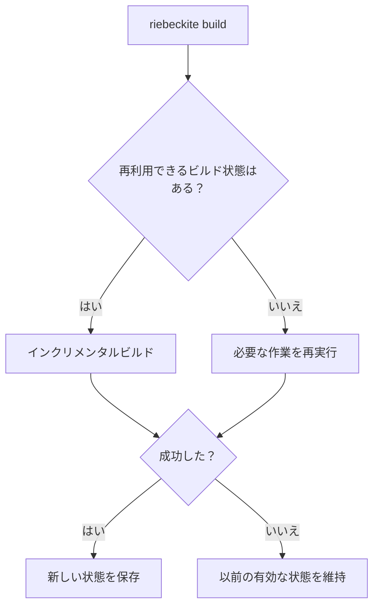

# ビルドと検査

## `build`

`build` はサイトをビルドします。

```sh id="iznhhd"
npm exec riebeckite build
```

通常はインクリメンタルな状態を再利用し、再利用できる作業を省略します。



マニフェストのビルドに失敗した場合は以前のビルド状態が残ります。状態のコミット後にページのレンダリングや出力の書き込みで失敗すると、新しい状態が残ることがあります。

### フルビルド

インクリメンタルな状態の再利用を避けるには、次のコマンドを実行します。

```sh id="wpr38p"
npm exec -- riebeckite build --full
```

ビルドを再現するときや、インクリメンタルな動作の問題を切り分けるときに使います。詳しくは [ビルドシステム](../../framework/build-system.ja.md) を参照してください。

## `clean`

`clean` は、ユーザーのコンテンツではなく、Riebeckite が管理する成果物を削除します。

```sh id="cln001"
npm exec riebeckite clean
```

オプションを指定しない場合は、管理対象の状態ルート（アプリケーションディレクトリ配下の `.riebeckite/`）を削除します。この中には、ビルド状態、[[glossary/plugin-cache|プラグインキャッシュ]]、永続コンテンツキャッシュ、[[glossary/ssg|SSG]] [[glossary/output-cache|出力キャッシュ]]が含まれます。

ビルド出力ディレクトリだけを削除するには、次のコマンドを実行します。

```sh id="cln002"
npm exec -- riebeckite clean --output
```

管理対象の状態とビルド出力の両方を削除するには、次のコマンドを実行します。

```sh id="cln003"
npm exec -- riebeckite clean --all
```

出力の場所はハードコードではなくプロジェクト設定から解決されるため、統合が定義した場所もそのまま使われます。削除対象が存在しなくてもエラーにならないので、`clean` は CI やトラブルシューティング用スクリプトからの繰り返し実行にも安全です。コンテンツ、設定、テーマやプラグインのソース、`public/` のアセット、Git のメタデータを削除することはありません。アプリケーションディレクトリの外にあるものは削除しません。シンボリックリンクやジャンクションはリンクとして削除するため、リンク先が削除されることはありません。`app/.riebeckite/` 配下の生成ソースは、統合が次の `dev` または `build` で再生成するため、そのまま残します。

インクリメンタルな状態、[[glossary/persistent-cache|永続キャッシュ]]、以前の出力に依存せずにサイトを再現するには、コールドビルドを実行します。

```sh id="cln004"
npm exec -- riebeckite clean --all
npm exec riebeckite build
```

ビルドが遅いときや、インクリメンタルな再利用が疑わしいときにも役立ちます。既定のレイアウトでは、これらの[[glossary/cache|キャッシュ]]は `.riebeckite/` 配下にあります。別の場所にキャッシュディレクトリを設定している場合、そのディレクトリは `clean` では削除されません。

## `profile`

`profile` は、ビルド時間がどこに費やされているかを調査します。

```sh id="5pvcmf"
npm exec riebeckite profile
```

トレースを収集し、ビルドのフェーズとプラグインの処理に関するパフォーマンスレポートを表示します。レポートはプラグインキャッシュとコンテンツキャッシュの動作を分けて表示します。コンテンツキャッシュの部分には、ミスまたはバイパスごとの理由も含まれるため、エントリが再利用されなかった理由を確認できます。

インクリメンタルな再利用なしで計測するには、次のコマンドを実行します。

```sh id="mqr87f"
npm exec -- riebeckite profile --full
```

`profile` はパフォーマンス調査のためのコマンドであり、設定の有効性を確認する方法ではありません。

## `inspect`

`inspect` は、Riebeckite が現在認識している状態を表示します。

```sh id="enl4wg"
npm exec riebeckite inspect plugins
```

インスペクターは意図的に読み取り専用です。ビルド状態やキャッシュを保存したり、アセットを出力したり、Vite/HonoX のビルドを呼び出したり、特殊な成果物を描画したり、問題を自動修正したりしてはいけません。位置の解決のためにコンテンツをメモリ上で処理することはあります。とくに、実行しても次のことは行いません。

- ビルド状態の書き込み
- プラグインキャッシュの書き込み
- アセットの出力
- Vite / HonoX のビルド
- 成果物の描画
- 設定の自動修正

### 設定

```sh id="c3x2ak"
npm exec riebeckite inspect config
```

解決済みの設定を表示します。

### プラグイン

```sh id="wnn5fz"
npm exec riebeckite inspect plugins
```

現在有効なプラグインを表示します。

### コンテンツ

```sh id="qqht5s"
npm exec -- riebeckite inspect content --list
```

現在の[[glossary/content-entry|コンテンツエントリ]]と、解決済みの正規パーマリンクを表示します。特定の記事がどの URL として認識されているかを確認するのに役立ちます。

### グラフ

```sh id="s8q7lx"
npm exec riebeckite inspect graph
```

[[glossary/content-graph|コンテンツグラフ]]を表示します。WikiLinks、[[glossary/backlink|バックリンク]]、グラフ拡張を調査するときに使います。

### アセット

```sh id="rb-assets"
npm exec -- riebeckite inspect assets
```

コンテンツルート直下の Markdown 以外のファイルを、読み取り専用で一覧表示します。合計サイズ、使用状況、形式、未使用・未使用の可能性があるアセット、SHA-256 による重複グループ、最適化候補を表示します。`--list` ですべてのアセットを、`--json` で構造化レポートを出力します。ファイルの削除や書き換えは行いません。

### API ライフサイクル

```sh id="rb-api-lifecycle"
npm exec -- riebeckite inspect api --deprecated
```

登録済みのライフサイクルメタデータを表示します。`--deprecated` で非推奨 API だけに絞り、`--json` で構造化された検査結果を出力します。レジストリを読むだけで、設定やビルド状態は変更しません。

### ビルド

```sh id="y2uc9f"
npm exec riebeckite inspect build
```

現在のインクリメンタルなビルド状態を表示します。状態が存在しない場合や壊れている場合でも、新しい状態を作成せず、状態とその理由を報告します。

インスペクターの設計については [インスペクター](../../framework/inspector.ja.md) を参照してください。
