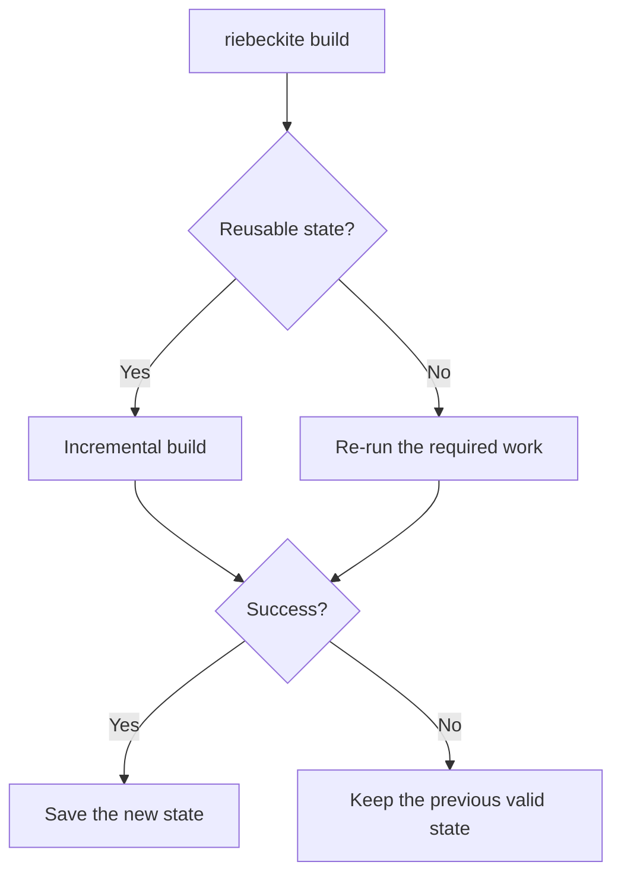

# Build and inspection

## `build`

`build` builds the site.

```sh
npm exec riebeckite build
```

Normally it reuses incremental state and skips work that can be reused.



A failed manifest build keeps the previous build state. A failure after the state commit, such as during page rendering or output writing, can leave the new state behind.

### Full build

To avoid reusing incremental state:

```sh
npm exec -- riebeckite build --full
```

Use this to reproduce a build or to isolate problems with incremental behavior. See [Build system](../../framework/build-system.md) for details.

## `clean`

`clean` removes Riebeckite-managed artifacts instead of user content.

```sh
npm exec riebeckite clean
```

With no options it removes the managed state root (`.riebeckite/` under the application directory), which holds the build state, plugin cache, persistent content cache, and [[glossary/ssg|SSG]] output cache.

To remove only the build output directory:

```sh
npm exec -- riebeckite clean --output
```

To remove both the managed state and the build output:

```sh
npm exec -- riebeckite clean --all
```

The output location is resolved from project configuration rather than hard-coded, so an integration-defined location is honored. Missing targets are not an error, so `clean` is safe to run repeatedly, including from CI and troubleshooting scripts. It never removes content, configuration, theme or plugin sources, `public/` assets, or Git metadata. It refuses to delete anything outside the application directory, and symlinks or junctions are removed as links, so their targets are never deleted. Generated source entries under `app/.riebeckite/` are left in place because the integration regenerates them on the next `dev` or `build`.

To reproduce a site without relying on incremental state, persistent caches, or previous output, run a cold build:

```sh
npm exec -- riebeckite clean --all
npm exec riebeckite build
```

This is also useful when the build is slow or incremental reuse is suspect. In the default layout those caches live under `.riebeckite/`; a cache directory configured elsewhere is not removed by `clean`.

## `profile`

`profile` investigates where build time is spent.

```sh
npm exec riebeckite profile
```

It collects traces and displays a performance report covering build phases and plugin processing. The report separates [[glossary/plugin-cache|Plugin cache]] activity from Content cache activity; the Content cache part also includes the reason for each miss or bypass, so you can see why an entry was not reused.

To measure without incremental reuse:

```sh
npm exec -- riebeckite profile --full
```

`profile` is a performance-investigation command, not a way to check configuration validity.

## `inspect`

`inspect` shows the state Riebeckite currently recognizes.

```sh
npm exec riebeckite inspect plugins
```

The inspector is deliberately read-only: it must not persist build state or caches, emit assets, invoke Vite/HonoX builds, render special artifacts, or auto-fix problems. Content may be processed in memory to resolve locations. In particular, running it does not perform:

- build state writes
- plugin cache writes
- asset emission
- Vite / HonoX builds
- artifact rendering
- automatic config fixes

### Config

```sh
npm exec riebeckite inspect config
```

Shows the resolved configuration.

### Plugins

```sh
npm exec riebeckite inspect plugins
```

Shows the currently active plugins.

### Content

```sh
npm exec -- riebeckite inspect content --list
```

Shows the current content entries and their resolved canonical permalinks. This is useful for confirming which URL a particular article is recognized as.

### Graph

```sh
npm exec riebeckite inspect graph
```

Shows the content graph. Use it when investigating WikiLinks, backlinks, or graph extensions.

### Assets

```sh
npm exec -- riebeckite inspect assets
```

Shows a read-only inventory of files under the content root that are not
Markdown: total size, usage, formats, unused and possibly unused assets, SHA-256
duplicate groups, and optimization candidates. Use `--list` to include every
asset, or `--json` for the structured report. Nothing is deleted or rewritten.

### API lifecycle

```sh
npm exec -- riebeckite inspect api --deprecated
```

Shows the registered lifecycle metadata. Use `--deprecated` to list only
deprecated APIs, or `--json` for the structured inspection. This reads the
registry and does not change the configuration or build state.

### Build

```sh
npm exec riebeckite inspect build
```

Shows the current incremental build state. When the state is missing or broken, it does not create a new state; it reports that state and the reason.

See [Inspector](../../framework/inspector.md) for the inspector's design.
