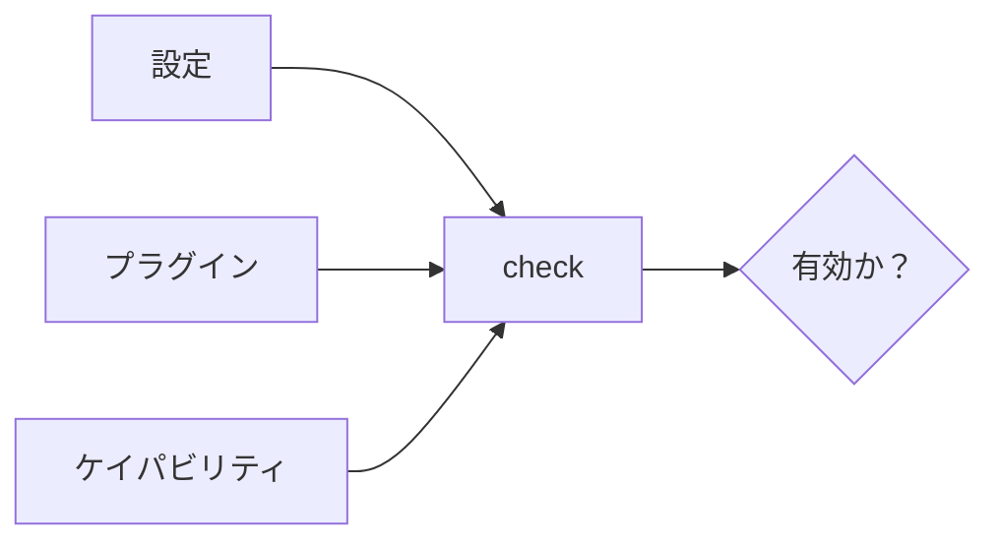
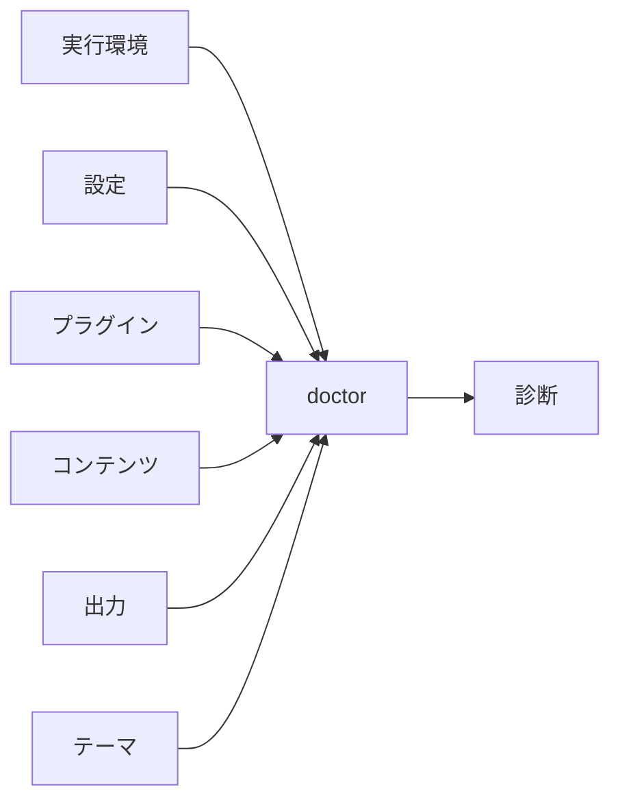

# 開発と検証

## `theme preview`

通常のサイトが使うのと同じ Riebeckite サイトと HonoX/Vite の経路を使って、生成済みのローカルのテーマをプレビューします。

```sh
riebeckite theme preview my-theme
riebeckite theme preview my-theme --port 4173 --no-open
```

プレビューは既定でブラウザーを開きます。無効にするには `--no-open` を指定します。プレビューは `themes/` 配下の一時サイトから、Home、Article、Documentation、Components の各フィクスチャページを毎回同じ内容で配信します。設定済みの Vault、ビルド出力、`riebeckite.config.ts` は読み取りも変更もしません。Ctrl+C で停止すると、一時サイトは削除されます。テーマの CSS は実際のテーマ定義を通じて読み込まれ、CSS の変更は Vite が反映します。`index.ts` を編集すると開発サーバーが再起動し、開いているページが再読み込みされます。レスポンシブな表示サイズとシステムの配色設定は、ブラウザの開発者ツールで確認してください。テーマは信頼済みのローカルアプリケーションコードです。プレビュー設定の読み込み中に、テーマのモジュールが実行されます。

## `plugin dev`

ローカルのプラグインを、一時的な Riebeckite サイトと実際の HonoX/Vite 開発サーバーでプレビューします。

```sh
riebeckite plugin dev ./extensions/my-plugin
riebeckite plugin dev ../my-plugin --port 4321 --no-open
```

プレビューは既定でブラウザーを開きます。無効にするには `--no-open` を指定します。パスにはプラグインのディレクトリ、またはその `package.json` を指定できます。ディレクトリには、サポートされるエントリポイントを持つ有効な `package.json` が必要です。エントリポイントとして使えるのは、`source`、`import`、`module`、`default` のいずれかの条件を持つ `exports["."]`、`main`、または慣例的な `index.ts` です。CLI は依存関係をインストールしません。プレビューを開始する前に、プラグイン側のプロジェクトで依存関係をインストールしてください。

コマンドはシステムの一時ディレクトリに隔離されたフィクスチャサイトを作成し、ローカルのプラグインをそこにリンクして、フィクスチャのパスを表示します。設定済みの Vault、[[glossary/site-config|サイト設定]]、ビルド出力は読み取りも変更もしません。フィクスチャには毎回同じ内容の Markdown が含まれるため、コンテンツを編集せずにプラグインを確認できます。

プレビュー中は、次のように変更が反映されます。

- CSS の変更は Vite の HMR で反映されます。
- クライアントスクリプトの変更はプレビューを再読み込みします。
- Markdown フィクスチャの変更は描画ページに反映されます。
- プラグインのエントリポイントの変更は開発サーバーを再起動します。

プラグインの読み込み、コンパイル、初期化で発生したエラーはターミナルに出力され、コマンドは 0 以外のステータスで終了します。一時サイトは Ctrl+C、正常終了、起動失敗のいずれでも削除されます。プロセスを強制終了した場合は、起動時に表示されたフィクスチャのパスを削除してください。

### `theme preview` との違い

`theme preview` は `themes/` 配下の固定されたコンテンツフィクスチャでテーマをプレビューします。`plugin dev` はシステムの一時ディレクトリにある一時サイトで、1 つのローカルのプラグインをプレビューします。どちらも実際の Riebeckite/HonoX/Vite の経路を使いますが、対象とする拡張ポイントが異なり、フィクスチャのライフサイクルも別々です。

### セキュリティ

`plugin dev` は信頼済みのローカル開発向けコマンドです。指定したパスのプラグインエントリとクライアントスクリプトを実行します。信頼できるプラグインだけを実行し、このコマンドを信頼できないユーザーに公開しないでください。コマンドがパッケージを自動でインストールすることはありません。

### トラブルシューティング

- `Could not find a plugin`: パスを確認してください。相対パスはカレントディレクトリから解決されます。
- `Could not find package.json`: パッケージのルート、またはその `package.json` を指定してください。
- `Could not find the plugin entry point`: `exports["."]` か `main` を宣言するか、`index.ts` を追加してください。
- コンパイルや初期化のエラー: プラグインの依存関係をインストールし、ターミナルの出力を確認してください。
- ポートがすでに使用されている: 別の `--port` を指定してください。

## `dev`

開発環境を起動します。

```sh id="ujiy7q"
npm exec riebeckite dev
```

Riebeckite の統合が提供する開発ワークフローでサイトを起動します。実際の開発サーバーとビルド状態の扱いは、使用している統合によって異なります。通常の HonoX サイトでは、開発中のページ確認にこのコマンドを使います。

Windows では、関連する編集をまとめて保存し、サーバーの再起動が終わってから再読み込みしてください。複数のファイルを続けて保存すると Vite のサーバーが何度も再起動し、一時的に `transport was disconnected` と表示されることがあります。再起動後に再読み込みすれば解消します。

## `check`

`check` は、設定、プラグイン、ケイパビリティが正しく構成されているかを検証します。

```sh id="5a2lrf"
npm exec riebeckite check
```

たとえば、次のことを確認します。

- 設定の形式が有効であること
- プラグインの設定が有効であること
- 必要なケイパビリティが解決されていること



`check` が確認するのはプロジェクトの基本的な妥当性であり、出力がビルド済みかどうかや、デプロイ済みかどうかということではありません。`check` が保証するのは、設定が有効であることです。

### プラグインオプションの検証

プラグインオプションの検証は `check` の一部として実行されます。各プラグインの `validateOptions` は、設定の有効性の判定に関わります。たとえばアナリティクスプラグインは、プロバイダーとコレクター URL を検証します。そのため、プラグインの設定が不正であれば、ビルドが始まる前に `check` が失敗します。

## `doctor`

`doctor` は、毎回同じ内容になる共通の開発診断レポートを出力します。サイトをビルドしたり、ビルド状態を変更したりしません。

```sh id="zruccx"
npm exec riebeckite doctor
npm exec -- riebeckite doctor --explain
npm exec -- riebeckite doctor --json
npm exec -- riebeckite doctor --fail-on warning --code CONTENT_UNAVAILABLE
```

`--explain` は安定した fingerprint、原因、詳細、推奨される修正を含めます。`--json` はツール向けにシリアライズ可能なレポートだけを出力し、追加された summary には unavailable ・ skipped ・ category ・ code ごとの件数も含まれます。`--code` は繰り返して[[glossary/diagnostic-code|診断コード]]を絞り込めます。`--fail-on` は失敗にする最小 severity を指定します（既定値は `error`）。`--fix` は安全な自動修正に限定されますが、現在は対応する自動修正がないため、`--dry-run` でファイルを変更せずにそのことを確認できます。

`doctor` は、観測できる範囲で、実行環境、設定、プラグイン、コンテンツ、出力計画、テーマの参照を確認します。観測できない項目は推測せず、利用不可として明示します。



`doctor` は独立したチェックをできる限り続行し、ヘルスチェックが失敗した場合は 0 以外の終了コードで終了します。

`riebeckite dev` の実行中、編集可能なコントロールの外で <kbd>Ctrl</kbd>+<kbd>Alt</kbd>+<kbd>R</kbd> を押すと、Development Inspector が開きます。`doctor` と同じレポートを使い、Vite の更新に合わせて更新されます。本番のクライアント出力やエンドポイントには含まれません。Overview、Diagnostics、Plugins の各タブは、診断レポートの準備ができ次第、それを表示します。Dependencies と Output タブは別に読み込まれ、ビルド状態を書き込んだりサイトをビルドしたりせずに、現在のコンテンツと出力計画を読み取ります。
