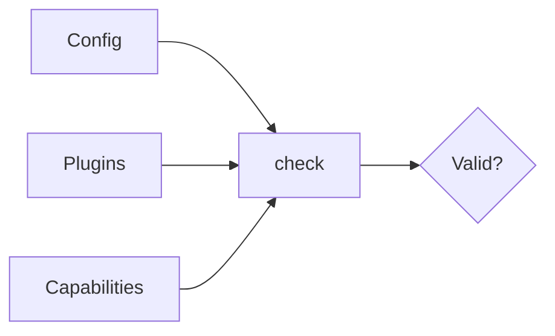
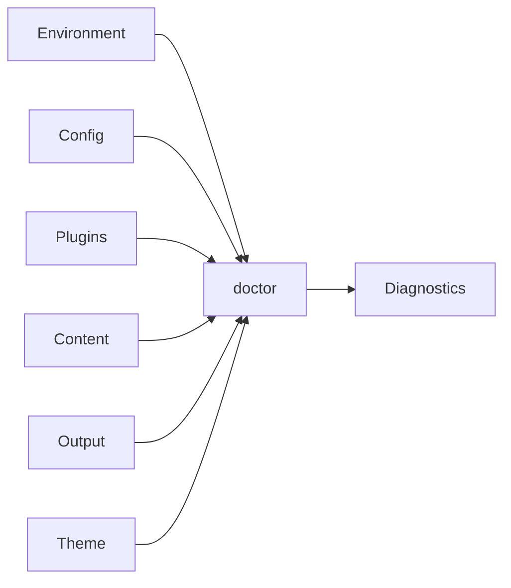

# Development and checks

## `theme preview`

Preview a generated local Theme with the same Riebeckite Site and HonoX/Vite path used by a normal site:

```sh
riebeckite theme preview my-theme
riebeckite theme preview my-theme --port 4173 --no-open
```

The preview opens a browser by default; pass `--no-open` to disable it. It serves deterministic Home, Article, Documentation, and Components fixture pages from a temporary site under `themes/`. It does not read or change the configured Vault, build output, or `riebeckite.config.ts`; the temporary site is removed when you stop it with Ctrl+C. Theme CSS is imported through the actual Theme definition and Vite updates CSS changes; editing `index.ts` restarts the dev server and reloads the open page. Use browser developer tools for responsive sizes and system color preference. A Theme is trusted local application code: its module executes while the preview configuration is loaded.

## `plugin dev`

Preview a local Plugin through a temporary Riebeckite site and the real HonoX/Vite development server:

```sh
riebeckite plugin dev ./extensions/my-plugin
riebeckite plugin dev ../my-plugin --port 4321 --no-open
```

The preview opens a browser by default; pass `--no-open` to disable it. The path can point to a Plugin directory or its `package.json`. The directory must contain a valid `package.json` with a supported entry point: `exports["."]` with a `source`, `import`, `module`, or `default` condition, `main`, or a conventional `index.ts`. The CLI does not install dependencies. Install the Plugin's dependencies in its own project before starting the preview.

The command creates an isolated fixture site in the system temporary directory, links the local Plugin into it, and prints the fixture path. It does not read or change the configured Vault, site configuration, or build output. The fixture contains deterministic Markdown so the Plugin can be checked without editing your content.

While the preview is running:

- CSS changes are applied through Vite HMR.
- Client-script changes reload the preview.
- Markdown fixture changes update the rendered page.
- Plugin entry changes restart the development server.

Errors from loading, compiling, or initializing the Plugin are printed in the terminal, and the command exits with a non-zero status. The temporary site is removed on Ctrl+C, normal shutdown, or startup failure. If the process is killed forcibly, remove the fixture path printed at startup.

### Difference from `theme preview`

`theme preview` previews a Theme with fixed content fixtures under `themes/`. `plugin dev` previews one local Plugin with a temporary site under the system temporary directory. Both use the real Riebeckite/HonoX/Vite path, but they exercise different extension points and have separate fixture lifecycles.

### Security

`plugin dev` is a trusted local development command. It executes the Plugin entry and its client script from the given path. Only run Plugins you trust, and do not expose this command to untrusted users. The command never installs packages automatically.

### Troubleshooting

- `Could not find a plugin`: check the path; relative paths resolve from the current directory.
- `Could not find package.json`: point at the package root or its `package.json`.
- `Could not find the plugin entry point`: declare `exports["."]`, `main`, or add `index.ts`.
- Compilation or initialization errors: install the Plugin's dependencies and read the terminal output.
- The port is already in use: pass another `--port`.

## `dev`

`dev` starts the development environment.

```sh
npm exec riebeckite dev
```

It starts the site through the Riebeckite integration's development workflow. The actual development server and how build state is handled depend on the integration in use. For an ordinary HonoX site, use this command to preview pages while developing.

On Windows, save related edits together and wait for the server to finish restarting before reloading. Saving several files in quick succession can restart the Vite server repeatedly and briefly show `transport was disconnected`; reload after the restart to clear it.

## `check`

`check` validates that the configuration, plugins, and capabilities are set up correctly.

```sh
npm exec riebeckite check
```

For example, it confirms:

- the config format is valid
- plugin configuration is valid
- required capabilities are resolved



`check` establishes basic project validity, not that output has been built or deployed. What `check` guarantees is that the configuration is valid.

### Plugin option validation

Plugin option validation runs as part of `check`. Each plugin's `validateOptions` (the analytics plugin, for example, validates its provider and collector URL) contributes to configuration validity, so an invalid plugin setup fails `check` before any build starts.

## `doctor`

`doctor` reports a deterministic, shared development diagnostic report. It does not emit a site build or alter persisted build state; content may be processed in memory for diagnostics.

```sh
npm exec riebeckite doctor
npm exec -- riebeckite doctor --explain
npm exec -- riebeckite doctor --json
npm exec -- riebeckite doctor --fail-on warning --code CONTENT_UNAVAILABLE
```

`--explain` includes the stable fingerprint, cause, details, and suggested remediation. `--json` writes only the serializable report for tooling; its additive summary includes unavailable, skipped, category, and code counts. Repeat `--code` to select diagnostic codes. `--fail-on` selects the lowest severity that fails the command (default: `error`). `--fix` is limited to safe automatic fixes; no safe automatic fix is currently available, so `--dry-run` confirms that without modifying files.

It checks environment, configuration, plugins, content, output planning, and theme references where the observation is available. Unavailable observations are reported explicitly rather than inferred.



`doctor` continues independent checks where possible and exits unsuccessfully when health checks fail.

During `riebeckite dev`, press <kbd>Ctrl</kbd>+<kbd>Alt</kbd>+<kbd>R</kbd> outside editable controls to open the Development [[framework/inspector|Inspector]]. It uses the same report as `doctor`, refreshes with Vite updates, and is not included in production client output or endpoints. Its Overview, Diagnostics, and Plugins tabs show the diagnostics report as soon as it is ready. The Dependencies and Output tabs load separately and read the current content and output plan without writing build state or building the site.
