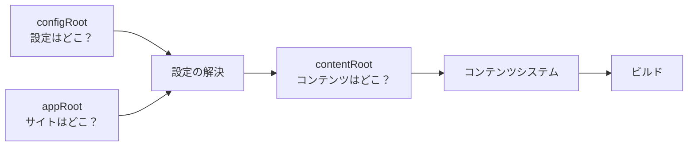

# 設定

Riebeckite の設定は `riebeckite.config.ts` に記述します。`defineConfig()` で設定を宣言し、コンテンツやプラグインの処理が始まる前に、インテグレーションが設定を解決します。

基本的なサイトでは、次のように設定します。

```ts id="vps2rj"
import { defineConfig } from "@riebeckite/core";

export default defineConfig({
  site: {
    title: "My site",
    baseUrl: "https://example.com",
  },

  content: {
    directory: "content",
    exclude: ["drafts/**"],
    filters: {
      publishStrategy: "explicit",
    },
  },

  theme: {
    colorMode: "system",
    layout: "article",
  },

  plugins: [],
});
```

必須は `site` だけです。`content`、`theme`、`plugins`、`cache`、`spa` は必要に応じて設定します。

| フィールド | 用途 |
| --- | --- |
| `site` | サイトの基本情報 |
| `content` | コンテンツの場所と公開条件 |
| `theme` | テーマの設定 |
| `plugins` | 使用するプラグイン |
| `cache` | ビルドキャッシュの設定 |
| `spa` | SPA ナビゲーションの設定 |

`spa` はクライアント側のページ遷移を有効にします。`true`、`false`、またはオプションオブジェクトを指定できます。動作とオプションは [SPA ナビゲーション](../guides/spa-navigation.ja.md) を参照してください。

## 関連ページから詳細を調べる

- [ナビゲーションの設定](./configuration/navigation.ja.md)
- [コンテンツの選択と ContentSource](./configuration/content.ja.md)
- [ファイルシステムのルートと外部 Vault](./configuration/roots.ja.md)
- [添付ファイル・メディアと公開](./configuration/assets.ja.md)
- [ビルドキャッシュ](./configuration/cache.ja.md)
- [プラグインの設定](./configuration/plugins.ja.md)
- [テーマの設定](./configuration/theme.ja.md)
- [外部 Vault のトラブルシューティング](./configuration/troubleshooting.ja.md)

## 設定を検証する

設定に問題がある場合は `ConfigValidationError` として報告されます。不正な設定を無視してそのまま起動するのではなく、早い段階で失敗させてください。

設定を変更した後は、次を実行してください。

```sh id="khhx15"
npm exec riebeckite check
```

## サイトとコンテンツの場所を分けて考える

設定では、サイトとコンテンツの場所を混同しないことが重要です。



基本は次の3つです。

```text id="htn7yn"
appRoot
  = サイトアプリケーションの場所

configRoot
  = riebeckite.config.* の場所

contentRoot
  = Markdown / Vault の場所
```

`content.directory` に相対パスを指定した場合、基準になるのは `appRoot` です。`configRoot` や `process.cwd()` は基準になりません。

通常のサイトでは、3つの違いを意識する必要はほとんどありません。外部の Vault を使う場合、コンテンツを別のリポジトリに置く場合、特殊なモノレポ構成にする場合だけ、この境界を意識してください。

設定を変更した後は `riebeckite check` を実行してください。実際にどう解決されたかを確認したい場合は `riebeckite inspect config` を使います。
