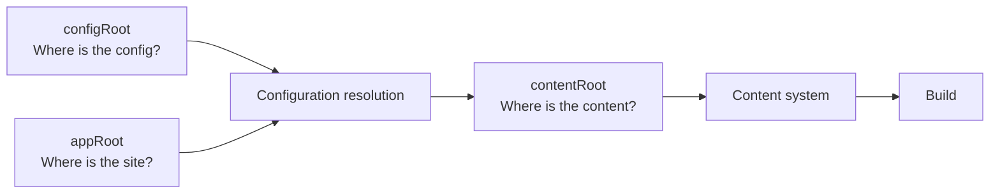

# Configuration

Create configuration with `defineConfig` and let the integration resolve it before content or plugins run. The required top-level field is `site`; optional sections are `content`, `theme`, `plugins`, `cache`, `publication`, `provenance`, and `spa`.

For the complete field list, start with [Configuration reference](./configuration-reference.md). The topic pages in this section cover content, assets, roots, cache, navigation, plugins, theme, and troubleshooting in depth.

```ts
import { defineConfig } from "@riebeckite/core";
import { defaultTheme } from "@riebeckite/theme-default";

export default defineConfig({
  site: { title: "My site", baseUrl: "https://example.com" },
  content: {
    directory: "content",
    exclude: ["drafts/**"],
    filters: { publishStrategy: "explicit" },
  },
  theme: defaultTheme({ colorMode: "system" }),
  plugins: [],
});
```

`spa` enables client-side page transitions. It accepts `true`, `false`, or an
options object; see [SPA Navigation](../guides/spa-navigation.md) for behavior
and options.

`publication` configures approval mode and durable publication state.
`provenance` controls build provenance recording; see
[Data Provenance](../framework/build-system/provenance.md).

## How this section is organized

- [Navigation](./configuration/navigation.md)
- [Content selection and ContentSource](./configuration/content.md)
- [Filesystem roots and external vaults](./configuration/roots.md)
- [Attachments, media, and publishing](./configuration/assets.md)
- [Build cache](./configuration/cache.md)
- [Plugin configuration](./configuration/plugins.md)
- [Theme configuration](./configuration/theme.md)
- [Troubleshooting an external vault](./configuration/troubleshooting.md)

## Config validation

Configuration errors in the regular sections are reported as `ConfigValidationError`; invalid theme presets or settings throw `ThemeSettingsValidationError`. Both are exported from `@riebeckite/core`. Do not catch and hide them. Run `riebeckite check` after changes.

```sh
npm exec riebeckite check
```

## Summary

Configuration keeps the site and its content separate:



```text
appRoot     = where the site application lives

configRoot  = where riebeckite.config.* lives

contentRoot = where the Markdown or vault lives
```

Relative `content.directory` values resolve against `appRoot`, never
`configRoot` or `process.cwd()`. Most sites never need to think about the three
boundaries. They matter only when you use an external vault, keep content in a
separate repository, or work in an unusual monorepo layout.
