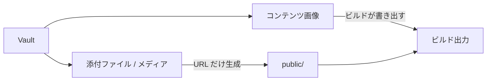
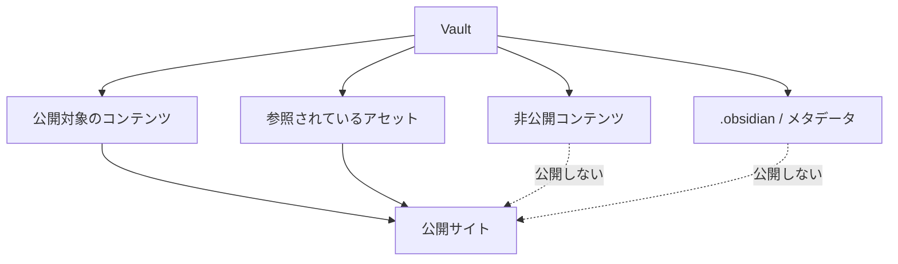

# 添付ファイルとメディアの公開

Obsidian の添付ファイルやメディアも、`contentRoot` を基準に扱います。

ここで添付ファイル / メディアとは、**Markdown でも画像でもないファイル**です。Vault 内の画像（png、jpg、svg など）はコンテンツ画像として別に扱われるため、混同しないよう次の節で分けて説明します。

たとえば、Vault に次のようなファイルがあるとします。

```text id="qv3qcs"
vault/
├─ notes/
│  └─ report.md
├─ attachments/
│  └─ report.pdf
└─ media/
   └─ interview.mp3
```

Markdown では、次のように参照できます。

```md id="csovb2"
![[attachments/report.pdf]]

![[media/interview.mp3]]
```

`obsidianMarkdown()` は、これらを Vault からの相対的な論理パスとして扱います。

`attachment()` と `media()` が、対応する埋め込みを描画します。`attachment()` は解決済みの Vault ルートから埋め込みファイルのサイズを読み取り、ルートの外を指すパスは拒否します。`media()` は対応する音声・動画形式を同じ論理パスで描画します。

公開 URL は安定した形式になります。

```text id="j9hboh"
/assets/attachments/<Vault からの相対 logical path>
```

たとえば、次のように論理パスを維持します。

```text id="pfr5c3"
attachments/report.pdf

↓

/assets/attachments/attachments/report.pdf
```

## アセットの URL と実ファイルは別

ここが重要な点です。

URL を生成することと、そのファイルがサイトへ公開されることは別です。

アセットは次の3種類に分かれ、公開を担当する場所も異なります。

| 種類 | 対象 | 公開 URL | 公開を担当する場所 |
| --- | --- | --- | --- |
| コンテンツ画像 | Vault 内の画像 | `/<Vault からの相対 logical path>` | Riebeckite のビルド |
| 添付ファイル / メディア | Markdown でも画像でもないファイル | `/assets/attachments/<Vault からの相対 logical path>` | サイトアプリケーション |
| 静的アセット | サイトアプリケーション自身が管理するファイル | `/` 配下 | Vite の `public/` |



### コンテンツ画像はビルドで公開される

`obsidianMarkdown()` は、公開ページから参照されている画像を、ビルドの出力として書き出します。

サイトアプリケーションが何もしなくても、その画像はビルド出力に含まれ、生成された URL から取得できます。

たとえば、次の論理パスをそのまま公開します。

```text id="b1t4hs"
assets/logo.png

↓

/assets/logo.png
```

開発サーバーでも、同じ論理パスのままコンテンツから直接配信されます。

参照されていない画像や、非公開ページからしか参照されていない画像は書き出されません。どの画像を書き出すかは、公開ページと参照関係から決まります。

### 添付ファイルとメディアの公開はサイトアプリケーションの担当

添付ファイルとメディアについては、URL を生成しただけでは実ファイルは公開されません。

プラグインが、

```text id="8m59d5"
/assets/attachments/attachments/report.pdf
```

という URL を生成したからといって、`report.pdf` が自動的に Vite の `public/` へコピーされるわけではありません。

サイトアプリケーションは、公開する必要があるアセットだけを、

```text id="5jd2hq"
public/assets/attachments/
```

へコピーしてください。

その際も、Vault からの相対的な論理パスを維持します。

参照実装の `build_images.ts` は、実際に参照されている添付ファイルだけを差分コピーする実装例です。

### `public/` を使う静的アセット

`public/` は、サイトアプリケーション自身が管理するアセット用のディレクトリです。

`public/` 以下のファイルは、Vite のビルドでそのままビルド出力へコピーされます。

コンテンツから取り込んだ画像や添付ファイルをここへまとめて置くのではなく、前述のように公開する対象を絞って配置します。

## Vault 全体を公開しない

次のような実装は避けてください。

```text id="wp29zc"
vault/**
   ↓
public/**
```

Vault 全体をそのまま `public/` へコピーすると、次のものまで公開される可能性があります。

- 非公開の記事
- 未公開ページからしか参照されていない画像
- 参照されていない添付ファイル
- `.obsidian/` のメタデータ
- 公開するつもりのないファイル



**必要なアセットだけを公開する**ことが重要です。

コンテンツ画像は、ビルドが公開対象を判断します。添付ファイルとメディアをどの範囲で公開するかは、サイトアプリケーション側の責務です。公開対象の判断を含む詳しい流れは、[コンテンツとサイトを分離する](../../guides/deployment/separate-content-repository.ja.md#4-3-コンテンツ画像と添付ファイルは公開のされ方が違う) を参照してください。
