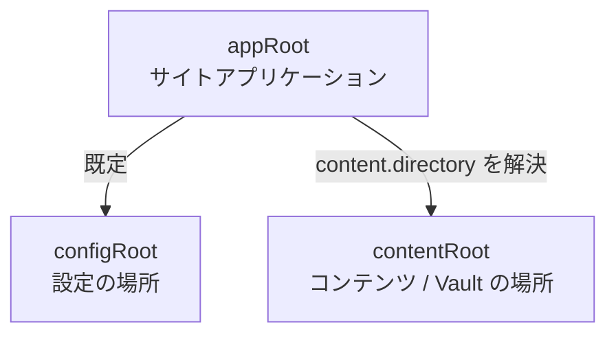
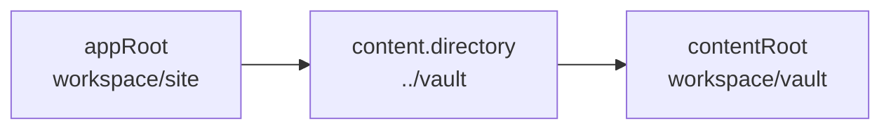
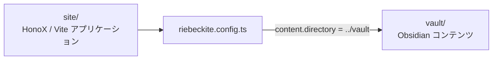
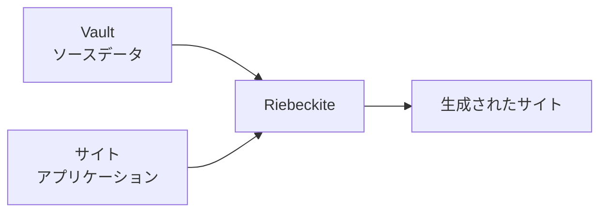
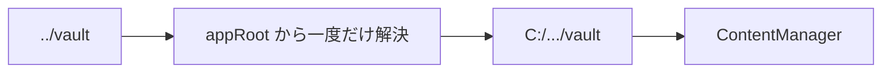

# 3つの Root

外部 Vault や monorepo 構成を扱う場合に重要なのが、次の3つの違いです。

- `appRoot`
- `configRoot`
- `contentRoot`



| 名前 | 役割 | 既定値 / 解決の基準 |
| --- | --- | --- |
| `appRoot` | HonoX / Vite アプリケーションのルート | Vite の `root` |
| `configRoot` | `riebeckite.config.*` を探すディレクトリ | `appRoot` |
| `contentRoot` | 実際にコンテンツを読み込む絶対パス | `path.resolve(appRoot, content.directory)` |

この3つは、それぞれ別の役割を持ちます。

## appRoot

`appRoot` は、**サイトアプリケーションの基準となるディレクトリ**です。

たとえば、次のような構成なら、

```text id="xkjg5v"
site/
├─ app/
├─ public/
├─ package.json
├─ vite.config.ts
└─ riebeckite.config.ts
```

通常は次のようになります。

```text id="2hwbbd"
appRoot = site/
```

`appRoot` は、次のようなサイトアプリケーションの基準になります。

- `app/`
- `public/`
- ルート
- 生成されたスタイル
- ビルド設定

## configRoot

`configRoot` は、次のファイルを探す基準です。

```text id="53pg8g"
riebeckite.config.ts
riebeckite.config.js
riebeckite.config.mjs
```

通常は `appRoot` と同じです。

```text id="7uqfyx"
appRoot
   └─ riebeckite.config.ts
```

特殊なリポジトリ構成で、設定を別の場所へ置く場合だけ変更します。

**`configRoot` を変更しても、`content.directory` の基準は変わらない**点に注意してください。

## contentRoot

`contentRoot` は、実際に Markdown やアセットを読み込む場所です。

相対パスの `content.directory` は、常に `appRoot` を基準に解決されます。

```ts id="jgnfqm"
content: {
  directory: "../vault",
}
```

この場合、次のようになります。

```text id="y6zaw5"
contentRoot
  = path.resolve(appRoot, "../vault")
```



基準は `process.cwd()` ではありません。

そのため、CLI を別のディレクトリから実行しても、同じサイトアプリケーションを解決できれば、同じ Vault を参照できます。

## 外部 Vault を使う

Obsidian Vault をサイトと独立して管理したい場合は、サイトの外へ置く構成を推奨します。

たとえば、次のような構成です。

```text id="bgmthg"
workspace/
├─ site/
│  ├─ package.json
│  ├─ vite.config.ts
│  ├─ riebeckite.config.ts
│  ├─ app/
│  └─ public/
│
└─ vault/
   ├─ index.md
   ├─ notes/
   ├─ attachments/
   └─ media/
```



サイトと Vault の役割が明確に分離されます。

```text id="wx10hc"
site/
  → アプリケーション

vault/
  → ソースコンテンツ
```

Vault を Vite アプリケーションのルートにする必要はありません。

## 外部 Vault の設定例

```ts id="p5vg19"
// site/riebeckite.config.ts

import { defineConfig } from "@riebeckite/core";
import { attachment } from "@riebeckite/plugin-attachment";
import { media } from "@riebeckite/plugin-media";
import { obsidianMarkdown } from "@riebeckite/plugin-obsidian-markdown";

export default defineConfig({
  site: {
    title: "My notes",
  },

  content: {
    directory: "../vault",
    exclude: [
      ".obsidian/**",
      "Templates/**",
    ],
  },

  plugins: [
    obsidianMarkdown(),
    media(),
    attachment(),
  ],
});
```

この場合、次のようになります。

```text id="9w7l08"
appRoot
  = workspace/site

content.directory
  = ../vault

contentRoot
  = workspace/vault
```

絶対パスを指定することもできます。

```ts id="vmohm9"
content: {
  directory: "C:/Users/example/Documents/vault",
}
```

ただし、絶対パスは開発用の PC や CI で場所が変わると使えなくなるため、通常はサイトからの相対パスを推奨します。

## `process.cwd()` に依存しない

コンテンツディレクトリを次のように組み立てることは避けてください。

```ts id="i3cfla"
directory: path.resolve(
  process.cwd(),
  "../vault",
)
```

CLI をどこから実行したかによって結果が変わるためです。

また、次のようにする必要もありません。

```text id="p2j2rb"
appRoot = Vault
```

Vault は**ソースデータ**、`appRoot` は**サイトアプリケーション**です。



この境界を維持してください。

## アプリケーションから ContentManager を使う

通常、HonoX インテグレーションが `contentRoot` を自動的に解決します。解決済みの値はフレームワークが所有するモジュールとして公開されるため、サイトが `riebeckite.config.ts` を読み直す必要はありません。

```ts id="veou0j"
import { config } from "virtual:riebeckite/config";
import { content } from "virtual:riebeckite/content";
```

`config.content.directory` は絶対パスで、`content` はそれに結びついた `ContentManager` です。そのため、別の基準からもう一度 `path.resolve()` しないでください。このモジュールは `riebeckiteVite()` が解決します。Vite の外で動くスクリプト（`tsx` で起動する Node スクリプトなど）は、`@riebeckite/honox/runtime` の `resolveHonoxConfig` で同じ値を解決できます。

```ts id="9pr6g1"
import { fileURLToPath } from "node:url";
import { resolveConfigModule } from "@riebeckite/core";
import { resolveHonoxConfig } from "@riebeckite/honox/runtime";
import * as rawConfigModule from "../riebeckite.config";

const appRoot = fileURLToPath(new URL("../", import.meta.url));
export const config = resolveHonoxConfig(
  resolveConfigModule(rawConfigModule),
  appRoot,
);
```



## 設定をサイトの外へ置く

通常は次の関係になります。

```text id="4p7m8h"
appRoot
  = configRoot
```

ただし、意図的に `riebeckite.config.ts` を別のディレクトリに置くこともできます。

その場合は、`riebeckiteVite()` に `configRoot` を指定します。

ただし、次の役割は変わりません。

```text id="8y2qf9"
appRoot
  → サイトアプリケーション

configRoot
  → 設定

contentRoot
  → コンテンツ / Vault
```

特に、`appRoot` を Vault 側へ変更しないでください。

相対パスの `content.directory` は、`configRoot` ではなく、引き続き **`appRoot` を基準**に指定します。
