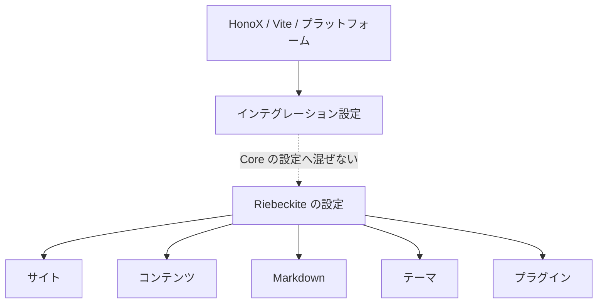

# テーマの設定

テーマは `theme` で設定します。

```ts id="pgj2be"
theme: {
  colorMode: "system",
  articleLayout: "article",
}
```

テーマの設定を直接書く方法と、宣言済みのテーマを利用する方法があります。

テーマは表示に関する設定です。

HonoX、Vite、Cloudflare など、インテグレーション固有の設定を Core の設定に混ぜないでください。


