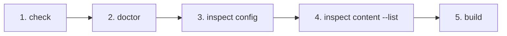

# 外部 Vault のトラブルシュート

外部 Vault や複雑なディレクトリ構成を使っている場合は、次の順番で確認すると、原因を切り分けやすくなります。

設定がカレントディレクトリに依存していないことを確かめるには、アプリケーションの下位ディレクトリから CLI を実行します。

```sh
cd site/app
npm exec riebeckite check
npm exec riebeckite doctor
npm exec riebeckite inspect config
npm exec -- riebeckite inspect content --list
npm exec riebeckite build
```



## 1. 設定を検証する

```sh id="7x4ypg"
npm exec riebeckite check
```

設定とプラグインの取り決めが正しいかを確認します。

## 2. コンテンツソースを診断する

```sh id="t7e22k"
npm exec riebeckite doctor
```

ファイルシステムのコンテンツソースが存在しない、読み込めないなどの問題を確認します。

## 3. 解決されたディレクトリを確認する

```sh id="rgnpgo"
npm exec riebeckite inspect config
```

`content.directory` が、期待する絶対パスに解決されているかを確認します。

## 4. コンテンツを確認する

```sh id="4ssq64"
npm exec -- riebeckite inspect content --list
```

WikiLink や埋め込みを調査する前に、期待する論理パスとコンテンツが認識されていることを確認します。

## 5. 実際にビルドする

```sh id="9wnm73"
npm exec riebeckite build
```

最後に、インテグレーション、SSG、ルートのレンダリングまで含めて確認します。

`riebeckite.config.ts` を Vite アプリケーションの外に置く場合は、`riebeckiteVite()` に `configRoot` を渡します。`appRoot` はサイトのルートに保ち、相対的な `content.directory` はそのルートを基準に解決します。
