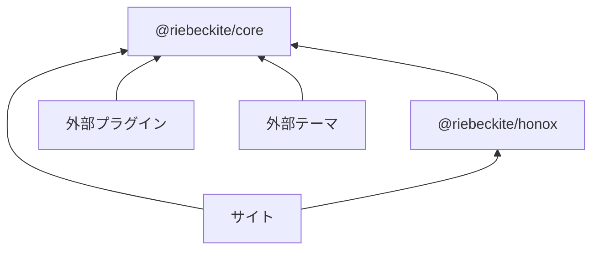
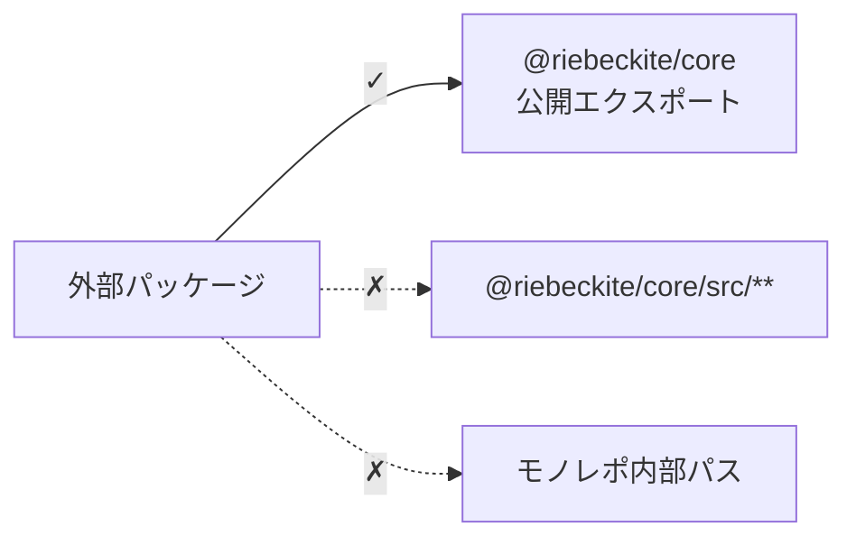

# 公開パッケージ

外部のプラグイン、テーマ、サイトは、**公開パッケージと公開エクスポートだけ**に依存してください。

主なパッケージは次のとおりです。

| パッケージ | 公開するもの | ドキュメント |
| --- | --- | --- |
| `@riebeckite/core` | `defineConfig`、`definePlugin`、`defineTheme`、コンテンツ API、パイプライン API、診断、可観測性の型 | [README](https://github.com/Rerurate514/riebeckite/blob/main/packages/core/README_ja.md) · [Core API](./core-api.ja.md) |
| `@riebeckite/cli` | `riebeckite` CLI | [README](https://github.com/Rerurate514/riebeckite/blob/main/packages/cli/README_ja.md) · [CLI リファレンス](./cli.ja.md) |
| `@riebeckite/honox` | HonoX / Vite との統合。`server` subpath に route / SSG helper（`resolveRiebeckiteRoute`、`resolveRiebeckiteContentRequest`、`resolveRiebeckiteHomeRequest`、`contentRouteSsgParams`、`riebeckiteSsgParams`）、`ui` subpath に article / site の UI primitive（`Article`、`ArticleBody`、`PageBody`、`ArticleContent`）を公開 | [README](https://github.com/Rerurate514/riebeckite/blob/main/packages/integrations/honox/README_ja.md) · [HonoX との統合](../framework/honox-integration.ja.md) |
| `@riebeckite/dev-inspector` | 開発時専用インスペクターオーバーレイ | [README](https://github.com/Rerurate514/riebeckite/blob/main/packages/dev-inspector/README_ja.md) · [インスペクター](../framework/inspector.ja.md) |
| `create-riebeckite` | `create-riebeckite` スキャフォールド CLI | [README](https://github.com/Rerurate514/riebeckite/blob/main/packages/create-riebeckite/README_ja.md) · [クイックスタート](../getting-started/quick-start.ja.md) |
| `@riebeckite/diagnostics` | CLI と integration が共有する開発診断 | [README](https://github.com/Rerurate514/riebeckite/blob/main/packages/diagnostics/README_ja.md) · [診断](../framework/diagnostics.ja.md) |
| `@riebeckite/diagram` | 図表プラグインが共有する基盤 | [README](https://github.com/Rerurate514/riebeckite/blob/main/packages/diagram/README_ja.md) · [ダイアグラムプラグイン基盤](../framework/diagram-infrastructure.ja.md) |
| `@riebeckite/graph` | Local Graph と Garden Explorer が共有する力学グラフのエンジン、フィルター、グループ、設定 | [README](https://github.com/Rerurate514/riebeckite/blob/main/packages/graph/README_ja.md) · [Local Graph](../plugins/local-graph.ja.md) · [Garden Explorer](../plugins/garden-explorer.ja.md) |
| `@riebeckite/preview` | 安全な Markdown プレビューランタイム | [README](https://github.com/Rerurate514/riebeckite/blob/main/packages/preview/README_ja.md) · [プレビュー API](./preview.ja.md) |
| `@riebeckite/og-image` | Open Graph 画像の描画ヘルパー | [README](https://github.com/Rerurate514/riebeckite/blob/main/packages/og-image/README_ja.md) |
| `@riebeckite/runtime` | メインスレッド、worker、WASM worker、サンドボックス iframe 実行の型付きライフサイクル契約 | [README](https://github.com/Rerurate514/riebeckite/blob/main/packages/runtime/README_ja.md) · [Interactive Runtime](../framework/interactive-runtime.ja.md) |
| `@riebeckite/spa` | 任意で有効にする SPA ナビゲーションランタイム | [README](https://github.com/Rerurate514/riebeckite/blob/main/packages/spa/README_ja.md) · [SPA ナビゲーションの構造](../framework/spa-navigation.ja.md) |
| `@riebeckite/ui` | integration とプラグインが共有する UI コンテキストと、任意で使えるヘッドレス primitive（`drawer`、`dialog`、`tabs`、`copy`、`behaviors`）、Drawer CSS | [README](https://github.com/Rerurate514/riebeckite/blob/main/packages/ui/README_ja.md) · [UI](../framework/ui.ja.md) |
| `@riebeckite/analytics-cloudflare` | analytics 用の Cloudflare Workers ・ D1・ KV ランタイム | [README](https://github.com/Rerurate514/riebeckite/blob/main/packages/integrations/analytics-cloudflare/README_ja.md) · [Cloudflare Worker](../guides/analytics/worker.ja.md) |
| `@riebeckite/webmention-cloudflare` | Webmention 用の Cloudflare Workers ・ D1・ KV ランタイム | [README](https://github.com/Rerurate514/riebeckite/blob/main/packages/integrations/webmention-cloudflare/README_ja.md) · [Webmention](../plugins/webmention.ja.md) |
| `@riebeckite/test` | テストヘルパー（`assertGolden`、`assertGoldenJson`）。`e2e` subpath に packed tarball の外部サイトエンジン、`fixtures` に Markdown fixture と一時ディレクトリの helper | [README](https://github.com/Rerurate514/riebeckite/blob/main/packages/test/README_ja.md) · [テスト](../framework/testing.ja.md) |
| `@riebeckite/node` | Node.js 向けアダプター。ファイルシステムから読み込む `FileSystemContentSource` とパス用ヘルパー | [README](https://github.com/Rerurate514/riebeckite/blob/main/packages/node/README_ja.md) · [ソースと管理](../framework/content-system/sources.ja.md) |
| `@riebeckite/git-history` | プラグインが共有する Git リポジトリへのアクセス。`test-support` subpath にテスト用の使い捨てリポジトリ | [README](https://github.com/Rerurate514/riebeckite/blob/main/packages/git-history/README_ja.md) |
| `@riebeckite/plugin-*` | プラグインのファクトリと、ドキュメント化された subpath エクスポート | [プラグインのドキュメント](../plugins/README.ja.md) |
| `@riebeckite/theme-*` | テーマのファクトリと CSS エクスポート | [テーマのドキュメント](../themes/README.ja.md) |

`@riebeckite/diagnostics`、`@riebeckite/node`、`@riebeckite/git-history` は、公式プラグインとフレームワーク内部で共有するパッケージです。個別の API ページはなく、使う場所は各機能のページ（たとえば [ContentSource](../framework/content-system/sources.ja.md)）で説明します。

依存関係は概ね次のようになります。



外部パッケージから Riebeckite モノレポの内部実装へ直接依存しないことが重要です。

## 公開 API と内部 API

外部パッケージでは、パッケージの公開エクスポートを利用します。

たとえば、次のようにインポートします。

```ts
import {
  definePlugin,
  escapeHtml,
} from "@riebeckite/core";
```

一方、次のようなインポートは使用しないでください。

```ts
import {
  something,
} from "@riebeckite/core/src/...";
```

また、次のような Riebeckite モノレポ内部のパスにも依存しないでください。

```text
../../../../packages/core/...
```



公開 API は外部利用を前提とした取り決めです。`src/**` やモノレポ内部のパスは実装の詳細であり、パッケージの更新によって変更される可能性があります。
