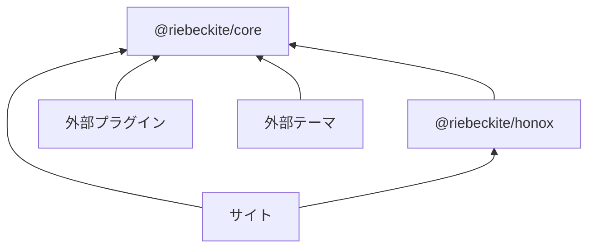
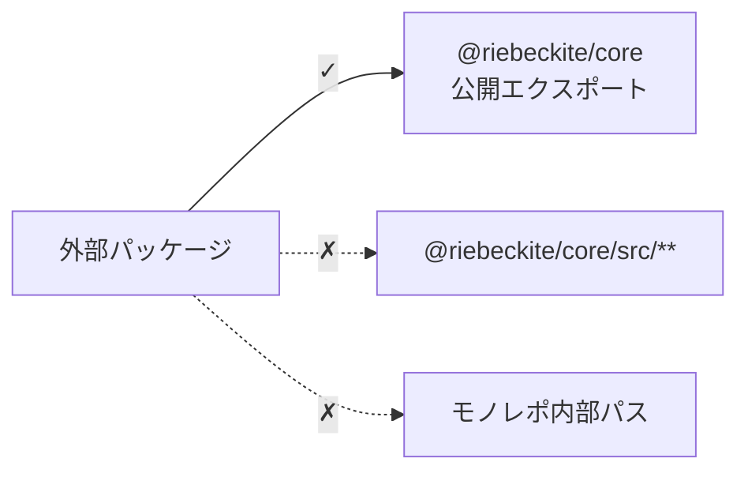

# 公開パッケージ

外部のプラグイン、テーマ、サイトは、**公開パッケージと公開エクスポートだけ**に依存してください。

主なパッケージは次のとおりです。

| パッケージ | 公開するもの |
| --- | --- |
| `@riebeckite/core` | `defineConfig`、`definePlugin`、`defineTheme`、コンテンツ API、パイプライン API、診断、可観測性の型 |
| `@riebeckite/cli` | `riebeckite` CLI |
| `@riebeckite/honox` | HonoX / Vite との統合とスキャフォールド。`server` subpath に route / SSG helper（`resolveRiebeckiteRoute`、`resolveRiebeckiteContentRequest`、`resolveRiebeckiteHomeRequest`、`contentRouteSsgParams`、`riebeckiteSsgParams`）、`ui` subpath に article / site の UI primitive（`Article`、`ArticleBody`、`PageBody`、`ArticleContent` と各種 Props 型）を公開 |
| `create-riebeckite` | `create-riebeckite` スキャフォールド CLI |
| `@riebeckite/diagnostics` | CLI と integration が共有する開発診断 |
| `@riebeckite/diagram` | 図表プラグインが共有する基盤 |
| `@riebeckite/preview` | 安全な Markdown プレビューランタイム |
| `@riebeckite/spa` | 任意で有効にする SPA ナビゲーションランタイム |
| `@riebeckite/ui` | integration とプラグインが共有する宣言的 UI コンテキスト |
| `@riebeckite/analytics-cloudflare` | analytics 用の Cloudflare Workers ・ D1・ KV ランタイム |
| `@riebeckite/webmention-cloudflare` | Webmention 用の Cloudflare Workers ・ D1・ KV ランタイム |
| `@riebeckite/test` | テストヘルパー（`assertGolden`、`assertGoldenJson`）。`e2e` subpath に packed tarball の外部サイトエンジン |
| `@riebeckite/node` | Node.js 向けアダプター。ファイルシステムから読み込む `FileSystemContentSource` とパス用ヘルパー |
| `@riebeckite/git-history` | プラグインが共有する Git リポジトリへのアクセス。`test-support` subpath にテスト用の使い捨てリポジトリ |
| `@riebeckite/plugin-*` | プラグインのファクトリと、ドキュメント化された subpath エクスポート |
| `@riebeckite/theme-*` | テーマのファクトリと CSS エクスポート |

`@riebeckite/diagnostics`、`@riebeckite/node`、`@riebeckite/git-history` は、公式プラグインとフレームワーク内部で共有するパッケージです。個別の API ページはなく、使う場所は各機能のページ（たとえば [ContentSource](../framework/content-system/sources.ja.md)）で説明します。

依存関係は概ね次のようになります。



外部パッケージから Riebeckite モノレポの内部実装へ直接依存しないことが重要です。

## 公開 API と内部 API

外部パッケージでは、パッケージの公開エクスポートを利用します。

たとえば、次のようにインポートします。

```ts
import {
  definePlugin,
  escapeHtml,
} from "@riebeckite/core";
```

一方、次のようなインポートは使用しないでください。

```ts
import {
  something,
} from "@riebeckite/core/src/...";
```

また、次のような Riebeckite モノレポ内部のパスにも依存しないでください。

```text
../../../../packages/core/...
```



公開 API は外部利用を前提とした取り決めです。`src/**` やモノレポ内部のパスは実装の詳細であり、パッケージの更新によって変更される可能性があります。
