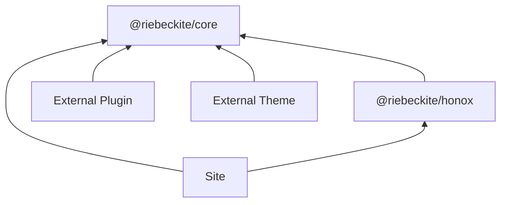
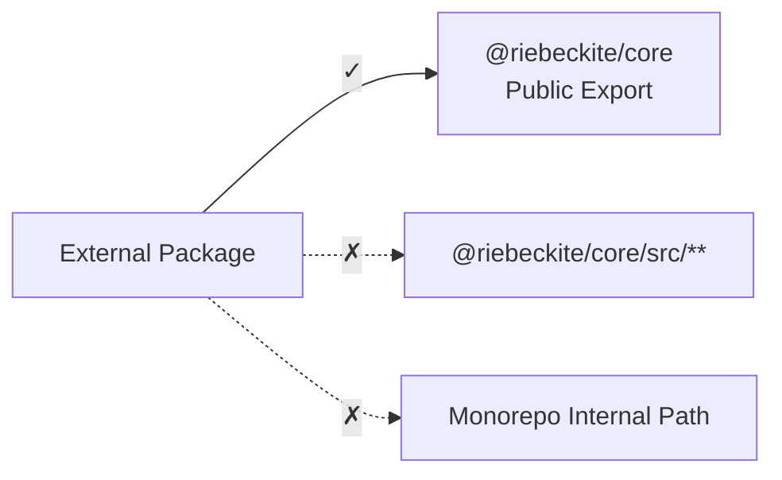

# Packages

## Public packages and imports

External plugins and themes should depend on public packages and public exports only.

| Package | Public surface |
| --- | --- |
| `@riebeckite/core` | `defineConfig`, `definePlugin`, `defineTheme`, content APIs, pipeline APIs, diagnostics, observability types |
| `@riebeckite/cli` | `riebeckite` CLI binary |
| `@riebeckite/honox` | HonoX integration and scaffolding support; the `server` subpath exports the route/SSG helpers (`resolveRiebeckiteRoute`, `resolveRiebeckiteContentRequest`, `resolveRiebeckiteHomeRequest`, `contentRouteSsgParams`, `riebeckiteSsgParams`), and the `ui` subpath exports the article/site UI primitives (`Article`, `ArticleBody`, `PageBody`, `ArticleContent`, and their props) |
| `create-riebeckite` | `create-riebeckite` scaffolding CLI |
| `@riebeckite/diagnostics` | Shared development diagnostics for the CLI and integrations |
| `@riebeckite/diagram` | Shared diagram infrastructure for diagram plugins |
| `@riebeckite/preview` | Secure Markdown preview runtime |
| `@riebeckite/spa` | Opt-in SPA navigation runtime |
| `@riebeckite/ui` | Shared UI context plus optional headless primitives (`drawer`, `dialog`, `tabs`, `copy`, `behaviors`) and Drawer CSS |
| `@riebeckite/analytics-cloudflare` | Cloudflare Workers, D1, and KV runtime for analytics |
| `@riebeckite/webmention-cloudflare` | Cloudflare Workers, D1, and KV runtime for Webmentions |
| `@riebeckite/test` | Test helpers (`assertGolden`, `assertGoldenJson`); the `e2e` subpath exports the packed-tarball external-site engine |
| `@riebeckite/node` | Node.js adapters; `FileSystemContentSource` and path helpers for filesystem-backed content |
| `@riebeckite/git-history` | Git repository access shared by plugins; the `test-support` subpath exports a throw-away repository for tests |
| `@riebeckite/plugin-*` | Plugin factory and documented subpath exports |
| `@riebeckite/theme-*` | Theme factory and CSS exports |

The dependencies are roughly as follows.



It is important that external packages do not depend directly on Riebeckite monorepo internals.

## Public API and internal API

External packages use a package's public exports. For example:

```ts
import {
  definePlugin,
  escapeHtml,
} from "@riebeckite/core";
```

Do not use imports such as:

```ts
import {
  something,
} from "@riebeckite/core/src/...";
```

Nor should you depend on Riebeckite monorepo-internal paths such as:

```text
../../../../packages/core/...
```



Do not import from `@riebeckite/core/src/**` or from monorepo-internal paths in external packages.

The public API is a contract intended for external use. `src/**` and monorepo-internal paths are implementation details and may change between package releases.
