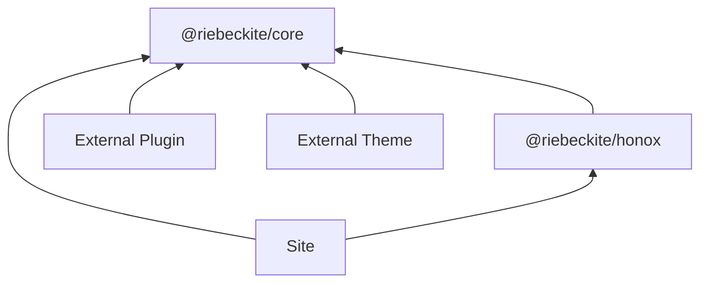
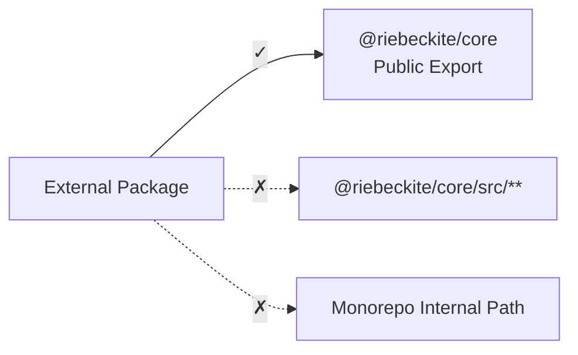

# Packages

## Public packages and imports

External plugins and themes should depend on public packages and public exports only.

| Package | Public surface | Documentation |
| --- | --- | --- |
| `@riebeckite/core` | `defineConfig`, `definePlugin`, `defineTheme`, content APIs, pipeline APIs, diagnostics, observability types | [README](https://github.com/Rerurate514/riebeckite/blob/main/packages/core/README.md) · [Core API](./core-api.md) |
| `@riebeckite/cli` | `riebeckite` CLI binary | [README](https://github.com/Rerurate514/riebeckite/blob/main/packages/cli/README.md) · [CLI Reference](./cli.md) |
| `@riebeckite/honox` | HonoX / Vite integration; the `server` subpath exports the route/SSG helpers (`resolveRiebeckiteRoute`, `resolveRiebeckiteContentRequest`, `resolveRiebeckiteHomeRequest`, `contentRouteSsgParams`, `riebeckiteSsgParams`), and the `ui` subpath exports the article/site UI primitives (`Article`, `ArticleBody`, `PageBody`, `ArticleContent`) | [README](https://github.com/Rerurate514/riebeckite/blob/main/packages/integrations/honox/README.md) · [HonoX Integration](../framework/honox-integration.md) |
| `@riebeckite/dev-inspector` | Development-only inspector overlay for Riebeckite sites | [README](https://github.com/Rerurate514/riebeckite/blob/main/packages/dev-inspector/README.md) · [Inspector](../framework/inspector.md) |
| `create-riebeckite` | `create-riebeckite` scaffolding CLI | [README](https://github.com/Rerurate514/riebeckite/blob/main/packages/create-riebeckite/README.md) · [Quick Start](../getting-started/quick-start.md) |
| `@riebeckite/diagnostics` | Shared development diagnostics for the CLI and integrations | [README](https://github.com/Rerurate514/riebeckite/blob/main/packages/diagnostics/README.md) · [Diagnostics](../framework/diagnostics.md) |
| `@riebeckite/diagram` | Shared diagram infrastructure for diagram plugins | [README](https://github.com/Rerurate514/riebeckite/blob/main/packages/diagram/README.md) · [Diagram Plugin Infrastructure](../framework/diagram-infrastructure.md) |
| `@riebeckite/graph` | Shared force-directed graph engine, filters, groups, and settings for Local Graph and Garden Explorer | [README](https://github.com/Rerurate514/riebeckite/blob/main/packages/graph/README.md) · [Local Graph](../plugins/local-graph.md) · [Garden Explorer](../plugins/garden-explorer.md) |
| `@riebeckite/preview` | Secure Markdown preview runtime | [README](https://github.com/Rerurate514/riebeckite/blob/main/packages/preview/README.md) · [Preview API](./preview.md) |
| `@riebeckite/og-image` | Open Graph image rendering helpers | [README](https://github.com/Rerurate514/riebeckite/blob/main/packages/og-image/README.md) |
| `@riebeckite/runtime` | Typed lifecycle contracts for main-thread, worker, WASM worker, and sandboxed iframe runtimes | [README](https://github.com/Rerurate514/riebeckite/blob/main/packages/runtime/README.md) · [Interactive Runtime](../framework/interactive-runtime.md) |
| `@riebeckite/spa` | Opt-in SPA navigation runtime | [README](https://github.com/Rerurate514/riebeckite/blob/main/packages/spa/README.md) · [SPA Navigation](../framework/spa-navigation.md) |
| `@riebeckite/ui` | Shared UI context plus optional headless primitives (`drawer`, `dialog`, `tabs`, `copy`, `behaviors`) and Drawer CSS | [README](https://github.com/Rerurate514/riebeckite/blob/main/packages/ui/README.md) · [UI](../framework/ui.md) |
| `@riebeckite/analytics-cloudflare` | Cloudflare Workers, D1, and KV runtime for analytics | [README](https://github.com/Rerurate514/riebeckite/blob/main/packages/integrations/analytics-cloudflare/README.md) · [Cloudflare Worker](../guides/analytics/worker.md) |
| `@riebeckite/webmention-cloudflare` | Cloudflare Workers, D1, and KV runtime for Webmentions | [README](https://github.com/Rerurate514/riebeckite/blob/main/packages/integrations/webmention-cloudflare/README.md) · [Webmention](../plugins/webmention.md) |
| `@riebeckite/test` | Test helpers (`assertGolden`, `assertGoldenJson`); the `e2e` subpath exports the packed-tarball external-site engine and `fixtures` exports Markdown fixture and temporary-directory helpers | [README](https://github.com/Rerurate514/riebeckite/blob/main/packages/test/README.md) · [Testing](../framework/testing.md) |
| `@riebeckite/node` | Node.js adapters; `FileSystemContentSource` and path helpers for filesystem-backed content | [README](https://github.com/Rerurate514/riebeckite/blob/main/packages/node/README.md) · [Sources and management](../framework/content-system/sources.md) |
| `@riebeckite/git-history` | Git repository access shared by plugins; the `test-support` subpath exports a throw-away repository for tests | [README](https://github.com/Rerurate514/riebeckite/blob/main/packages/git-history/README.md) |
| `@riebeckite/plugin-*` | Plugin factory and documented subpath exports | [Plugin documentation](../plugins/README.md) |
| `@riebeckite/theme-*` | Theme factory and CSS exports | [Theme documentation](../themes/README.md) |

`@riebeckite/diagnostics`, `@riebeckite/node`, and `@riebeckite/git-history` are shared by official plugins and framework internals. They do not have separate API pages; the pages that use them describe the relevant exports, such as [ContentSource](../framework/content-system/sources.md).

The dependencies are roughly as follows.



It is important that external packages do not depend directly on Riebeckite monorepo internals.

## Public API and internal API

External packages use a package's public exports. For example:

```ts
import {
  definePlugin,
  escapeHtml,
} from "@riebeckite/core";
```

Do not use imports such as:

```ts
import {
  something,
} from "@riebeckite/core/src/...";
```

Nor should you depend on Riebeckite monorepo-internal paths such as:

```text
../../../../packages/core/...
```



Do not import from `@riebeckite/core/src/**` or from monorepo-internal paths in external packages.

The public API is a contract intended for external use. `src/**` and monorepo-internal paths are implementation details and may change between package releases.
