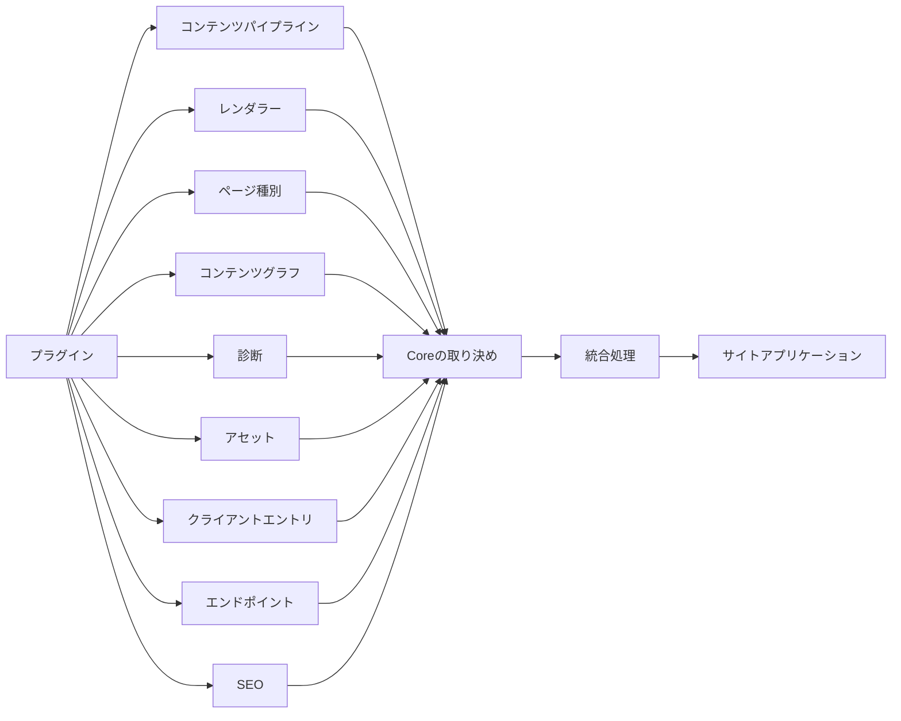

# プラグインシステム

Riebeckiteの[[plugin|プラグイン]]は、Coreやサイトアプリケーションへ直接手を入れず、再利用できる形で機能を追加するための仕組みです。

[[glossary/plugin|プラグイン]]では、たとえば次のような機能を追加できます。

- Markdown や HTML の変換
- コンテンツの処理
- 独自形式の埋め込み表示
- 独立したページ
- CSS
- ブラウザ上で動く処理
- HTTP エンドポイント
- SEO
- 診断
- [[glossary/content-graph|コンテンツグラフ]]の拡張

プラグインは、必要な機能だけを実装します。

## このページの構成

- [基本の契約](./plugin-api/basics.ja.md)
- [コンテンツ処理](./plugin-api/content-processing.ja.md)
- [UI ・アセット・実行時連携](./plugin-api/ui-and-assets.ja.md)
- [配布とパッケージ構成](./plugin-api/distribution.ja.md)

## プラグインシステムの全体像

[[framework/plugin-system|プラグインシステム]]は、次のような役割分担で構成されます。

基本原則は、**必要な最小の拡張ポイントだけを使い、フレームワークがすでに解決した情報をプラグイン側で作り直さないこと**です。

プラグインは再利用できる機能を提供し、Core はそのための取り決めを提供します。統合処理はフレームワークやプラットフォームへ接続し、サイトアプリケーションが最終的なルート、HTML 文書、UI を所有します。

## 関連

- [アーキテクチャ](../framework/architecture.ja.md)
- [コンテンツシステム](../framework/content-system.ja.md)
- [プラグインの独立ページ](../framework/page-system.ja.md)
- [テスト](../framework/testing.ja.md)
- [可観測性](../framework/observability.ja.md)
- [テーマ API](./theme-api.ja.md)
- [フレームワークリファレンス](./README.ja.md)
