# プラグインシステム

Riebeckiteの[[plugin|プラグイン]]は、Coreやサイトアプリケーションへ直接手を入れず、再利用できる形で機能を追加するための仕組みです。

プラグインでは、たとえば次のような機能を追加できます。

- MarkdownやHTMLの変換
- コンテンツの処理
- 独自形式の埋め込み表示
- 独立したページ
- CSS
- ブラウザ上で動く処理
- HTTPエンドポイント
- SEO
- 診断
- コンテンツグラフの拡張

プラグインは、必要な機能だけを実装します。

## どの拡張ポイントを使うか

プラグインを作るときは、まず**目的に合った最小の拡張ポイント**を選びます。

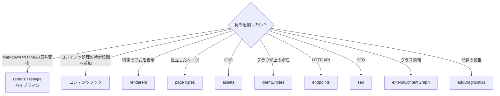

たとえば、CanvasやExcalidrawを記事内へ表示するなら `renderers`、`/explore` のような独立したページを提供するなら `pageTypes` を使います。独立した画面が必要だからといって、プラグイン固有のHonoXルートを追加するわけではありません。

## 最小のプラグイン

最も小さいプラグインは、次のように作れます。

```ts
import { definePlugin } from "@riebeckite/core";

export function example() {
  return definePlugin({
    name: "example",
  });
}
```

プラグインに設定を持たせる場合は、ファクトリ関数の引数として受け取ります。

```ts
type ExampleOptions = {
  enabled?: boolean;
};

export function example(
  options: ExampleOptions = {},
) {
  return definePlugin({
    name: "example",
    options,
  });
}
```

`definePlugin()` が、プラグイン共通の取り決めを提供します。

## プラグインが持てる機能

`RiebeckitePlugin` には、主に次の拡張ポイントがあります。

| 分類 | 主なAPI |
| --- | --- |
| 基本情報 | `name`, `enabled`, `order`, `options` |
| 依存関係 | `provides`, `requires`, `optional` |
| 設定の検証 | `validateOptions` |
| キャッシュ | `cacheVersion`, `context.cache` |
| ライフサイクル | `setup`, `buildStart`, `buildEnd`, `dispose` |
| コンテンツ | `onConfigResolved`, `onContentLoaded`, `onPostParsed`, `onPostProcessed`, `onManifestCreated` |
| 公開先 | `resolveContentLocations` |
| Markdown / HTML | `remarkPlugins`, `rehypePlugins`, `extendMarkdownPipeline`, `extendHtmlPipeline` |
| グラフ | `extendContentGraph` |
| 診断 | `addDiagnostics` |
| 埋め込み表示 | `renderers` |
| 独立ページ | `pageTypes` |
| ブラウザ | `assets`, `clientEntries` |
| HTTP | `endpoints` |
| SEO | `seo` |

この中から、**必要なものだけ**を使ってください。

## 開発時のルートマニフェスト

開発時は、記事HTMLを処理する前に frontmatter とリンクのメタデータでルートを解決します。`extendContentGraph` または `onManifestCreated` を使うプラグインは、`entry.html === ""` でも処理が正しく、生成物やアセット変換を必要とせず、開発サーバーでも実行が必要な場合に限り `developmentRouteManifest: true` を指定します。それ以外のマニフェストへ影響するプラグインは、互換性を保つため開発時も Full Manifest を使います。

## プラグインを有効にする

プラグインは、`riebeckite.config.ts` の `plugins` へ追加します。

```ts
plugins: [
  my(),
]
```

条件付きで有効化することもできます。

```ts
plugins: [
  condition && my(),
]
```

`false`、`null`、`undefined` は、プラグインを解決するときに除外されます。また、`enabled: false` を指定したプラグインも実行されません。

```ts
enabled: false
```

## 実行順と依存関係

`order` は、変換やレンダラーの優先順を決まったものにするための基本順です。プラグイン同士に機能の提供・利用関係がなく、パイプライン内の実行順だけを決めたい場合に使います。

一方、プラグイン同士に実際の提供・利用関係がある場合は、`order` ではなく**ケイパビリティ**を使います。変換順を表すためだけのケイパビリティは作成しないでください。

```ts
definePlugin({
  name: "consumer",

  provides: [
    "example.output",
  ],
  requires: [
    "content.graph",
  ],
  optional: [
    "example.optional",
  ],
});
```

それぞれの意味は次のとおりです。

| 項目 | 意味 |
| --- | --- |
| `provides` | このプラグインが提供する機能 |
| `requires` | 必ず必要な機能 |
| `optional` | あれば利用する機能 |

依存関係の解決処理は、提供側を利用側より前に置くよう実行順を決めます。

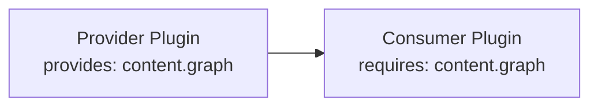

次の状態は設定エラーになります。

- 必須の[[capability|ケイパビリティ]]が存在しない
- 同じケイパビリティを複数のプラグインが提供している
- 依存関係が循環している

解決に失敗した場合は、`PluginDependencyError`（`@riebeckite/core` からインポート可能）を投げます。`kind` と `pluginName` から原因を特定できます。依存関係のないプラグインについては、入力順をできるだけ維持します。

## オプションの検証

TypeScriptの型だけでは、実行時に渡される設定値が必ず正しいとは限りません。必要なプラグインは `validateOptions` を実装できます。

検証は、次の流れで行われます。

```text
プラグインのオプション
      ↓
validateOptions
      ↓
構造化された問題
      ↓
設定の検証
```

検証処理では、**設定の確認だけ**を行ってください。ファイルシステムの走査、ビルド、キャッシュへの書き込み、外部状態の変更などは行いません。問題は構造化された値として返し、Riebeckiteの設定検証がまとめて表示できるようにします。

## プラグインに渡されるコンテキスト

プラグインは、フレームワークの機能を `PluginContext` から受け取ります。基本的なコンテキストは、概念的には次のようなものです。

```ts
type PluginContext = {
  config?: ResolvedRiebeckiteConfig;
  contentIndex: Map<string, string>;
  diagnostics: Diagnostic[];
  cache: PluginCache;
  output: GeneratedOutputSink;
  logger: Logger;
  tracer: Tracer;
  contentSource?: ContentSource;
};
```

フックによって、`slug`、`markdown`、`content`、`manifest`、`entries`、公開先を決めるための入力などが追加されます。

プラグイン内でグローバルなシングルトンを作るより、コンテキストからフレームワークの機能を受け取ってください。

## ライフサイクル

プラグインには、フレームワーク全体のライフサイクルと、コンテンツ処理のライフサイクルがあります。

フレームワーク側の主なフックは `setup`、`buildStart`、`buildEnd` です。`dispose` は、プラグインが確保したリソースを解放するために使います。

`setup`、`buildStart`、`onConfigResolved`、コンテンツ処理、`buildEnd` は、1つの `ContentManager` につき一度だけ実行されます。`buildEnd` は、診断情報を集めたあとの完成したマニフェストを受け取る唯一の終了フックです。`dispose` は、解決済みプラグインの逆順で実行されます。

名前付きのライフサイクルフックやコンテンツフックでエラーが起きた場合は、そのまま上位へ伝えます。エラーは `PluginHookError`（`@riebeckite/core` からインポート可能）です。`message` は `Plugin "<name>" failed during "<hook>"` の形式になり、元のエラーは `cause` に保持されます。コンテンツフックで起きた場合は、対象ファイルが `path`（例: `note.md`）として設定されます。

## コンテンツ処理の流れ

コンテンツ処理は、概念的には次の順番で進みます。

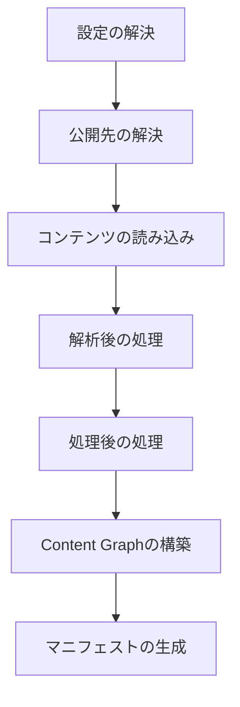

全体の順序は、`setup` → `buildStart` → `onConfigResolved` → 公開先の解決です。続いて `onContentLoaded` → Markdown / HTMLパイプライン → `onPostParsed` → `onPostProcessed` と進みます。最後に `extendContentGraph` → `onManifestCreated` → 診断 → `buildEnd` です。

**必要な段階のフックだけを使ってください**。後続の段階で得られる情報を、前の段階で独自に作り直す必要はありません。

## MarkdownとHTMLの変換

MarkdownやHTMLの意味を変換する場合は、パイプラインを使います。簡単なremark / rehypeプラグインなら、配列として直接宣言できます。

```ts
definePlugin({
  name: "example",

  remarkPlugins: [
    remarkExample,
  ],

  rehypePlugins: [
    rehypeExample,
  ],
});
```

パイプライン自体を構成する必要がある場合は、拡張APIを使います。

```ts
definePlugin({
  name: "example",

  extendMarkdownPipeline(pipeline) {
    pipeline.use(remarkExample);
  },

  extendHtmlPipeline(pipeline) {
    pipeline.use(rehypeExample);
  },
});
```

Markdown ASTやHTML ASTの処理は、アプリケーションのコンポーネントへ持ち込まず、プラグインのパイプライン処理として実装します。

```ts
definePlugin({
  name: "citations",

  processedContentCache: {
    version: "citations-v1",
    dependencyMode: "tracked",
  },

  extendMarkdownPipeline(pipeline, context) {
    pipeline.use(remarkCitations, { contentSource: context.contentSource });
  },
});
```

## 埋め込みコンテンツの描画

レンダラーは、描画対象の情報（`kind`、`path`、`raw`、`label`、`url`、`embed`）と通常のプラグインコンテキストを受け取ります。対象を処理しない場合は `null` を返し、別のレンダラーが処理できるようにします。

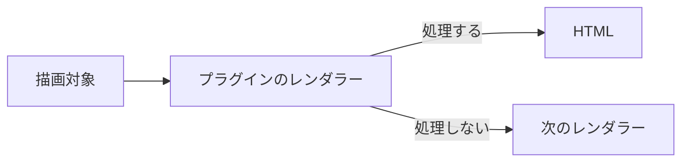

## UIコンポーネント

プラグインは、ファクトリから `PluginComponent<Props>` と `PluginDataHelper<Input, Model>` をエクスポートできます。データヘルパーは `PublicContentView` のような狭い入力を受け取り、型付きのモデルを返します。コンポーネントは読み取り専用の型付きpropsを受け取り、描画結果を返します。サイトは自身のTSXでこれらのコンポーネントを組み合わせ、表示するかどうか、位置、頻度を決めます。

典型的なエクスポートの形は次のとおりです。

```ts
// index.ts
export function example() {
  return definePlugin({
    name: "example",
    // ... factory hooks, assets, clientEntries, etc.
  });
}

export { MyComponent, getMyData };
```

より整理された形にするなら、プラグインの `./components/` の下に置けます。

```text
packages/plugins/example/
├─ index.ts
├─ components/
│  ├─ my-component.tsx   // <MyComponent /> と getMyData を export
│  └─ types.ts
├─ style.css
└─ client.ts
```

サイト側では、これをインポートして描画します。

```tsx
import { getMyData } from "@riebeckite/plugin-example";
import { MyComponent } from "@riebeckite/plugin-example/components";

const model = getMyData({ view, frontmatter: entry.frontmatter });
<MyComponent model={model} />
```

コンポーネントは、内部で使うCSSやクライアントコードを選択してエクスポートすることもできます。登録は既存の連携処理を通じて行われます。アセットとクライアントコードの登録は、引き続きプラグインのファクトリが担当します。コンポーネントをインポートしただけでは、CSSやクライアントランタイムは登録されず、プラグインの機能も有効になりません。CSSのツリーシェイキングは、既存のパッケージの `sideEffects` メタデータに従います。

### SPAナビゲーション時の配置

コンポーネントはサーバーのリクエストに対して描画するもので、配置やブラウザ上でいつ置き換えるかは決めません。ページの内容に属するコンポーネントは、Siteが `main#main-content` に置きます。シェルの出力が現在のURL、言語、ページデータに依存する場合は、相互に遷移するすべてのルートで、安定して一意な `data-spa-region` で囲みます。

```tsx
<aside data-spa-region="docs-navigation">
  <DocsSidebar />
</aside>
```

クライアントの動作はコンポーネントの所有者ではなくDOMの寿命に従います。`main` 内のコンテンツ用のクライアントエントリは既定の `page` scopeを使います。置き換わるシェルregion用のクライアントエントリは `app` scopeで実行し、`spa:navigation` の後に初期化し直すか、イベント委譲を使います。Pluginはコンポーネントがどちらに置かれるかを前提にしてはいけません。

HonoXの描画プリミティブとして、`Article`、`ArticleHeader`、`ArticleContent`、`ArticleBody`、`ArticleFooter`、`Sidebar`、`ThemeRoot` があります。これらは記事の構造とレイアウトのための意味的な部品です。プラグインのコンポーネントはプラグインのパッケージに置き、モデルの型やヘルパーとともに公開エントリーポイントからエクスポートします。サイトのTSXはアプリケーションの `app/` に置きます。HonoXは描画のプリミティブだけを所有し、プラグインのコンポーネントを集めたり、順序を決めたりしません。

```tsx
// サイト route にある最小 UI composition
import { getBacklinks } from "@riebeckite/core";
import { MyComponent } from "@riebeckite/plugin-example";

const view = createPublicContentView(manifest);
const entry = view.findRoutableBySlug(slug);
const backlinks = await getBacklinks({ view, slug });
<article>
  <MyComponent backlinks={backlinks} />
  <ArticleBody html={entry.html} />
</article>
```

## マニフェストのコレクションと公開範囲

マニフェストを受け取るフック（`onManifestCreated`、ページの解決処理、レンダラー）では、用途に応じて3つのコレクションを使い分けます。

- `manifest.entries`：スキャンしたソースの生のコレクションです。下書き、予約投稿、非公開のものを含みます。公開用ではないため、公開ページや、読者が記事を見つけるための一覧には描画しないでください。
- `manifest.publicEntries`：到達可能なエントリ（`public` と `unlisted`）です。サイトマップなど、到達可能なすべてのURLを網羅する出力に使います。`unlisted` が含まれる点に注意してください。
- `manifest.discoverableEntries`：一覧に表示してよいエントリ（`public` のみ）です。関連記事、新着、タグページ、検索インデックスなど、読者が一覧から辿るUIにはこちらを使います。

`frontmatter` から公開状態を判定し直したり、`publishAt` の処理を独自に実装したりしないでください。フックで条件分岐が必要な場合は、解決済みの `entry.publishing`（`visibility`、`routable`、`discoverable`）を参照します。それ以外の場合は、判定結果を反映済みのコレクションを選んでください。公開方針は [設定](./configuration.ja.md) で指定します。

## プラグインが提供する独立ページ

`pageTypes` を使うと、プラグインが独立したページを提供できます。たとえば `/explore` や `/report` のようなページです。

```ts
definePlugin({
  name: "example-pages",

  pageTypes: [
    {
      id: "example.report",
      paths: ["/report"],
      resolve: ({ pathname, manifest }) =>
        pathname === "/report"
          ? {
              type: "example.report",
              pathname,
              body: `<p>${manifest.discoverableEntries.length}</p>`,
            }
          : null,
    },
  ],
});
```

プラグインがアプリケーションのルートを直接追加する必要はありません。

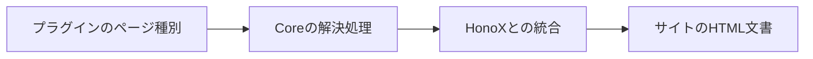

ページ種別では、次の項目を宣言します。

- 一意なID
- 静的生成のパス
- ページを解決する関数
- 必要に応じて `priority`

ページは `body` に加えて、`title`、`description`、`headTags`、`language` も返せます。ただし、これらを最終的なHTMLのどこに描画するかはサイトアプリケーションが決めます。

詳しくは [プラグインの独立ページ](../framework/page-system.ja.md) を参照してください。

## 処理済みコンテンツのビルド依存関係

増分更新の対象を決めるのはCoreの役割です。プラグインは `processedContentCache` でキャッシュの前提を宣言し、影響を受けるコンテンツの判定を独自に実装しないでください。

```ts
processedContentCache: {
  version: "example-v1",
  dependencyMode: "tracked",
}
```

- `none` は、変換結果がソースのコンテンツ、frontmatter、オプション、宣言したバージョンだけに依存する場合に使います。
- `tracked` は、他のコンテンツやファイルをCore経由で読む変換に使います。`context.contentSource`、`readContentSourceEntry`、`renderContent`、`renderNoteEmbed` を使うと、Coreが `ContentDependencyTracker` を通じて読み取りを自動的に記録します。ファイルシステムを直接読まないでください。
- `global` は、Vault全体で解決した公開先に依存する変換に使います。Coreが公開先の集合を指紋化し、変化があったときはすべてのエントリを再処理します。
- `unsafe` は、Git、ネットワーク、時刻、プロセスの状態など、Coreが追跡できない入力に使います。処理済みコンテンツの永続的な再利用を安全側で無効にします。

`tracked` の依存関係は、コンテンツの処理中に記録します。Coreがコンテンツやファイルの識別情報を保存し、その逆引きインデックスから次回の増分ビルドで再処理が必要なコンテンツを決めます。この目的でVaultを独自に走査したり、プラグイン固有の増分ビルド状態を保存したりしないでください。フレームワークのAPIで依存関係を追跡できない場合は `unsafe` を使います。広い範囲の再処理は許容されますが、古い結果の再利用は許されません。

## 出力の依存関係

コンテンツの依存関係は再処理するソースを決め、出力の依存関係は再出力するファイルを決めます。両者は別の取り決めです。

ページ種別は `outputDependencies` を宣言します。`onManifestCreated` で既存のエントリのHTMLを更新するプラグインは、ルートの `contentOutputDependencies` を宣言するか、`resolveContentOutputDependencies({ entry, manifest })` でコンテンツ出力ごとの依存関係を返します。

```ts
resolveContentOutputDependencies: ({ entry, manifest }) =>
  entry.slug === "report"
    ? [{ type: "content-query", properties: ["status", "file.mtime"] }]
    : []

pageTypes: [{
  id: "example.report",
  paths: ["/report"],
  outputDependencies: [{ type: "tag", tag: "release" }],
  resolve: () => null,
}]
```

`content-query` は、一覧に表示できるコンテンツの候補集合と、そこで読むfrontmatterや `file.*` のプロパティを表します。前回の条件に一致しなかったノートでも、追加、削除、公開状態の変化を検出できます。

対象を特定できる場合は `content`、`tag`、`folder` を使います。マニフェスト全体に依存する集合変換は `global` を使います。表現できない入力にだけ `unknown` を使ってください。`unknown` は安全側で再生成し、すべての出力の再生成を要求します。依存関係を宣言しない生成出力も `unknown` として扱われます。

生成出力のパスは、実際に書き出すファイルのパスです。コンテンツ、リダイレクト、プラグインページのルートと衝突させないでください。衝突した場合、ルートを上書きせず、Coreがビルドを失敗させます。

`planGeneratedOutputs` は増分ビルドのたびに実行されるため、変更がないときの高速経路は使いません。任意のプランナー処理に未追跡の入力がないことをCoreは証明できないため、計画を再利用せずに毎回作り直します。

## アセット

プラグイン固有のCSSはプラグインのパッケージ内に置き、`assets` で公開します。

```ts
assets: [
  {
    pluginName: "example",
    kind: "style",
    moduleSpecifier:
      "@riebeckite/plugin-example/style.css",
  },
]
```

プラグインのCSSを `apps/web` へコピーしたり、ブラウザから `/node_modules` を直接参照させたりしないでください。

`createStyleAsset()` と `createClientEntry()` には、プラグイン名と、パッケージが `exports` で公開するモジュール指定子を明示します。そのため、`@riebeckite/plugin-<name>`、サイト内のプラグイン、任意の名前の第三者パッケージで同じAPIを利用できます。

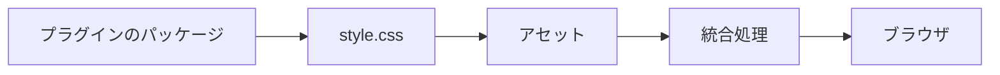

## CSSフック

プラグイン固有のCSSはプラグインのパッケージ内に置き、最も外側の要素に安定したCSSフックを付けます。

フック名には `rr-<feature>` の形式を使います。たとえば `rr-search`、`rr-callout`、`rr-query`、`rr-code` です。

内部の要素にはBEM形式を使えます。

```text
rr-search
rr-search__input
rr-search__result
rr-search--loading
```

プラグイン固有の出力を `rb-*` の名前空間に置かないでください。

| 名前空間 | 用途 |
| --- | --- |
| `rb-*` | フレームワークの構造フック |
| `--rb-*` | フレームワークの意味的なデザイントークン |
| `rr-*` | プラグインと機能のフック |
| `--rr-*` | プラグイン固有のトークン |

出力には `rr-*` のフックだけを使い、プラグインのCSSとテーマも `rr-*` のフックを対象にします。テーマに公開する必要があるフックだけを、安定した取り決めとして文書化してください。

プラグインの既定のCSSはテーマのCSSより先に読み込まれるため、テーマはプラグインのパッケージを変更せずに見た目を上書きできます。

ダークモードへの対応では、`--rb-*` の意味的なトークンを参照するのが基本です。これらのトークンは、ライト、明示的なダーク、システム設定によるダークのいずれでも正しく解決されます。状態そのもので分岐する必要があるのは、ビルド済みの画像を反転する場合などに限られます。その場合は、HTMLのルート要素でも埋め込みテーマの `.rb-theme-root` でも効くように、テーマのルートへスコープしてください。

セレクターは `:is(:root, .rb-theme-root)[data-rb-mode="dark"] <hook>` です。システム設定によるダークモードには `@media (prefers-color-scheme: dark) { :is(:root, .rb-theme-root):not([data-rb-mode]) <hook> { ... } }` を使います。`html[data-rb-mode="dark"]` や `:root:not([data-rb-mode])` だけに依存すると、埋め込みテーマのルートを取りこぼします。フレームワークは `.dark` クラスを付与しないため、`.dark` を前提にしないでください。

詳しくは [テーマAPI](./theme-api.ja.md#安定したcssフック) を参照してください。

## クライアントエントリ

ブラウザ上でJavaScriptを実行する必要がある場合だけ、`clientEntries` を使います。

```ts
clientEntries: [
  {
    pluginName: "example",
    moduleSpecifier:
      "@riebeckite/plugin-example/client",
    exportName: "initExample",
    publicConfig: {
      selector: ".example",
    },
  },
]
```

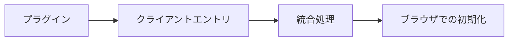

サーバー側の描画やビルドだけで完結するプラグインに、クライアントのJavaScriptを追加しないでください。

`publicConfig` はブラウザへ渡される公開情報です。そのため、次の情報を含めてはいけません。

- トークン
- 認証情報
- 非公開のサービスURL
- 秘密情報

プラグインの `options` が自動的にブラウザへ渡されることもありません。

## HTTPエンドポイント

再利用できるHTTPエンドポイントを提供する場合は、`endpoints` を使います。

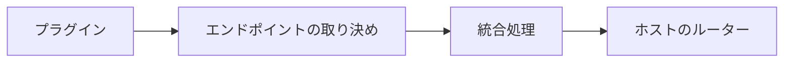

HonoXなど特定のルーター実装をプラグイン本体へ直接埋め込まず、統合処理がエンドポイントの取り決めをホストのルーターへ接続します。

## SEO

メタデータやフィードなどのSEO処理に参加する場合は、`seo` 拡張ポイントを使います。プラグイン固有のSEO処理を、アプリケーションのルート側へ実装し直さないでください。

## 診断

プラグイン固有の問題を報告する場合は、`addDiagnostics` を使います。

```ts
addDiagnostics(context) {
  return [
    {
      // Diagnostic contract
    },
  ];
}
```

診断結果は、可能な限り構造化されたデータとして返してください。CLI向けのメッセージを `console.log(...)` で直接出力するのではなく、診断の仕組みかLoggerを使ってください。

## プラグインのキャッシュ

`context.cache` は、プラグインごとに分離されたビルド時のキャッシュです。保存する値は、次の条件を満たす必要があります。

- 再生成できる
- JSONとして保存できる
- プラグインの名前空間内で完結する

`cacheVersion` を使うと、キャッシュ形式の互換性を管理できます。壊れたキャッシュは、安全にキャッシュの未命中として扱える設計にしてください。書き込みは不可分に行います。

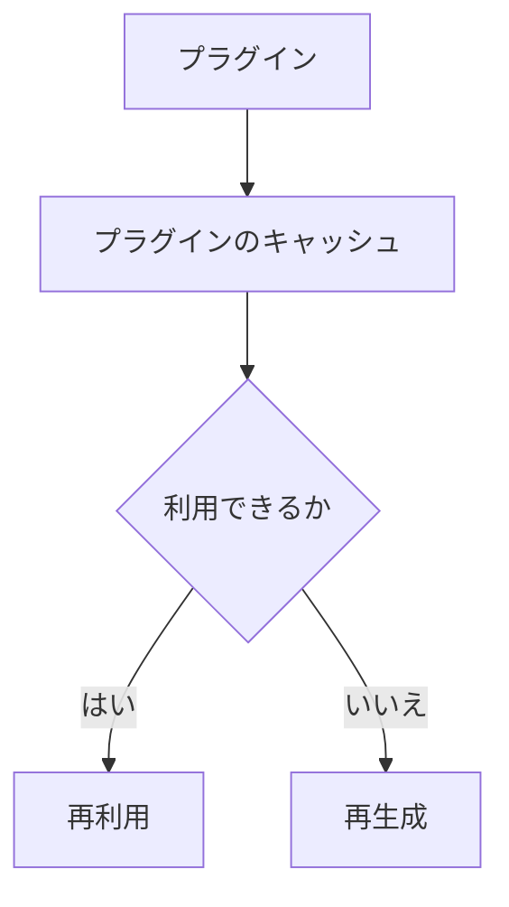

このキャッシュは、Cloudflare Workersなどの実行時データベースではありません。

## ログとトレース

プラグインからフレームワークの可観測性の仕組みを利用できます。

```ts
context.logger.info("...");
await context.tracer.span(
  "plugin.example.work",
  {
    plugin: "example",
  },
  async () => {
    // work
  },
);
```

Loggerは「何が起きたか」を、Tracerは「どこに時間がかかったか」を記録します。Profilerはこの構造化されたトレースを利用するため、プラグインが独自のストップウォッチやプロファイラを作る必要はありません。

## サイト内だけで使うプラグイン

プラグインはnpmパッケージとして公開する必要はありません。サイト内にプラグインを作ることもできます。

```ts
// site/extensions/local-plugin.ts

return definePlugin({
  name: "site-local",

  assets: [
    {
      pluginName: "site-local",
      kind: "style",
      moduleSpecifier:
        "/extensions/plugin.css",
    },
  ],
};
```

作成したプラグインは、`riebeckite.config.ts` の `plugins` へ追加します。

サイト内のプラグインでも、依存関係の解決、パイプラインのフック、診断、レンダラー、エンドポイントなどは、パッケージとして配布するプラグインと同じ取り決めを使います。

`createStyleAsset()` と `createClientEntry()` には、モジュール指定子を明示して渡します。サイト内のプラグインでも、別名の第三者パッケージでも、ホストのバンドラーが解決できるサブパスを指定してください。

## リポジトリ外へプラグインを配布する

外部のプラグインは、Riebeckiteのmonorepo内部のパスに依存しないようにします。基本的には `@riebeckite/core` の公開APIを利用してください。

プラグイン自身が提供する `./client`、`./components`、`./style.css` などは、そのパッケージの `package.json` にある `exports` で公開します。次のようなインポートは避けてください。

```ts
import {
  something,
} from "@riebeckite/core/src/...";
```

`src/**` は公開APIではありません。また、Riebeckiteのmonorepo内にしか存在しない相対パスへ依存しないでください。

公式のプラグインも、可能な限り同じ公開APIの利用者として実装します。

## 推奨するパッケージ構成

公開するパッケージでは、ビルド済みのESMと型定義を公開し、`exports` をそのビルド成果物へ向けます。最小構成の `package.json` は次のとおりです。

```json
{
  "name": "my-riebeckite-plugin",
  "version": "1.0.0",
  "type": "module",
  "main": "./dist/index.js",
  "types": "./dist/index.d.ts",
  "exports": {
    ".": {
      "types": "./dist/index.d.ts",
      "import": "./dist/index.js",
      "default": "./dist/index.js"
    },
    "./client": {
      "types": "./dist/client.d.ts",
      "import": "./dist/client.js",
      "default": "./dist/client.js"
    },
    "./style.css": "./style.css"
  },
  "files": ["dist", "style.css"],
  "scripts": {
    "build": "node build.mjs && tsc -p tsconfig.json",
    "prepack": "npm run build"
  },
  "dependencies": {
    "@riebeckite/core": "^0.0.32",
    "unist-util-visit": "^5.0.0"
  },
  "devDependencies": {
    "@types/mdast": "^4.0.0",
    "esbuild": "^0.28.0",
    "typescript": "^5.0.0"
  }
}
```

`client.ts` や `style.css` を持たないプラグインでは、そのサブパスと `files` の項目を削除します。

JavaScriptのエントリーポイントは `esbuild` でバンドルし、型定義は `tsc` で出力します。どちらも一般的なツールであり、Riebeckite固有のビルドスクリプトは必要ありません。

`build.mjs` の例です。

```js
import { build } from "esbuild";

await build({
  entryPoints: ["index.ts", "client.ts"],
  outdir: "dist",
  bundle: true,
  format: "esm",
  platform: "neutral",
  packages: "external",
  external: ["@riebeckite/*"],
  logLevel: "warning",
});
```

`entryPoints` には、そのパッケージが持つエントリーだけを列挙します。クライアントのエントリーを持たない場合は `index.ts` だけです。

`tsconfig.json` の例です。

```json
{
  "compilerOptions": {
    "declaration": true,
    "emitDeclarationOnly": true,
    "outDir": "dist",
    "rootDir": ".",
    "module": "ESNext",
    "moduleResolution": "Bundler",
    "target": "ESNext",
    "lib": ["ESNext", "DOM", "DOM.Iterable"],
    "strict": true,
    "skipLibCheck": true
  },
  "include": ["index.ts", "client.ts"]
}
```

`prepack` でビルドするようにしておけば、`npm pack` と `npm publish` は常に最新の成果物を含めます。`@riebeckite/core` は `dependencies` に置くのが最も簡単です。サイト側と同じインスタンスを共有したい場合は `peerDependencies` でもかまいません。インポートする変換用の依存関係（`unist-util-visit`、`unified`、remarkやrehypeのパッケージなど）は `dependencies` に宣言してください。公開するパッケージの `exports` をTypeScriptのソース（`./index.ts`）へ向けないでください。

公式のプラグインも、可能な限り同じ公開APIの利用者として実装します。

## プラグインに置くもの

プラグインに置くのは、**Riebeckiteのサイト間で再利用できる機能**です。

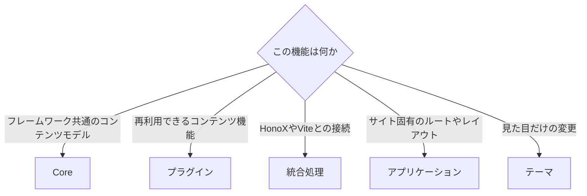

プラグインに向いているのは、次のような機能です。

- MarkdownやHTMLの解釈
- 再利用できるコンテンツの変換
- プラグイン固有のレンダラー
- 再利用できるブラウザ上の動作
- プラグイン固有の診断
- プラグイン固有のエンドポイント
- SEOの拡張
- 独立したプラグインページ

一方、フレームワーク全体のコンテンツモデルはCoreへ、HonoXやViteとの接続は統合処理へ、アプリケーション固有のルートやレイアウトはサイトアプリケーションへ、見た目だけの変更はテーマへ置きます。

## ESM

Riebeckiteのパッケージは、NodeNextとESMを前提とします。ビルド後にNode.jsが実際に解決できるインポートを維持してください。

開発時のTypeScriptローダーが、拡張子のないインポートなどを偶然解決できている状態に依存しないことが重要です。

## プラグインシステムの全体像

プラグインシステムは、次のような役割分担で構成されます。

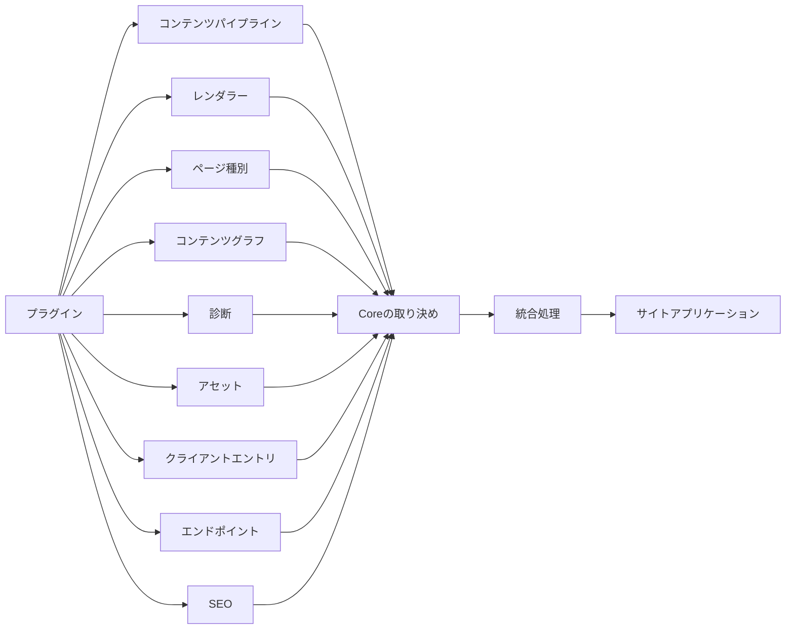

基本原則は、**必要な最小の拡張ポイントだけを使い、フレームワークがすでに解決した情報をプラグイン側で作り直さないこと**です。

プラグインは再利用できる機能を提供し、Coreはそのための取り決めを提供します。統合処理はフレームワークやプラットフォームへ接続し、サイトアプリケーションが最終的なルート、HTML文書、UIを所有します。

## 関連

- [アーキテクチャ](../framework/architecture.ja.md)
- [コンテンツシステム](../framework/content-system.ja.md)
- [プラグインの独立ページ](../framework/page-system.ja.md)
- [テスト](../framework/testing.ja.md)
- [可観測性](../framework/observability.ja.md)
- [テーマAPI](./theme-api.ja.md)
- [フレームワークリファレンス](./README.ja.md)
