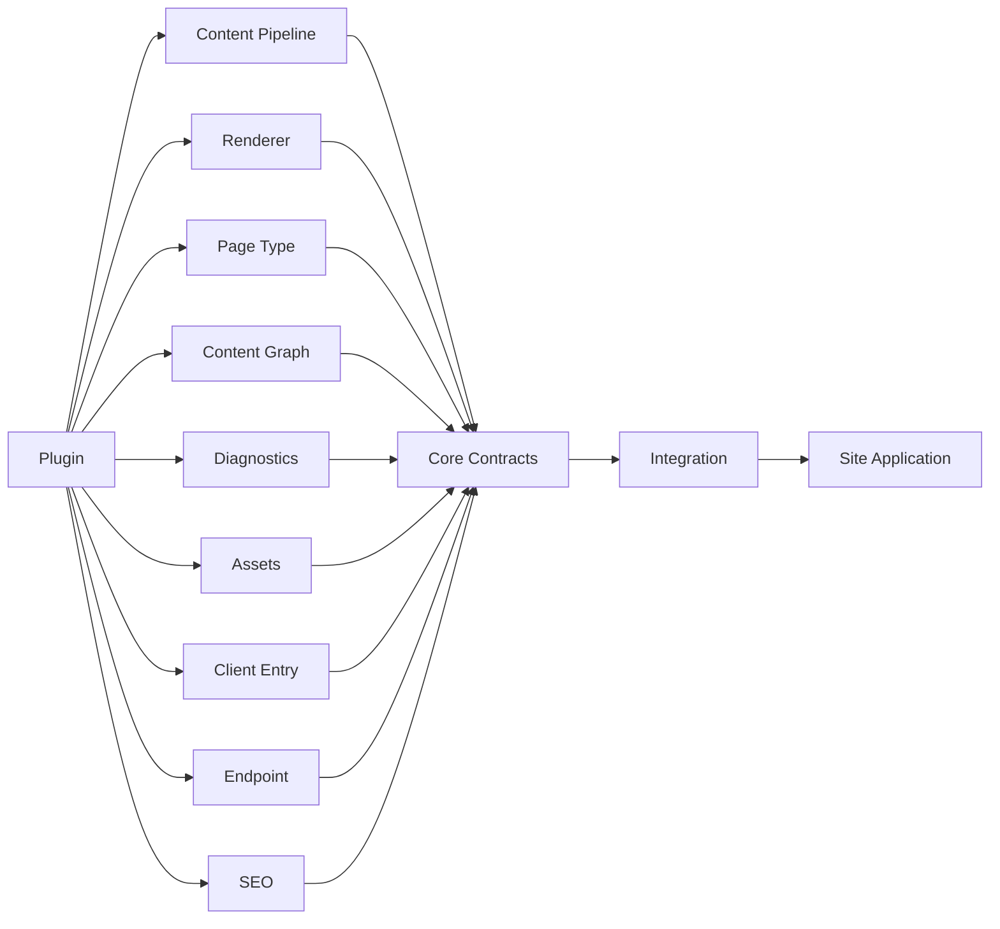

# Plugin System

Riebeckite [[plugin|Plugins]] extend content interpretation, transformation,
rendering, diagnostics, build-time processing, browser behavior,
endpoints, and SEO. This document describes the shared plugin contract
rather than individual plugins.

## In this section

- [The basic contract](./plugin-api/basics.md)
- [Content processing](./plugin-api/content-processing.md)
- [UI, assets, and runtime](./plugin-api/ui-and-assets.md)
- [Distribution and package layout](./plugin-api/distribution.md)

## Plugin system overview

The basic principle: use the smallest extension point you need, and do not
rebuild information the framework has already resolved. Plugins provide
reusable functionality, Core provides the contracts, the Integration connects
to the framework and platform, and the site application owns the final routes,
document, and UI.

## Related

- [Architecture](../framework/architecture.md)
- [Content System](../framework/content-system.md)
- [Testing](../framework/testing.md)
- [Observability](../framework/observability.md)
- [Theme System](./theme-api.md)
- [Framework Reference](./README.md]
