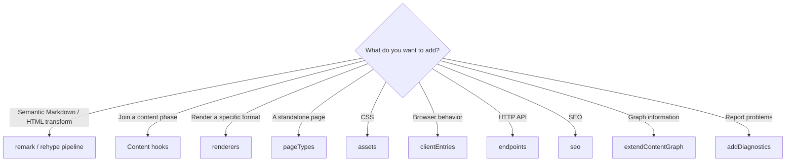
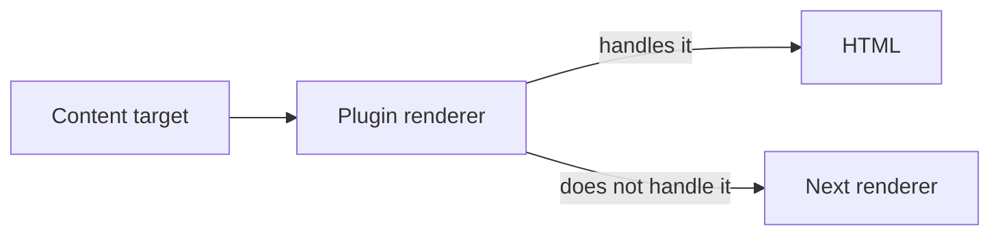
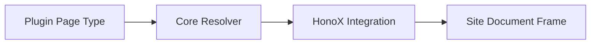
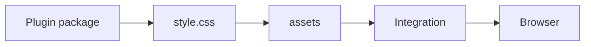
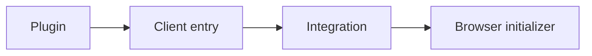
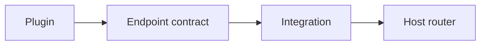
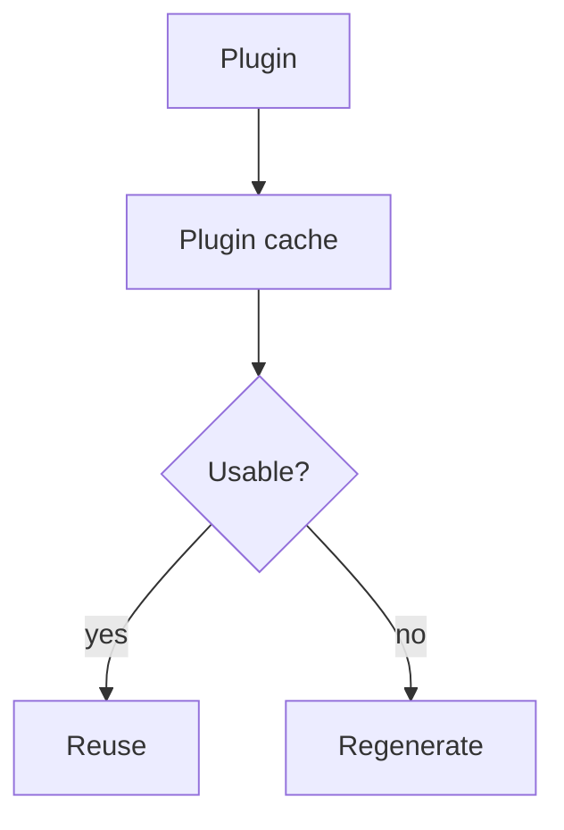
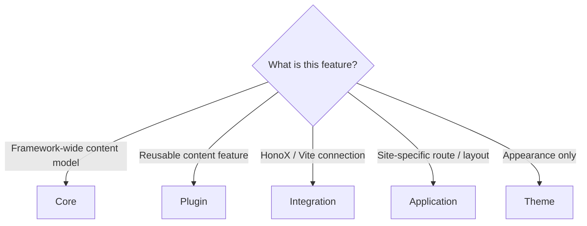
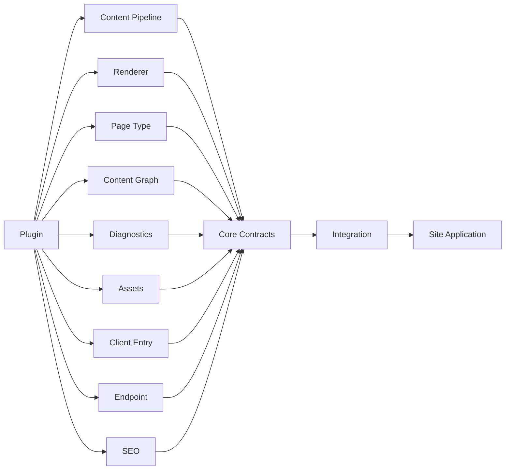

# Plugin System

Riebeckite [[plugin|Plugins]] extend content interpretation, transformation,
rendering, diagnostics, build-time processing, browser behavior,
endpoints, and SEO. This document describes the shared plugin contract
rather than individual plugins.

## Start with the smallest contract

Choose a remark/rehype or pipeline extension for semantic source transforms;
use a content hook only when a named content phase is required. Use assets for
CSS, client entries only for necessary browser code, endpoints for reusable
HTTP behavior, and renderers for a specific target. Do not use a plugin to add
application routes or to hide framework-specific routing. Use `pageTypes` for
a reusable, framework-independent page; the integration owns the one generic
route that renders it.



For example, use `renderers` to show Canvas or Excalidraw inside an article,
and `pageTypes` to provide a standalone page such as `/explore`. Needing a
standalone screen does not mean adding a plugin-specific HonoX route.

## Minimal plugin

``` ts
import { definePlugin } from "@riebeckite/core";

export function examplePlugin() {
  return definePlugin({ name: "example" });
}
```

A plugin factory may expose typed options and retain the resolved
options on the plugin object:

``` ts
type ExampleOptions = {
  enabled?: boolean;
};

export function examplePlugin(options: ExampleOptions = {}) {
  return definePlugin({
    name: "example",
    options,
  });
}
```

## Contract overview

  Area                  API
  --------------------- ------------------------------------------------
  Identity              `name`, `enabled`, `order`, `options`
  Dependencies          `provides`, `requires`, `optional`
  Validation            `validateOptions`
  Cache                 `cacheVersion`, `context.cache`
  Lifecycle             `setup`, `buildStart`, `buildEnd`, `dispose`
  Content hooks         config/content/post/manifest hooks
  Public location       `resolveContentLocations`
  Pipeline              remark/rehype declarations and extension hooks
  Graph                 `extendContentGraph`
  Diagnostics           `addDiagnostics`
   Rendering             `renderers`
   Pages                 `pageTypes`
  Browser integration   `assets`, `clientEntries`
  HTTP integration      `endpoints`
  SEO                   `seo`

Use only the extension points a plugin actually needs.

## Ordering and capabilities

Disabled/false/null inputs are removed, and `enabled: false` is never
executed. `order` provides a basic ordering before dependency resolution,
while [[capability|capability]] dependencies express real requirements:

``` ts
plugins: [
  condition && myPlugin(),
]
```

``` ts
definePlugin({
  name: "consumer",
  provides: ["example.output"],
  requires: ["content.graph"],
  optional: ["example.optional"],
});
```

- `provides`: capabilities this plugin provides.
- `requires`: capabilities that must exist.
- `optional`: capabilities used when present.

The resolver places providers before consumers and detects missing
requirements, duplicate providers, and cycles while preserving unrelated
input order where possible. Capability resolution failures throw
`PluginDependencyError` (importable from `@riebeckite/core`); `kind` and
`pluginName` identify the cause.

## Option validation

Runtime option validation complements TypeScript factory types.

```text
Plugin options
      ↓
validateOptions
      ↓
Structured issues
      ↓
Config validation
```

Validators should be pure and must not scan content, build the site, or
mutate cache/state. Return problems as structured issues so Riebeckite's config
validation can report them together.

## Plugin Context

The base context contains resolved config when available, `contentIndex`,
diagnostics, plugin-scoped cache, generated-output sink, Logger, Tracer, and
the content source when Core owns one.

Specialized hooks add post, manifest, graph, location, or render data.

``` ts
type PluginContext = {
  config?: ResolvedRiebeckiteConfig;
  contentIndex: Map<string, string>;
  diagnostics: Diagnostic[];
  cache: PluginCache;
  output: GeneratedOutputSink;
  logger: Logger;
  tracer: Tracer;
  contentSource?: ContentSource;
};
```

Prefer injected context services over plugin-owned global singletons.

## Lifecycle

Framework lifecycle hooks run once per `ContentManager` in this order:
`setup`, `buildStart`, `onConfigResolved`, content processing, and `buildEnd`.
`dispose` runs in reverse resolved order when the manager is disposed.
`buildEnd` receives the completed manifest after diagnostics have been
collected and is the only terminal build hook.

Named lifecycle and content hooks run in resolved plugin order. A hook failure
is reported as `PluginHookError` (importable from `@riebeckite/core`); its
`message` names the plugin and hook, `cause` holds the original error, and for
content hooks `path` identifies the offending file (for example `note.md`).

## Markdown and HTML pipelines

Plugins can declare remark/rehype plugins directly:

``` ts
definePlugin({
  name: "example",
  remarkPlugins: [remarkExample],
  rehypePlugins: [rehypeExample],
});
```

Or compose the framework pipelines themselves:

``` ts
definePlugin({
  name: "example",
  extendMarkdownPipeline(pipeline, context) {
    pipeline.use(remarkExample);
  },
  extendHtmlPipeline(pipeline) {
    pipeline.use(rehypeExample);
  },
});
```

Semantic Markdown/HTML transformation belongs here, not in application
components.

## Processed-content build dependencies

Core owns incremental invalidation. A plugin declares its cache contract with
`processedContentCache`; it must not implement its own affected-content logic.

``` ts
definePlugin({
  name: "citations",
  processedContentCache: {
    version: "citations-v1",
    dependencyMode: "tracked",
  },
  extendMarkdownPipeline(pipeline, context) {
    pipeline.use(remarkCitations, { contentSource: context.contentSource });
  },
});
```

- `none` means processing depends only on the content source, frontmatter,
  options, and the declared version.
- `tracked` means the pipeline reads other content or files. Read them through
  `context.contentSource` so Core records the dependency and selectively
  rebuilds its consumers. For example, a citations plugin reads its BibTeX file
  with `readContentSourceEntry(context.contentSource, path)`.
- `unsafe` opts out of persistent processed-content reuse. A content-affecting
  plugin without a contract receives the same safe full-content fallback.

Tracked dependencies are captured while processing content. Core persists their
content/file identities, builds a reverse index, and computes affected content
on the next incremental build. Do not scan the vault independently or persist a
plugin-specific incremental state for this purpose. If a dependency cannot be
observed through the framework API, use `unsafe`; a broad rebuild is correct,
where a stale result is not.

This is separate from output dependencies. `pageTypes[].outputDependencies`
and `context.output.emit(..., { dependencies })` declare which rendered pages
or generated files require regeneration. Use `content`, `tag`, `folder`,
`global`, or `unknown` there; `unknown` safely requests full output
regeneration.

Generated output paths are physical output paths. A generated output must not
collide with a content, redirect, or plugin page route; Core fails the build
instead of overwriting the route.

## Renderers

Renderers receive a target (`kind`, `path`, `raw`, `label`, `url`,
`embed`) plus normal plugin context. Return `null` when the renderer
does not handle a target so another renderer can participate.



## UI components

Plugins may export a `PluginComponent<Props>` and a `PluginDataHelper<Input, Model>` in addition to their factory. Data helpers receive narrow inputs such as `PublicContentView` and return typed models; components accept readonly typed props and return no Slot HTML. The Site composes these components in its own TSX, choosing whether, where, and how often to render each one. This replaces the removed body-slot system: plugins no longer contribute HTML fragments to a `bodySlots` map on the manifest entry.

Typical plugin export shape:

```ts
// index.ts
export function examplePlugin() {
  return definePlugin({
    name: "example",
    // ... factory hooks, assets, clientEntries, etc.
  });
}

export { MyComponent, getMyData };
```

Or more conventionally, a plugin may place its component and helper under `./components/`:

```text
packages/plugins/example/
├─ index.ts
├─ components/
│  ├─ my-component.tsx   // exports <MyComponent /> and getMyData
│  └─ types.ts
├─ style.css
└─ client.ts
```

The Site then imports and renders:

```tsx
import { getMyData } from "@riebeckite/plugin-example";
import { MyComponent } from "@riebeckite/plugin-example/components";

const model = getMyData({ view, frontmatter: entry.frontmatter });
<MyComponent model={model} />
```

Components may also optionally export internal CSS and a client entry, registered through the integration as usual. Existing asset and client-entry registration remains factory-owned; importing a component alone neither registers CSS/client runtime nor enables a plugin capability.

HonoX primitives such as `Article`, `ArticleHeader`, `ArticleContent`, `ArticleBody`, `ArticleFooter`, `Sidebar`, and `ThemeRoot` remain as semantic primitives for article structure and layout. They are kept after removing Slot APIs and placement attributes. Components belong in plugin packages and are exported from their public entry points with their model types and helpers. Site TSX belongs under the application's `app/`. HonoX owns rendering primitives only; it does not collect plugin components or select their order.

```tsx
// Minimal UI composition in a site route
import { getBacklinks } from "@riebeckite/core";
import { MyComponent } from "@riebeckite/plugin-example";

const view = createPublicContentView(manifest);
const entry = view.findRoutableBySlug(slug);
const backlinks = await getBacklinks({ view, slug });
<article>
  <MyComponent backlinks={backlinks} />
  <ArticleBody html={entry.html} />
</article>
```

## Manifest collections and publication safety

Hooks that receive the manifest (`onManifestCreated`, page resolvers, renderers)
choose between three entry collections:

- `manifest.entries` — the raw collection for every scanned source, including
  `draft`, `scheduled`, private, and other nonpublic entries. It is not a
  publication view; never render it into a public page or discovery UI.
- `manifest.publicEntries` — routable entries: `public` and `unlisted`. Use for
  output that must cover every reachable URL, such as a sitemap. It still
  includes `unlisted` content.
- `manifest.discoverableEntries` — entries allowed in discovery surfaces:
  `public` only. Use this for related posts, recent lists, tag pages, search
  indexes, and any list a reader browses.

Do not re-derive visibility from `frontmatter` or reimplement `publishAt`. When a
hook genuinely needs to branch, read the resolved `entry.publishing`
(`visibility`, `routable`, `discoverable`); otherwise pick the collection that
already encodes the decision. The publish strategy is configured in
[Configuration](./configuration.md).

## Pages

`pageTypes` supplies standalone pages without adding application routes. A page
type declares its stable ID, SSG paths, optional priority, and a resolver. The
resolver receives the resolved manifest and a normalized request path, then
returns HTML for the page body or `null`. The site still owns its document frame
and theme. A page may also return `title`, `description`, `headTags`, and the
`language` it resolved; the document frame decides how to render that metadata.



```ts
definePlugin({
  name: "example-pages",
  pageTypes: [{
    id: "example.report",
    paths: ["/report"],
    resolve: ({ pathname, manifest }) => pathname === "/report"
      ? { type: "example.report", pathname, body: `<p>${manifest.discoverableEntries.length}</p>` }
      : null,
  }],
});
```

Use `resolveRiebeckiteRoute(content, c.req.path)` and
`pluginPageSsgParams(content)` from `@riebeckite/honox/server` in a catch-all
route. Duplicate IDs fail at plugin resolution. When multiple types match, the
highest `priority` wins; ties fail explicitly.

## Build dependencies

`processedContentCache` declares whether Core may reuse a plugin's processed
content between builds. This is separate from `cacheVersion` and
`context.cache`.

``` ts
processedContentCache: {
  version: "example-v1",
  dependencyMode: "tracked",
}
```

- `none` is for transforms that depend only on the source content, frontmatter,
  options, and the declared version.
- `tracked` is for transforms that read other content or files through Core.
  Use `context.contentSource`, `readContentSourceEntry`, `renderContent`, or
  `renderNoteEmbed`; Core owns `ContentDependencyTracker` and records those
  content and file reads automatically. Do not read the filesystem directly.
- `global` is for transforms that depend on resolved locations across the
  vault. Core fingerprints that location set and reprocesses every entry when
  it changes.
- `unsafe` is for inputs Core cannot track, such as Git, network, time, or
  process state. It safely bypasses persistent processed-content reuse.

Content dependencies decide which source content must be processed again.
Output dependencies decide which emitted files must be written again. They are
separate contracts. Page types declare `outputDependencies`; a plugin that
updates existing manifest entry HTML in `onManifestCreated` declares root
`outputDependencies`, which are added to those content outputs.

``` ts
outputDependencies: [{ type: "global" }]

pageTypes: [{
  id: "example.report",
  paths: ["/report"],
  outputDependencies: [{ type: "tag", tag: "release" }],
  resolve: () => null,
}]
```

Use `content`, `tag`, or `folder` when the exact scope is known; use `global`
for a manifest-wide collection transform. Use `unknown` only when the input
cannot be represented: it regenerates safely and requests full output
regeneration. Generated outputs without declared dependencies are `unknown`.

## Assets and client entries

Plugin CSS remains in the plugin package and is declared through
`assets`. Browser initialization is declared through `clientEntries`
only when browser JavaScript is genuinely required. Do not copy plugin
CSS into `apps/web` or expose `/node_modules` directly.

For a package named `@riebeckite/plugin-example`, use the Core helpers. They
declare the package's conventional `./style.css` and `./client` exports while
keeping the integration-facing values consistent:

``` ts
import {
  createClientEntry,
  createStyleAsset,
  definePlugin,
} from "@riebeckite/core";

export function examplePlugin() {
  return definePlugin({
    name: "example",
    assets: [createStyleAsset("example")],
    clientEntries: [
      createClientEntry("example", "initExample", { selector: ".example" }),
    ],
  });
}
```

The same declarations written out explicitly:

``` ts
assets: [
  {
    pluginName: "example",
    kind: "style",
    moduleSpecifier: "@riebeckite/plugin-example/style.css",
  },
]
```



The helpers build the specifier from the package name: `createStyleAsset("example")`
produces `@riebeckite/plugin-example/style.css` and
`createClientEntry("example", ...)` produces `@riebeckite/plugin-example/client`.
They therefore fit only a package literally named `@riebeckite/plugin-<name>`. A
package published under any other name — including a site-local plugin — must
declare `assets` and `clientEntries` explicitly with specifiers its own `exports`
map exposes. See
[Distributing a Plugin outside this repository](#distributing-a-plugin-outside-this-repository).

Omit `assets` or `clientEntries` when the plugin does not need them. The client
entry's export name is optional and defaults to the module default export. Its
third argument is an optional JSON value passed to that initializer. It is the
only plugin configuration exposed to browser code (and recorded in the
manifest for static hosts); `options` are never copied to the client. Register
only deliberately public values—never tokens, credentials, or private service
URLs. An initializer without public config continues to receive no arguments.

A client entry can also be declared explicitly:

``` ts
clientEntries: [
  {
    pluginName: "example",
    moduleSpecifier: "@riebeckite/plugin-example/client",
    exportName: "initExample",
    publicConfig: { selector: ".example" },
  },
]
```



Do not add client JavaScript to a plugin that completes entirely at SSR or
build time.

## CSS hooks

Plugin CSS stays in the plugin package and reaches the browser through
`assets`. When a plugin renders a distinct, reusable feature, put a stable
root hook on its outermost element:

- Name plugin/feature hooks `rr-<feature>` (`rr-search`, `rr-callout`,
  `rr-query`, `rr-code`, ...). Use BEM structure under the root:
  `rr-<feature>`, `rr-<feature>__element`, `rr-<feature>--modifier`.
- Emit `rr-*` hooks only. Do not retain historical class names in plugin output;
  plugin CSS and site themes should target the `rr-` hook.
- Do not put plugin output in the `rb-` namespace. `rb-*` classes and
  `--rb-*` tokens belong to framework structural hooks and semantic design
  tokens. Plugin-local tokens use `--rr-*` and may fall back to `--rb-*`.
- `rr-<feature>__*` and `rr-<feature>--*` are internal implementation
  details. Document any descendant a theme is expected to target.

| Namespace | Use |
| --- | --- |
| `rb-*` | Framework structural hooks |
| `--rb-*` | Framework semantic design tokens |
| `rr-*` | Plugin / feature hooks |
| `--rr-*` | Plugin-local tokens |

Themes target these root hooks. Plugin default CSS loads before theme CSS, so
a theme restyles a feature without editing the plugin. See
[Theme System](./theme-api.md#stable-css-hooks).

For dark mode, consume the semantic `--rb-*` tokens: they resolve correctly in
light, explicit dark, and system dark. Only when a plugin must branch on the
mode itself (for example to invert a build-time asset) should it scope the
override to the theme root so it works both at the document root and inside an
embedded `.rb-theme-root`:
`:is(:root, .rb-theme-root)[data-theme="dark"] <hook>` and, for system dark,
`@media (prefers-color-scheme: dark) { :is(:root, .rb-theme-root):not([data-theme]) <hook> { ... } }`.
Do not key a dark override on `html[data-theme="dark"]` or
`:root:not([data-theme])` alone; those miss embedded theme roots. The
framework never adds a `.dark` class, so do not depend on one.

## Endpoints and SEO

`endpoints` lets an Integration connect reusable plugin HTTP behavior to
the host router without embedding HonoX-specific routing in Core. `seo`
lets plugins participate in metadata/feed-related behavior through the
framework contract.



Do not embed a specific router implementation (such as HonoX) in the plugin
itself; the integration connects the endpoint contract to the host router.
Do not reimplement plugin-specific SEO logic in application routes.

Use `defineEndpoint` to declare an endpoint. Pass `cacheControl` only when the
response is safe to cache; the helper applies the header without duplicating
response plumbing.

``` ts
import { defineEndpoint } from "@riebeckite/core";

const searchEndpoint = defineEndpoint(
  "/search-data.json",
  ({ config, manifest }) => ({ json: buildSearchItems({ config, manifest }) }),
  { cacheControl: "public, max-age=300" },
);
```

## Diagnostics

Return structured diagnostics rather than printing ad-hoc CLI messages.
Use the injected Logger for operational logging.

``` ts
addDiagnostics(context) {
  return [
    {
      // Diagnostic contract
    },
  ];
}
```

Return diagnostics as structured data rather than calling `console.log(...)`
for CLI messages; use diagnostics or the logger.

## Plugin Cache

`context.cache` is a plugin-scoped, regenerable **build-time** cache.

- Store only regenerable, JSON-serializable values.
- Reference only your own plugin namespace.
- Use `cacheVersion` when compatibility changes.
- Treat a corrupt cache as a safe miss.
- Writes are atomic.



It is not a database or Cloudflare Workers runtime storage.

## Observability (Logger / Tracer)

Use `context.logger` and `context.tracer`:

``` ts
context.logger.info("...");
await context.tracer.span("plugin.example.work", { plugin: "example }, async () => {
  // work
});
```

The Profiler consumes structured tracing, so plugins do not need their own
timing/reporting system.

## Suggested package layout

``` text
packages/plugins/example/
├─ index.ts
├─ components/        # only when you export components
├─ client.ts          # only when needed
├─ style.css          # only when needed
├─ package.json
└─ src/
   ├─ remark.ts
   ├─ rehype.ts
   ├─ renderer.ts
   └─ types.ts
```

A plugin without a `client.ts` or `style.css` drops those subpaths and `files`
entries.

Bundle the JavaScript entry points with `esbuild` and emit declarations with
`tsc`. Both are ordinary ecosystem tools; no Riebeckite-specific build script
is required.

`build.mjs`:

```js
import { build } from "esbuild";

await build({
  entryPoints: ["index.ts", "client.ts"],
  outdir: "dist",
  bundle: true,
  format: "esm",
  platform: "neutral",
  packages: "external",
  external: ["@riebeckite/*"],
  logLevel: "warning",
});
```

List only the entry points your package actually has (drop `client.ts` when
there is no client).

`tsconfig.json`:

```json
{
  "compilerOptions": {
    "declaration": true,
    "emitDeclarationOnly": true,
    "outDir": "dist",
    "rootDir": ".",
    "module": "ESNext",
    "moduleResolution": "Bundler",
    "target": "ESNext",
    "lib": ["ESNext", "DOM", "DOM.Iterable"],
    "strict": true,
    "skipLibCheck": true
  },
  "include": ["index.ts", "client.ts"]
}
```

Building in `prepack` keeps `npm pack` / `npm publish` shipping fresh output.
Puting `@riebeckite/core` in `dependencies` is the simplest choice; use
`peerDependencies` instead when the site should provide the module instance.
Declare each transform dependency you import (`unist-util-visit`, `unified`,
remark/rehype packages) in `dependencies`, and never point a published `exports`
entry at TypeScript source (`./index.ts`).

For testing a distributed package, see [Testing](../framework/testing.md#testing-a-plugin);
for CSS and client packaging, see [Assets](#assets) and [Client entries](#client-entries).

### Distributing a Plugin outside this repository

An external Plugin package depends only on `@riebeckite/core` and declares the
subpaths it owns (`./client`, `./components`, `./style.css`) in its own `exports`
map. Do not import `@riebeckite/core/src/**` or reference monorepo paths. See
[Public packages and import paths](./README.md#public-packages-and-import-paths)
for the supported package surface and current constraints.

### Package shape

Publish built ESM plus type declarations and point `exports` at the built files.
A complete, copyable manifest:

```json
{
  "name": "my-riebeckite-plugin",
  "version": "1.0.0",
  "type": "module",
  "main": "./dist/index.js",
  "types": "./dist/index.d.ts",
  "exports": {
    ".": {
      "types": "./dist/index.d.ts",
      "import": "./dist/index.js",
      "default": "./dist/index.js"
    },
    "./client": {
      "types": "./dist/client.d.ts",
      "import": "./dist/client.js",
      "default": "./dist/client.js"
    },
    "./style.css": "./style.css"
  },
  "files": ["dist", "style.css"],
  "scripts": {
    "build": "node build.mjs && tsc -p tsconfig.json",
    "prepack": "npm run build"
  },
  "dependencies": {
    "@riebeckite/core": "^0.0.19",
    "unist-util-visit": "^5.0.0"
  },
  "devDependencies": {
    "@types/mdast": "^4.0.0",
    "esbuild": "^0.28.0",
    "typescript": "^5.0.0"
  }
}
```

A plugin without a `client.ts` or `style.css` drops those subpaths and `files`
entries.

JavaScript of the entry point is bundled with `esbuild` and type declarations
are emitted with `tsc`. Both are ordinary ecosystem tools; no Riebeckite-specific
build script is required.

`build.mjs`:

```js
import { build } from "esbuild";

await build({
  entryPoints: ["index.ts", "client.ts"],
  outdir: "dist",
  bundle: true,
  format: "esm",
  platform: "neutral",
  packages: "external",
  external: ["@riebeckite/*"],
  logLevel: "warning",
});
```

`entryPoints` includes only the entry points your package actually has (drop
`client.ts` when there is no client).

`tsconfig.json`:

```json
{
  "compilerOptions": {
    "declaration": true,
    "emitDeclarationOnly": true,
    "outDir": "dist",
    "rootDir": ".",
    "module": "ESNext",
    "moduleResolution": "Bundler",
    "target": "ESNext",
    "lib": ["ESNext", "DOM", "DOM.Iterable"],
    "strict": true,
    "skipLibCheck": true
  },
  "include": ["index.ts", "client.ts"]
}
```

`prepack`でbuildするようにしておけば、`npm pack` / `npm publish` は常に最新の成果物を同梱します。`@riebeckite/core` は `dependencies` に置くのが最も簡単です（Site側の instance を共有したい場合は `peerDependencies` でもかまいません）。import する変換依存（`unist-util-visit`、`unified`、remark/rehype package など）は `dependencies` に宣言し、公開 package の `exports` を TypeScript の source（`./index.ts`）へ向けないでください。

配布する Package のテストは [Testing](../framework/testing.md#testing-a-plugin) を、CSS / Client entry の packaging は [Assets](#assets) と [Client Entries](#client-entries) を参照してください。

### Package 構成

公開 package では、Build 済み ESM と型定義を publish し、`exports` をその
Build 成果物へ向けます。最小構成の `package.json` は次のとおりです。

```json
{
  "name": "my-riebeckite-plugin",
  "version": "1.0.0",
  "type": "module",
  "main": "./dist/index.js",
  "types": "./dist/index.d.ts",
  "exports": {
    ".": {
      "types": "./dist/index.d.ts",
      "import": "./dist/index.js",
      "default": "./dist/index.js"
    },
    "./client": {
      "types": "./dist/client.d.ts",
      "import": "./dist/client.js",
      "default": "./dist/client.js"
    },
    "./style.css": "./style.css"
  },
  "files": ["dist", "style.css"],
  "scripts": {
    "build": "node build.mjs && tsc -p tsconfig.json",
    "prepack": "npm run build"
  },
  "dependencies": {
    "@riebeckite/core": "^0.0.19",
    "unist-util-visit": "^5.0.0"
  },
  "devDependencies": {
    "@types/mdast": "^4.0.0",
    "esbuild": "^0.28.0",
    "typescript": "^5.0.0"
  }
}
```

`client.ts` や `style.css` を持たない Plugin では、その subpath と `files` の entry を削除します。

JavaScript の entry point は `esbuild` で bundle し、型定義は `tsc` で emit します。どちらも一般的なツールで、Riebeckite 固有の build script は必要ありません。

`build.mjs`:

```js
import { build } from "esbuild";

await build({
  entryPoints: ["index.ts", "client.ts"],
  outdir: "dist",
  bundle: true,
  format: "esm",
  platform: "neutral",
  packages: "external",
  external: ["@riebeckite/*"],
  logLevel: "warning",
});
```

`entryPoints` には、その Package が持つ entry だけを列挙します（client を持たないなら `index.ts` だけ）。

`tsconfig.json`:

```json
{
  "compilerOptions": {
    "declaration": true,
    "emitDeclarationOnly": true,
    "outDir": "dist",
    "rootDir": ".",
    "module": "ESNext",
    "moduleResolution": "Bundler",
    "target": "ESNext",
    "lib": ["ESNext", "DOM", "DOM.Iterable"],
    "strict": true,
    "skipLibCheck": true
  },
  "include": ["index.ts", "client.ts"]
}
```

`prepack` で build するようにしておけば、`npm pack` / `npm publish` は常に最新の成果物を同梱します。`@riebeckite/core` は `dependencies` に置くのが最も簡単です（Site 側の instance を共有したい場合は `peerDependencies` でもかまいません）。import する変換依存（`unist-util-visit`、`unified`、remark / rehype package など）は `dependencies` に宣言し、公開 package の `exports` を TypeScript の source（`./index.ts`）へ向けないでください。

公式 Plugin も可能な限り同じ Public API の consumer として実装します。

## Responsibility boundary

Decide by the nature of the feature:



Put in a plugin:

- Markdown/HTML interpretation and reusable content transformation.
- Plugin-specific renderers, reusable browser behavior, and diagnostics.
- Plugin-specific endpoint/SEO extensions.

Do not put in a plugin:

- Framework-wide content model — belongs in Core.
- HonoX/Vite connections — belong in the Integration.
- Application-specific routes/layouts — belong in the App.
- Appearance-only changes — belong in Theme.

## ESM

For NodeNext/ESM packages, ensure built JavaScript uses import paths
Node can actually resolve; do not depend on a TypeScript loader
repairing runtime resolution.

## Plugin system overview



The basic principle: use the smallest extension point you need, and do not
rebuild information the framework has already resolved. Plugins provide
reusable functionality, Core provides the contracts, the Integration connects
to the framework and platform, and the site application owns the final routes,
document, and UI.

## Related

- [Architecture](../framework/architecture.md)
- [Content System](../framework/content-system.md)
- [Testing](../framework/testing.md)
- [Observability](../framework/observability.md)
- [Theme System](./theme-api.md)
- [Framework Reference](./README.md]
