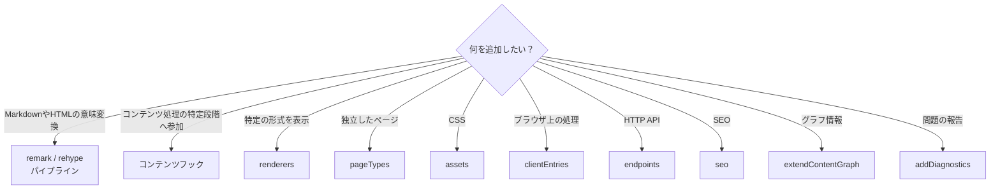
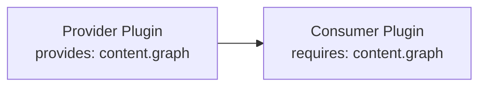

# 基本の契約

## どの拡張ポイントを使うか

プラグインを作るときは、まず**目的に合った最小の拡張ポイント**を選びます。



たとえば、Canvas や Excalidraw を記事内へ表示するなら `renderers`、`/explore` のような独立したページを提供するなら `pageTypes` を使います。独立した画面が必要だからといって、プラグイン固有の HonoX ルートを追加するわけではありません。

## 最小のプラグイン

最も小さいプラグインは、次のように作れます。

```ts
import { definePlugin } from "@riebeckite/core";

export function example() {
  return definePlugin({
    name: "example",
  });
}
```

プラグインに設定を持たせる場合は、ファクトリ関数の引数として受け取ります。

```ts
type ExampleOptions = {
  enabled?: boolean;
};

export function example(
  options: ExampleOptions = {},
) {
  return definePlugin({
    name: "example",
    options,
  });
}
```

`definePlugin()` がプラグイン共通の取り決めを提供します。

## プラグインが持てる機能

`RiebeckitePlugin` には、主に次の拡張ポイントがあります。

| 分類 | 主な API |
| --- | --- |
| 基本情報 | `name`, `enabled`, `order`, `options` |
| 依存関係 | `provides`, `requires`, `optional` |
| 設定の検証 | `validateOptions` |
| [[glossary/cache|キャッシュ]] | `cacheVersion`, `context.cache` |
| ライフサイクル | `setup`, `buildStart`, `buildEnd`, `dispose` |
| コンテンツ | `onConfigResolved`, `onContentLoaded`, `onPostParsed`, `onPostProcessed`, `onManifestCreated` |
| [[glossary/public-location|公開先]] | `resolveContentLocations` |
| Markdown / HTML | `remarkPlugins`, `rehypePlugins`, `extendMarkdownPipeline`, `extendHtmlPipeline` |
| グラフ | `extendContentGraph` |
| 診断 | `addDiagnostics` |
| API ライフサイクル | `apiLifecycle` |
| 埋め込み表示 | `renderers` |
| 独立ページ | `pageTypes` |
| ブラウザ | `assets`, `clientEntries` |
| HTTP | `endpoints` |
| SEO | `seo` |
| インスペクターのタブ | `inspector` |

この中から、**必要なものだけ**を使ってください。

非推奨のプラグインオプションやフックは `apiLifecycle` で宣言すると、`check`、`doctor`、インスペクターから報告できます。詳しくは [API ライフサイクル](../api-lifecycle.ja.md) を参照してください。

## 開発時のルートマニフェスト

開発時は、記事 HTML を処理する前に frontmatter とリンクのメタデータでルートを解決します。`extendContentGraph` または `onManifestCreated` を使うプラグインでは、`entry.html === ""` でも正しく処理でき、[[glossary/generated-output|生成物]]やアセット変換を必要とせず、開発サーバーでも実行する必要がある場合に限り、`developmentRouteManifest: true` を指定します。それ以外の[[glossary/manifest|マニフェスト]]へ影響するプラグインは、互換性を保つため開発時も Full Manifest を使います。

## プラグインを有効にする

プラグインは、`riebeckite.config.ts` の `plugins` へ追加します。

```ts
plugins: [
  my(),
]
```

条件付きで有効化することもできます。

```ts
plugins: [
  condition && my(),
]
```

`false`、`null`、`undefined` は、プラグインを解決するときに除外されます。また、`enabled: false` を指定したプラグインも実行されません。

```ts
enabled: false
```

## 実行順と依存関係

`order` は、変換や[[glossary/renderer|レンダラー]]の優先順を一定にするための基本順です。プラグイン同士に機能の提供・利用関係がなく、パイプライン内の実行順だけを決めたい場合に使います。

一方、プラグイン同士に実際の提供・利用関係がある場合は、`order` ではなく**[[glossary/capability|ケイパビリティ]]**を使います。変換順を表すためだけのケイパビリティは作成しないでください。

```ts
definePlugin({
  name: "consumer",

  provides: [
    "example.output",
  ],
  requires: [
    "content.graph",
  ],
  optional: [
    "example.optional",
  ],
});
```

それぞれの意味は次のとおりです。

| 項目 | 意味 |
| --- | --- |
| `provides` | このプラグインが提供する機能 |
| `requires` | 必ず必要な機能 |
| `optional` | あれば利用する機能 |

依存関係の解決処理は、提供側が利用側より前に来るよう実行順を決めます。



次の状態は設定エラーになります。

- 必須の[[capability|ケイパビリティ]]が存在しない
- 同じケイパビリティを複数のプラグインが提供している
- 依存関係が循環している

解決に失敗した場合は、`PluginDependencyError`（`@riebeckite/core` からインポート可能）を投げます。`kind` と `pluginName` は原因を特定できますが、`duplicate-provider` や `cycle` の場合は `pluginName` が設定されておらず、`pluginNames` / `chain` を使って原因を特定してください。依存関係のないプラグインについては、入力順をできるだけ維持します。

## オプションの検証

TypeScript の型だけでは、実行時に渡される設定値が必ず正しいとは限りません。必要なプラグインは `validateOptions` を実装できます。

検証は、次の流れで行われます。

```text
プラグインのオプション
      ↓
validateOptions
      ↓
構造化された問題
      ↓
設定の検証
```

検証処理では、**設定の確認だけ**を行ってください。ファイルシステムの走査、ビルド、キャッシュへの書き込み、外部状態の変更などは行いません。問題は構造化された値として返し、Riebeckite の設定検証がまとめて表示できるようにします。

## プラグインに渡されるコンテキスト

プラグインは、フレームワークの機能を `PluginContext` から受け取ります。基本的なコンテキストは、概念的には次のようなものです。

```ts
type PluginContext = {
  config?: ResolvedRiebeckiteConfig;
  isDevelopment?: boolean;
  /**
   * Deterministic build clock. Publishing, scheduling, and time-dependent
   * plugin output share this value so one build always agrees with itself.
   */
  buildTime?: Date;
  contentIndex: Map<string, string>;
  diagnostics: Diagnostic[];
  cache: PluginCache;
  derived?: DerivedViewRegistry;
  /**
   * Registers a file to be written to the build output directory. Available
   * during build lifecycle hooks; the integration layer forwards each entry to
   * the build tool.
   */
  externalDependencies?: ReadonlyMap<string, ExternalDependencySnapshot>;
  output: GeneratedOutputSink;
  logger: Logger;
  tracer: Tracer;
  contentSource?: ContentSource;
};
```

`isDevelopment` は Vite の開発ランタイムでのみ `true` です。開発サーバーが配信しない静的出力をプラグインが遅延させるために使えます。

フックによって、`slug`、`markdown`、`content`、`manifest`、`entries`、公開先を決めるための入力などが追加されます。

プラグイン内でグローバルなシングルトンを作るより、コンテキストからフレームワークの機能を受け取ってください。

## ライフサイクル

プラグインには、フレームワーク全体のライフサイクルと、コンテンツ処理のライフサイクルがあります。

フレームワーク側の主なフックは `setup`、`buildStart`、`buildEnd` です。`dispose` は、プラグインが確保したリソースを解放するために使います。

`setup`、`buildStart`、`onConfigResolved`、コンテンツ処理、`buildEnd` は、1つの `ContentManager` につき一度だけ実行されます。`buildEnd` は、診断情報を集めたあとに完成したマニフェストを受け取る唯一の終了フックです。`dispose` は、解決済みプラグインの逆順で実行されます。

名前付きの[[glossary/lifecycle-hook|ライフサイクルフック]]や[[glossary/content-hook|コンテンツフック]]でエラーが起きた場合は、そのまま上位へ伝えます。エラーは `PluginHookError`（`@riebeckite/core` からインポート可能）です。`message` は `Plugin "<name>" failed during "<hook>"` の形式になり、元のエラーは `cause` に保持されます。コンテンツフックで起きた場合は、対象ファイルが `path`（例: `note.md`）として設定されます。
