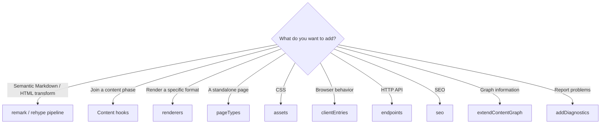

# The basic contract

## Start with the smallest contract

Choose a remark/rehype or pipeline extension for semantic source transforms;
use a content hook only when a named content phase is required. Use assets for
CSS, client entries only for necessary browser code, endpoints for reusable
HTTP behavior, and renderers for a specific target. Do not use a plugin to add
application routes or to hide framework-specific routing. Use `pageTypes` for
a reusable, framework-independent page; the integration owns the one generic
route that renders it.



For example, use `renderers` to show Canvas or Excalidraw inside an article,
and `pageTypes` to provide a standalone page such as `/explore`. Needing a
standalone screen does not mean adding a plugin-specific [[framework/honox-integration|HonoX]] route.

## Minimal plugin

``` ts
import { definePlugin } from "@riebeckite/core";

export function example() {
  return definePlugin({ name: "example" });
}
```

A plugin factory may expose typed options and retain the resolved
options on the plugin object:

``` ts
type ExampleOptions = {
  enabled?: boolean;
};

export function example(options: ExampleOptions = {}) {
  return definePlugin({
    name: "example",
    options,
  });
}
```

## Contract overview

  Area                  API
  --------------------- ------------------------------------------------
  Identity              `name`, `enabled`, `order`, `options`
  Dependencies          `provides`, `requires`, `optional`
  Validation            `validateOptions`
  [[glossary/cache|Cache]]                 `cacheVersion`, `context.cache`
  Lifecycle             `setup`, `buildStart`, `buildEnd`, `dispose`
  Content hooks         config/content/post/manifest hooks
  Public location       `resolveContentLocations`
  [[glossary/pipeline|Pipeline]]              remark/rehype declarations and extension hooks
  Graph                 `extendContentGraph`
  Diagnostics           `addDiagnostics`
  API lifecycle         `apiLifecycle`
   Rendering             `renderers`
   Pages                 `pageTypes`
  Browser integration   `assets`, `clientEntries`
  HTTP integration      `endpoints`
  SEO                   `seo`

Use only the extension points a plugin actually needs.

Declare deprecated plugin options and hooks with `apiLifecycle` so `check`, `doctor`, and the Inspector can report them. See [API lifecycle](../api-lifecycle.md).

## Development route manifests

Development resolves routes from frontmatter and link metadata before processing
article HTML. A plugin that uses `extendContentGraph` or `onManifestCreated`
must set `developmentRouteManifest: true` only when those hooks are correct
with `entry.html === ""`, need no generated outputs or asset transforms, and
are required while serving. Other manifest-affecting plugins use the full
manifest in development to preserve compatibility.

## Ordering and capabilities

Disabled/false/null inputs are removed, and `enabled: false` is never
executed. `order` provides deterministic transform and renderer precedence
before dependency resolution. Use it when plugins must run in a particular
pipeline order but neither consumes a capability from the other. [[capability|Capability]]
dependencies express real provider/consumer requirements; do not invent a
capability merely to encode transform order.

``` ts
plugins: [
  condition && my(),
]
```

``` ts
definePlugin({
  name: "consumer",
  provides: ["example.output"],
  requires: ["content.graph"],
  optional: ["example.optional"],
});
```

- `provides`: capabilities this plugin provides.
- `requires`: capabilities that must exist.
- `optional`: capabilities used when present.

The resolver places providers before consumers and detects missing
requirements, duplicate providers, and cycles while preserving the numeric
precedence and unrelated input order where possible. [[glossary/capability|Capability]] resolution failures throw
`PluginDependencyError` (importable from `@riebeckite/core`); `kind` and
`pluginName` identify the cause.

## Option validation

Runtime option validation complements TypeScript factory types.

```text
Plugin options
      ↓
validateOptions
      ↓
Structured issues
      ↓
Config validation
```

Validators should be pure and must not scan content, build the site, or
mutate cache/state. Return problems as structured issues so Riebeckite's config
validation can report them together.

## Plugin Context

The base context contains resolved config when available, `contentIndex`,
diagnostics, plugin-scoped cache, generated-output sink, [[glossary/logger|Logger]], Tracer, and
the content source when Core owns one.

Specialized hooks add post, manifest, graph, location, or render data.

``` ts
type PluginContext = {
  config?: ResolvedRiebeckiteConfig;
  isDevelopment?: boolean;
  contentIndex: Map<string, string>;
  diagnostics: Diagnostic[];
  cache: PluginCache;
  output: GeneratedOutputSink;
  logger: Logger;
  tracer: Tracer;
  contentSource?: ContentSource;
};
```

`isDevelopment` is true only for the Vite development runtime. Plugins can use
it to defer static output that the development server does not serve.

Prefer injected context services over plugin-owned global singletons.

## Lifecycle

Framework lifecycle hooks run once per `ContentManager` in this order:
`setup`, `buildStart`, `onConfigResolved`, content processing, and `buildEnd`.
`dispose` runs in reverse resolved order when the manager is disposed.
`buildEnd` receives the completed manifest after diagnostics have been
collected and is the only terminal build hook.

Named lifecycle and content hooks run in resolved plugin order. A hook failure
is reported as `PluginHookError` (importable from `@riebeckite/core`); its
`message` names the plugin and hook, `cause` holds the original error, and for
content hooks `path` identifies the offending file (for example `note.md`).
