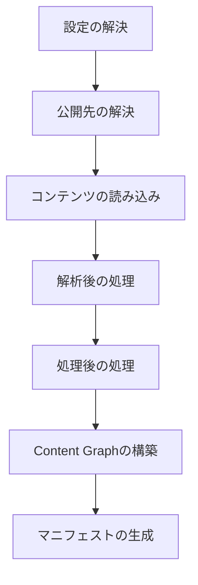
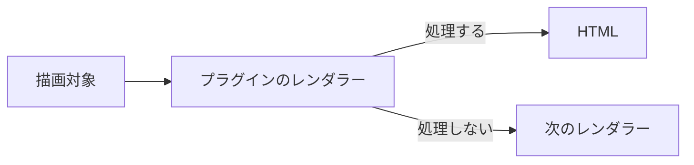

# コンテンツ処理

## コンテンツ処理の流れ

コンテンツ処理は、概念的には次の順番で進みます。



全体の順序は、`setup` → `buildStart` → `onConfigResolved` → 公開先の解決です。続いて `onContentLoaded` → Markdown / HTML パイプライン → `onPostParsed` → `onPostProcessed` と進みます。最後に `extendContentGraph` → `onManifestCreated` → 診断 → `buildEnd` です。

**必要な段階のフックだけを使ってください**。後続の段階で得られる情報を、前の段階で独自に作り直す必要はありません。

## MarkdownとHTMLの変換

Markdown や HTML の意味を変換する場合は、[[glossary/pipeline|パイプライン]]を使います。簡単な remark / rehype プラグインなら、配列として直接宣言できます。

```ts
definePlugin({
  name: "example",

  remarkPlugins: [
    remarkExample,
  ],

  rehypePlugins: [
    rehypeExample,
  ],
});
```

パイプライン自体を構成する必要がある場合は、拡張 API を使います。

```ts
definePlugin({
  name: "example",

  extendMarkdownPipeline(pipeline) {
    pipeline.use(remarkExample);
  },

  extendHtmlPipeline(pipeline) {
    pipeline.use(rehypeExample);
  },
});
```

Markdown AST や HTML AST の処理は、アプリケーションのコンポーネントへ持ち込まず、プラグインのパイプライン処理として実装します。

```ts
definePlugin({
  name: "citations",

  processedContentCache: {
    version: "citations-v1",
    dependencyMode: "tracked",
  },

  extendMarkdownPipeline(pipeline, context) {
    pipeline.use(remarkCitations, { contentSource: context.contentSource });
  },
});
```

## 埋め込みコンテンツの描画

レンダラーは、描画対象の情報（`kind`、`path`、`raw`、`label`、`url`、`embed`）と通常のプラグインコンテキストを受け取ります。対象を処理しない場合は `null` を返し、別のレンダラーが処理できるようにします。



## マニフェストのコレクションと公開範囲

マニフェストを受け取るフック（`onManifestCreated`、ページの解決処理）では、用途に応じて3つのコレクションを使い分けます。

- `manifest.entries`：スキャンしたソースの生のコレクションです。[[glossary/draft|下書き]]、予約投稿、非公開のものを含みます。公開用ではないため、公開ページや、読者が記事を見つけるための一覧には描画しないでください。
- `manifest.publicEntries`：到達可能なエントリ（`public` と `unlisted`）です。[[glossary/sitemap|サイトマップ]]など、到達可能なすべての URL を網羅する出力に使います。`unlisted` が含まれる点に注意してください。
- `manifest.discoverableEntries`：一覧に表示してよいエントリ（`public` のみ）です。関連記事、新着、タグページ、検索インデックスなど、読者が一覧から辿る[[glossary/ui|UI]]にはこちらを使います。

`frontmatter` から公開状態を判定し直したり、`publishAt` の処理を独自に実装したりしないでください。フックで条件分岐が必要な場合は、解決済みの `entry.publishing`（`visibility`、`routable`、`discoverable`）を参照します。それ以外の場合は、判定結果が反映済みのコレクションを選んでください。公開方針は [設定](../configuration.ja.md) で指定します。

## プラグインが提供する独立ページ

`pageTypes` を使うと、プラグインが独立したページを提供できます。たとえば `/explore` や `/report` のようなページです。

```ts
definePlugin({
  name: "example-pages",

  pageTypes: [
    {
      id: "example.report",
      paths: ["/report"],
      resolve: ({ pathname, manifest }) =>
        pathname === "/report"
          ? {
              type: "example.report",
              pathname,
              body: `<p>${manifest.discoverableEntries.length}</p>`,
            }
          : null,
    },
  ],
});
```

プラグインがアプリケーションのルートを直接追加する必要はありません。


[[glossary/page-type|ページ種別]]では、次の項目を宣言します。

- 一意な ID
- 静的生成のパス
- ページを解決する関数
- 必要に応じて `priority`

ページは `body` に加えて、`title`、`description`、`headTags`、`language` も返せます。ただし、これらを最終的な HTML のどこに描画するかはサイトアプリケーションが決めます。

詳しくは [プラグインの独立ページ](../../framework/page-system.ja.md) を参照してください。

## 処理済みコンテンツのビルド依存関係

増分更新の対象を決めるのは Core の役割です。プラグインは `processedContentCache` でキャッシュの前提を宣言し、影響を受けるコンテンツの判定を独自に実装しないでください。

```ts
processedContentCache: {
  version: "example-v1",
  dependencyMode: "tracked",
}
```

- `none` は、変換結果がソースのコンテンツ、frontmatter、オプション、宣言したバージョンだけに依存する場合に使います。
- `tracked` は、他のコンテンツやファイルを Core 経由で読む変換に使います。`context.contentSource`、`readContentSourceEntry`、`renderContent`、`renderNoteEmbed` を使うと、Core が `ContentDependencyTracker` を通じて読み取りを自動的に記録します。ファイルシステムを直接読まないでください。
- `global` は、Vault 全体で解決した公開先に依存する変換に使います。Core が公開先の集合を指紋化し、変化があったときはすべてのエントリを再処理します。
- `unsafe` は、Git、ネットワーク、時刻、プロセスの状態など、Core が追跡できない入力に使います。処理済みコンテンツの永続的な再利用を安全側で無効にします。

`tracked` の依存関係は、コンテンツの処理中に記録します。Core がコンテンツやファイルの識別情報を保存し、その逆引きインデックスを使って、次回の[[glossary/incremental-build|増分ビルド]]で再処理が必要なコンテンツを決めます。この目的で Vault を独自に走査したり、プラグイン固有の増分ビルド状態を保存したりしないでください。フレームワークの API で依存関係を追跡できない場合は `unsafe` を使います。広い範囲の再処理は許容されますが、古い結果の再利用は許されません。

## 出力の依存関係

コンテンツの依存関係は再処理するソースを決め、出力の依存関係は再出力するファイルを決めます。両者は別の取り決めです。

ページ種別は `outputDependencies` を宣言します。`onManifestCreated` で既存のエントリの HTML を更新するプラグインは、ルートの `contentOutputDependencies` を宣言するか、`resolveContentOutputDependencies({ entry, manifest })` でコンテンツ出力ごとの依存関係を返します。

```ts
resolveContentOutputDependencies: ({ entry, manifest }) =>
  entry.slug === "report"
    ? [{ type: "content-query", properties: ["status", "file.mtime"] }]
    : []

pageTypes: [{
  id: "example.report",
  paths: ["/report"],
  outputDependencies: [{ type: "tag", tag: "release" }],
  resolve: () => null,
}]
```

`content-query` は、一覧に表示できるコンテンツの候補集合と、そこで読む frontmatter や `file.*` のプロパティを表します。前回の条件に一致しなかったノートについても、追加、削除、公開状態の変化を検出できます。

対象を特定できる場合は `content`、`tag`、`folder` を使います。マニフェスト全体に依存する集合変換は `global` を使います。表現できない入力にだけ `unknown` を使ってください。`unknown` の場合は、安全側で再生成し、すべての出力の再生成を要求します。`context.output` から依存関係なしで出力したものは `unknown` として扱われます。`planGeneratedOutputs` が返す出力は、依存関係を1つ以上宣言しないとビルドが失敗します。

生成出力のパスは、実際に書き出すファイルのパスです。コンテンツ、[[glossary/redirect|リダイレクト]]、プラグインページのルートと衝突させないでください。衝突した場合、Core はルートを上書きせず、ビルドを失敗させます。

`planGeneratedOutputs` は増分ビルドのたびに実行されます。生成出力に `unknown` 依存関係がない場合（依存関係が分かっている場合）、変更がないときの高速経路は使用されます。Core は未追跡の入力が存在する可能性がある場合にのみ、高速経路をスキップします。
