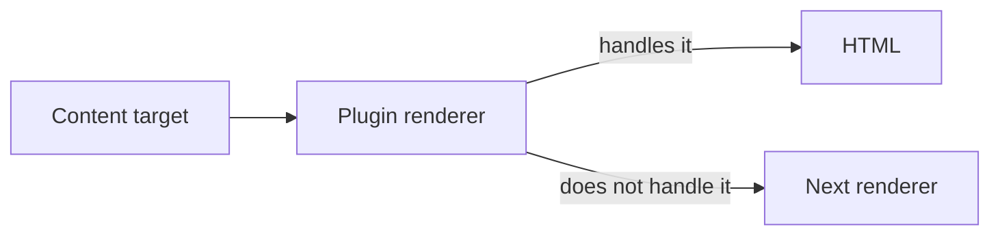
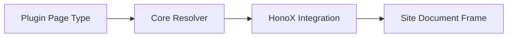

# Content processing

## Markdown and HTML pipelines

Plugins can declare remark/rehype plugins directly:

``` ts
definePlugin({
  name: "example",
  remarkPlugins: [remarkExample],
  rehypePlugins: [rehypeExample],
});
```

Or compose the framework pipelines themselves:

``` ts
definePlugin({
  name: "example",
  extendMarkdownPipeline(pipeline, context) {
    pipeline.use(remarkExample);
  },
  extendHtmlPipeline(pipeline) {
    pipeline.use(rehypeExample);
  },
});
```

Semantic Markdown/HTML transformation belongs here, not in application
components.

## Processed-content build dependencies

Core owns incremental invalidation. A plugin declares its cache contract with
`processedContentCache`; it must not implement its own affected-content logic.

``` ts
definePlugin({
  name: "citations",
  processedContentCache: {
    version: "citations-v1",
    dependencyMode: "tracked",
  },
  extendMarkdownPipeline(pipeline, context) {
    pipeline.use(remarkCitations, { contentSource: context.contentSource });
  },
});
```

- `none` means processing depends only on the content source, frontmatter,
  options, and the declared version.
- `tracked` means the pipeline reads other content or files. Read them through
  `context.contentSource` so Core records the dependency and selectively
  rebuilds its consumers. For example, a citations plugin reads its BibTeX file
  with `readContentSourceEntry(context.contentSource, path)`.
- `unsafe` opts out of persistent processed-content reuse. A content-affecting
  plugin without a contract receives the same safe full-content fallback.

Tracked dependencies are captured while processing content. Core persists their
content/file identities, builds a reverse index, and computes affected content
on the next incremental build. Do not scan the vault independently or persist a
plugin-specific incremental state for this purpose. If a dependency cannot be
observed through the framework API, use `unsafe`; a broad rebuild is correct,
where a stale result is not.

This is separate from output dependencies. `pageTypes[].outputDependencies`
and `context.output.emit({ path, content, dependencies })` declare which rendered pages
or generated files require regeneration. Use `content`, `tag`, `folder`,
`global`, or `unknown` there; `unknown` safely requests full output
regeneration.

Generated output paths are physical output paths. A generated output must not
collide with a content, redirect, or plugin page route; Core fails the build
instead of overwriting the route.

`planGeneratedOutputs` runs on each incremental build. When dependencies are known
(no `unknown` dependencies in generated outputs), the no-change fast path may still
be used. Core only skips the fast path when untracked inputs might exist.

## Renderers

Renderers receive a target (`kind`, `path`, `raw`, `label`, `url`,
`embed`) plus normal plugin context. Return `null` when the renderer
does not handle a target so another renderer can participate.



## Content formats

A plugin can register an additional source format, such as `.mdx`. Register the
extension and, when HonoX should render the page at request time, a renderer
module. The renderer receives the source path and `rendererOptions`; it returns
the article body, not the document frame.

```ts
definePlugin({
  name: "example-format",
  contentFormats: [{
    extension: ".txt",
    rendererModule: "@example/riebeckite-format/renderer",
    rendererOptions: { strict: true },
    async process({ source }) {
      return { frontmatter: {}, html: renderText(source) };
    },
    dependencies({ source, paths }) {
      return findLocalImports(source, paths);
    },
  }],
});
```

`process` returns `PostContent`. `html` is a safe build-time projection used by
search, feeds, excerpts, and table-of-contents extraction; `plainText` can carry
cleaner text for search and reading time. The projection must not execute
untrusted page code. `dependencies` returns local source or module paths whose
content should invalidate the cached result. Extensions are registered in the
Content Format Registry, so framework code must use `isContentPath` and
`toSlug` instead of checking `.md` directly. A duplicate extension fails plugin
resolution.

Content formats that change article output must declare
`processedContentCache`. Bump its `version` whenever the projection or rendered
output changes.

## Manifest collections and publication safety

Hooks that receive the manifest (`onManifestCreated`, page resolvers)
choose between three entry collections:

- `manifest.entries` — the raw collection for every scanned source, including
  `draft`, `scheduled`, private, and other nonpublic entries. It is not a
  publication view; never render it into a public page or discovery [[glossary/ui|UI]].
- `manifest.publicEntries` — routable entries: `public` and `unlisted`. Use for
  output that must cover every reachable URL, such as a sitemap. It still
  includes `unlisted` content.
- `manifest.discoverableEntries` — entries allowed in discovery surfaces:
  `public` only. Use this for related posts, recent lists, tag pages, search
  indexes, and any list a reader browses.

Do not re-derive visibility from `frontmatter` or reimplement `publishAt`. When a
hook genuinely needs to branch, read the resolved `entry.publishing`
(`visibility`, `routable`, `discoverable`); otherwise pick the collection that
already encodes the decision. The publish strategy is configured in
[Configuration](../configuration.md).

## Pages

`pageTypes` supplies standalone pages without adding application routes. A page
type declares its stable ID, [[glossary/ssg|SSG]] paths, optional priority, and a resolver. The
resolver receives the resolved manifest and a normalized request path, then
returns HTML for the page body or `null`. The site still owns its document frame
and theme. A page may also return `title`, `description`, `headTags`, and the
`language` it resolved; the document frame decides how to render that metadata.



```ts
definePlugin({
  name: "example-pages",
  pageTypes: [{
    id: "example.report",
    paths: ["/report"],
    resolve: ({ pathname, manifest }) => pathname === "/report"
      ? { type: "example.report", pathname, body: `<p>${manifest.discoverableEntries.length}</p>` }
      : null,
  }],
});
```

Use `resolveRiebeckiteRoute(content, c.req.path)` and
`pluginPageSsgParams(content)` from `@riebeckite/honox/server` in a catch-all
route. Duplicate IDs fail at plugin resolution. When multiple types match, the
highest `priority` wins; ties fail explicitly.

## Build dependencies

`processedContentCache` declares whether Core may reuse a plugin's processed
content between builds. This is separate from `cacheVersion` and
`context.cache`.

``` ts
processedContentCache: {
  version: "example-v1",
  dependencyMode: "tracked",
}
```

- `none` is for transforms that depend only on the source content, frontmatter,
  options, and the declared version.
- `tracked` is for transforms that read other content or files through Core.
  Use `context.contentSource`, `readContentSourceEntry`, `renderContent`, or
  `renderNoteEmbed`; Core owns `ContentDependencyTracker` and records those
  content and file reads automatically. Do not read the filesystem directly.
- `global` is for transforms that depend on resolved locations across the
  vault. Core fingerprints that location set and reprocesses every entry when
  it changes.
- `unsafe` is for inputs Core cannot track, such as Git, network, time, or
  process state. It safely bypasses persistent processed-content reuse.

Content dependencies decide which source content must be processed again.
Output dependencies decide which emitted files must be written again. They are
separate contracts. Page types declare `outputDependencies`; a plugin that
updates existing manifest entry HTML in `onManifestCreated` declares root
`contentOutputDependencies`, which are added to those content outputs. When the
dependency differs by entry, use
`resolveContentOutputDependencies({ entry, manifest })` to return dependencies
only for the affected content output.

``` ts
resolveContentOutputDependencies: ({ entry, manifest }) =>
  entry.slug === "report"
    ? [{ type: "content-query", properties: ["status", "file.mtime"] }]
    : []

pageTypes: [{
  id: "example.report",
  paths: ["/report"],
  outputDependencies: [{ type: "tag", tag: "release" }],
  resolve: () => null,
}]
```

`content-query` represents a discoverable-content candidate set plus the
frontmatter or `file.*` properties it reads. It detects additions, removals, and
publication-state transitions even when a note did not match the previous query.
Use `content`, `tag`, or `folder` when the exact scope is known; use `global`
for a manifest-wide collection transform. Use `unknown` only when the input
cannot be represented: it regenerates safely and requests full output
regeneration. Outputs emitted through `context.output` without dependencies are treated as `unknown`; an output returned by `planGeneratedOutputs` must declare at least one dependency or the build fails.
