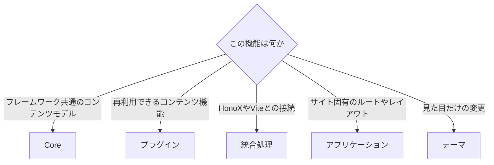

# 配布とパッケージ構成

## サイト内だけで使うプラグイン

プラグインは npm パッケージとして公開する必要はありません。サイト内にプラグインを作ることもできます。

```ts
// site/extensions/local-plugin.ts
import { definePlugin } from "@riebeckite/core";

export function localPlugin() {
  return definePlugin({
    name: "site-local",
    assets: [
      {
        pluginName: "site-local",
        kind: "style",
        moduleSpecifier: "/extensions/plugin.css",
      },
    ],
  });
}
```

作成したプラグインは、`riebeckite.config.ts` の `plugins` へ追加します。

サイト内のプラグインでも、依存関係の解決、パイプラインのフック、診断、レンダラー、エンドポイントなどは、パッケージとして配布するプラグインと同じ取り決めを使います。

`createStyleAsset()` と `createClientEntry()` には、モジュール指定子を明示して渡します。サイト内のプラグインでも、別名の第三者パッケージでも、ホストのバンドラーが解決できるサブパスを指定してください。

## リポジトリ外へプラグインを配布する

外部のプラグインは、Riebeckite の monorepo 内部のパスに依存しないようにします。基本的には `@riebeckite/core` の公開 API を利用してください。

プラグイン自身が提供する `./client`、`./components`、`./style.css` などは、そのパッケージの `package.json` にある `exports` で公開します。次のようなインポートは避けてください。

```ts
import {
  something,
} from "@riebeckite/core/src/...";
```

`src/**` は公開 API ではありません。また、Riebeckite の monorepo 内にしか存在しない相対パスへ依存しないでください。

公式のプラグインも、可能な限り同じ公開 API の利用者として実装します。

## 推奨するパッケージ構成

配布するパッケージでは、ビルド済みの ESM と型定義を公開し、`exports` をそのビルド成果物へ向けます。最小構成の `package.json` は次のとおりです。

```json
{
  "name": "my-riebeckite-plugin",
  "version": "1.0.0",
  "type": "module",
  "main": "./dist/index.js",
  "types": "./dist/index.d.ts",
  "exports": {
    ".": {
      "types": "./dist/index.d.ts",
      "import": "./dist/index.js",
      "default": "./dist/index.js"
    },
    "./client": {
      "types": "./dist/client.d.ts",
      "import": "./dist/client.js",
      "default": "./dist/client.js"
    },
    "./style.css": "./style.css"
  },
  "files": ["dist", "style.css"],
  "scripts": {
    "build": "node build.mjs && tsc -p tsconfig.json",
    "prepack": "npm run build"
  },
  "dependencies": {
    "@riebeckite/core": "^0.0.38",
    "unist-util-visit": "^5.0.0"
  },
  "devDependencies": {
    "@types/mdast": "^4.0.0",
    "esbuild": "^0.28.0",
    "typescript": "^5.0.0"
  }
}
```

`client.ts` や `style.css` を持たないプラグインでは、そのサブパスと `files` の項目を削除します。

JavaScript のエントリーポイントは `esbuild` でバンドルし、型定義は `tsc` で出力します。どちらも一般的なツールであり、Riebeckite 固有のビルドスクリプトは必要ありません。

`build.mjs` の例です。

```js
import { build } from "esbuild";

await build({
  entryPoints: ["index.ts", "client.ts"],
  outdir: "dist",
  bundle: true,
  format: "esm",
  platform: "neutral",
  packages: "external",
  external: ["@riebeckite/*"],
  logLevel: "warning",
});
```

`entryPoints` には、そのパッケージが持つエントリーだけを列挙します。クライアントのエントリーを持たない場合は `index.ts` だけです。

`tsconfig.json` の例です。

```json
{
  "compilerOptions": {
    "declaration": true,
    "emitDeclarationOnly": true,
    "outDir": "dist",
    "rootDir": ".",
    "module": "ESNext",
    "moduleResolution": "Bundler",
    "target": "ESNext",
    "lib": ["ESNext", "DOM", "DOM.Iterable"],
    "strict": true,
    "skipLibCheck": true
  },
  "include": ["index.ts", "client.ts"]
}
```

`prepack` でビルドするようにしておけば、`npm pack` と `npm publish` が常に最新の成果物を含むようになります。`@riebeckite/core` は `dependencies` に置くのが最も簡単です。サイト側と同じインスタンスを共有したい場合は `peerDependencies` でもかまいません。インポートする変換用の依存関係（`unist-util-visit`、`unified`、remark や rehype のパッケージなど）は `dependencies` に宣言してください。公開するパッケージの `exports` を TypeScript のソース（`./index.ts`）へ向けないでください。

公式のプラグインも、可能な限り同じ公開 API の利用者として実装します。

## プラグインに置くもの

プラグインに置くのは、**Riebeckite のサイト間で再利用できる機能**です。



プラグインに向いているのは、次のような機能です。

- Markdown や HTML の解釈
- 再利用できるコンテンツの変換
- プラグイン固有のレンダラー
- 再利用できるブラウザ上の動作
- プラグイン固有の診断
- プラグイン固有のエンドポイント
- SEO の拡張
- 独立したプラグインページ

一方、フレームワーク全体のコンテンツモデルは Core へ、HonoX や Vite との接続は統合処理へ、アプリケーション固有のルートやレイアウトはサイトアプリケーションへ、見た目だけの変更はテーマへ置きます。

## ESM

Riebeckite のパッケージは、NodeNext と ESM を前提とします。ビルド後に Node.js が実際に解決できるインポートを維持してください。

開発時の TypeScript ローダーが、拡張子のないインポートなどを偶然解決できている状態に依存しないことが重要です。
