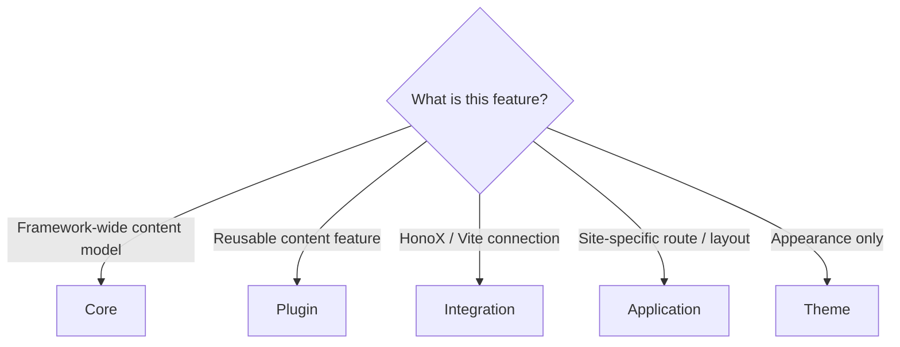

# Distribution and package layout

## Suggested package layout

``` text
packages/plugins/example/
├─ index.ts
├─ components/        # only when you export components
├─ client.ts          # only when needed
├─ style.css          # only when needed
├─ package.json
└─ src/
   ├─ remark.ts
   ├─ rehype.ts
   ├─ renderer.ts
   └─ types.ts
```

A plugin without a `client.ts` or `style.css` drops those subpaths and `files`
entries.

Bundle the JavaScript entry points with `esbuild` and emit declarations with
`tsc`. Both are ordinary ecosystem tools; no Riebeckite-specific build script
is required.

`build.mjs`:

```js
import { build } from "esbuild";

await build({
  entryPoints: ["index.ts", "client.ts"],
  outdir: "dist",
  bundle: true,
  format: "esm",
  platform: "neutral",
  packages: "external",
  external: ["@riebeckite/*"],
  logLevel: "warning",
});
```

List only the entry points your package actually has (drop `client.ts` when
there is no client).

`tsconfig.json`:

```json
{
  "compilerOptions": {
    "declaration": true,
    "emitDeclarationOnly": true,
    "outDir": "dist",
    "rootDir": ".",
    "module": "ESNext",
    "moduleResolution": "Bundler",
    "target": "ESNext",
    "lib": ["ESNext", "DOM", "DOM.Iterable"],
    "strict": true,
    "skipLibCheck": true
  },
  "include": ["index.ts", "client.ts"]
}
```

Building in `prepack` keeps `npm pack` / `npm publish` shipping fresh output.
Putting `@riebeckite/core` in `dependencies` is the simplest choice; use
`peerDependencies` instead when the site should provide the module instance.
Declare each transform dependency you import (`unist-util-visit`, `unified`,
remark/rehype packages) in `dependencies`, and never point a published `exports`
entry at TypeScript source (`./index.ts`).

For testing a distributed package, see [Testing](../../framework/testing/plugins.md#testing-a-plugin);
for CSS and client packaging, see [Assets and client entries](./ui-and-assets.md#assets-and-client-entries).

### Distributing a Plugin outside this repository

An external Plugin package depends only on `@riebeckite/core` and declares the
subpaths it owns (`./client`, `./components`, `./style.css`) in its own `exports`
map. Do not import `@riebeckite/core/src/**` or reference monorepo paths. See
[Public packages and import paths](../packages.md#public-packages-and-imports)
for the supported package surface and current constraints.

### Package shape

Publish built ESM plus type declarations and point `exports` at the built files.
A complete, copyable manifest:

```json
{
  "name": "my-riebeckite-plugin",
  "version": "1.0.0",
  "type": "module",
  "main": "./dist/index.js",
  "types": "./dist/index.d.ts",
  "exports": {
    ".": {
      "types": "./dist/index.d.ts",
      "import": "./dist/index.js",
      "default": "./dist/index.js"
    },
    "./client": {
      "types": "./dist/client.d.ts",
      "import": "./dist/client.js",
      "default": "./dist/client.js"
    },
    "./style.css": "./style.css"
  },
  "files": ["dist", "style.css"],
  "scripts": {
    "build": "node build.mjs && tsc -p tsconfig.json",
    "prepack": "npm run build"
  },
  "dependencies": {
    "@riebeckite/core": "^0.0.35",
    "unist-util-visit": "^5.0.0"
  },
  "devDependencies": {
    "@types/mdast": "^4.0.0",
    "esbuild": "^0.28.0",
    "typescript": "^5.0.0"
  }
}
```

A plugin without a `client.ts` or `style.css` drops those subpaths and `files`
entries.

JavaScript of the entry point is bundled with `esbuild` and type declarations
are emitted with `tsc`. Both are ordinary ecosystem tools; no Riebeckite-specific
build script is required.

`build.mjs`:

```js
import { build } from "esbuild";

await build({
  entryPoints: ["index.ts", "client.ts"],
  outdir: "dist",
  bundle: true,
  format: "esm",
  platform: "neutral",
  packages: "external",
  external: ["@riebeckite/*"],
  logLevel: "warning",
});
```

`entryPoints` includes only the entry points your package actually has (drop
`client.ts` when there is no client).

`tsconfig.json`:

```json
{
  "compilerOptions": {
    "declaration": true,
    "emitDeclarationOnly": true,
    "outDir": "dist",
    "rootDir": ".",
    "module": "ESNext",
    "moduleResolution": "Bundler",
    "target": "ESNext",
    "lib": ["ESNext", "DOM", "DOM.Iterable"],
    "strict": true,
    "skipLibCheck": true
  },
  "include": ["index.ts", "client.ts"]
}
```

## Responsibility boundary

Decide by the nature of the feature:



Put in a plugin:

- Markdown/HTML interpretation and reusable content transformation.
- Plugin-specific renderers, reusable browser behavior, and diagnostics.
- Plugin-specific endpoint/SEO extensions.

Do not put in a plugin:

- Framework-wide content model — belongs in Core.
- HonoX/Vite connections — belong in the Integration.
- Application-specific routes/layouts — belong in the App.
- Appearance-only changes — belong in [[glossary/theme|Theme]].

## ESM

For NodeNext/ESM packages, ensure built JavaScript uses import paths
Node can actually resolve; do not depend on a TypeScript loader
repairing runtime resolution.
