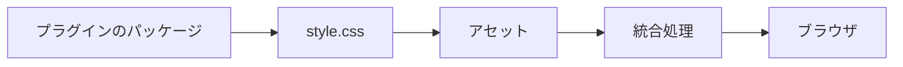
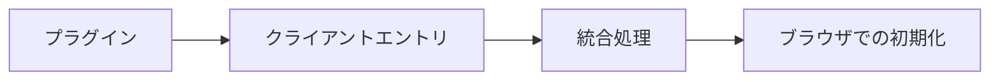
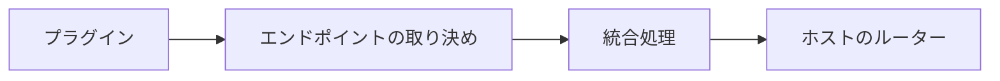
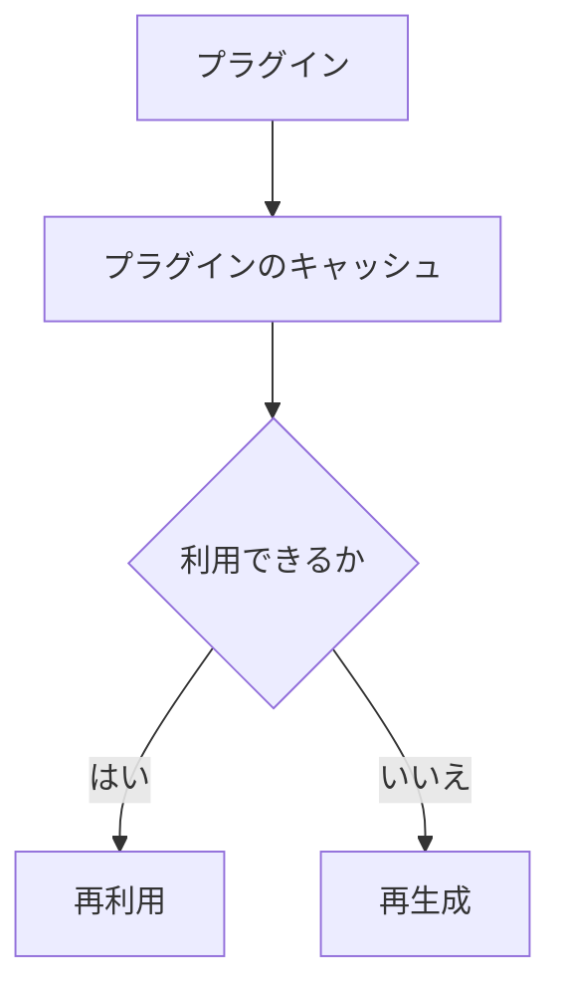

# UI・アセット・実行時連携

## UIコンポーネント

プラグインは、ファクトリから `PluginComponent<Props>` と `PluginDataHelper<Input, Model>` をエクスポートできます。データヘルパーは `PublicContentView` のような狭い入力を受け取り、型付きのモデルを返します。コンポーネントは読み取り専用の型付きpropsを受け取り、描画結果を返します。サイトは自身のTSXでこれらのコンポーネントを組み合わせ、表示するかどうか、位置、頻度を決めます。

典型的なエクスポートの形は次のとおりです。

```ts
// index.ts
export function example() {
  return definePlugin({
    name: "example",
    // ... factory hooks, assets, clientEntries, etc.
  });
}

export { MyComponent, getMyData };
```

より整理された構成にしたい場合は、プラグインの `./components/` の下に置けます。

```text
packages/plugins/example/
├─ index.ts
├─ components/
│  ├─ my-component.tsx   // <MyComponent /> と getMyData を export
│  └─ types.ts
├─ style.css
└─ client.ts
```

サイト側では、これをインポートして描画します。

```tsx
import { getMyData } from "@riebeckite/plugin-example";
import { MyComponent } from "@riebeckite/plugin-example/components";

const model = getMyData({ view, frontmatter: entry.frontmatter });
<MyComponent model={model} />
```

コンポーネントは、内部で使うCSSやクライアントコードを選択してエクスポートすることもできます。登録は既存の連携処理を通じて行われます。アセットとクライアントコードの登録は、引き続きプラグインのファクトリが担当します。コンポーネントをインポートしただけでは、CSSやクライアントランタイムは登録されず、プラグインの機能も有効になりません。CSSのツリーシェイキングは、既存のパッケージの `sideEffects` メタデータに従います。

### SPAナビゲーション時の配置

コンポーネントはサーバーのリクエストに対して描画するもので、どこに配置するかや、ブラウザ上でいつ置き換えるかは決めません。ページの内容に属するコンポーネントは、Siteが `main#main-content` に置きます。シェルの出力が現在のURL、言語、ページデータに依存する場合は、相互に遷移するすべてのルートで、安定して一意な `data-spa-region` で囲みます。

```tsx
<aside data-spa-region="docs-navigation">
  <DocsSidebar />
</aside>
```

クライアントの動作はコンポーネントの所有ではなくDOMの寿命に従います。`main` 内のコンテンツ用の[[glossary/client-entry|クライアントエントリ]]は既定の `page` scopeを使います。置き換わるシェルregion用のクライアントエントリは `app` scopeで実行し、`spa:navigation` の後に初期化し直すか、イベント委譲を使います。Pluginはコンポーネントがどちらに置かれるかを前提にしてはいけません。

[[framework/honox-integration|HonoX]]の描画プリミティブとして、`Article`、`ArticleHeader`、`ArticleContent`、`ArticleBody`、`ArticleFooter`、`Sidebar`、`ThemeRoot` があります。これらは記事の構造とレイアウトのための意味的な部品です。プラグインのコンポーネントはプラグインのパッケージに置き、モデルの型やヘルパーとともに公開エントリーポイントからエクスポートします。サイトのTSXはアプリケーションの `app/` に置きます。HonoXは描画のプリミティブだけを所有し、プラグインのコンポーネントを集めたり、順序を決めたりしません。

```tsx
// サイト route にある最小 UI composition
import { getBacklinks } from "@riebeckite/core";
import { MyComponent } from "@riebeckite/plugin-example";

const view = createPublicContentView(manifest);
const entry = view.findRoutableBySlug(slug);
const backlinks = await getBacklinks({ view, slug });
<article>
  <MyComponent backlinks={backlinks} />
  <ArticleBody html={entry.html} />
</article>
```

## アセット

プラグイン固有のCSSはプラグインのパッケージ内に置き、`assets` で公開します。

```ts
assets: [
  {
    pluginName: "example",
    kind: "style",
    moduleSpecifier:
      "@riebeckite/plugin-example/style.css",
  },
]
```

プラグインのCSSを `apps/web` へコピーしたり、ブラウザから `/node_modules` を直接参照させたりしないでください。

`createStyleAsset()` と `createClientEntry()` には、プラグイン名と、パッケージが `exports` で公開するモジュール指定子を明示します。そのため、`@riebeckite/plugin-<name>`、サイト内のプラグイン、任意の名前の第三者パッケージで同じAPIを利用できます。



## CSSフック

プラグイン固有のCSSはプラグインのパッケージ内に置き、最も外側の要素に安定したCSSフックを付けます。

フック名には `rr-<feature>` の形式を使います。たとえば `rr-search`、`rr-callout`、`rr-query`、`rr-code` です。

内部の要素にはBEM形式を使えます。

```text
rr-search
rr-search__input
rr-search__result
rr-search--loading
```

プラグイン固有の出力を `rb-*` の名前空間に置かないでください。

| 名前空間 | 用途 |
| --- | --- |
| `rb-*` | フレームワークの構造フック |
| `--rb-*` | フレームワークの意味的な[[glossary/design-token|デザイントークン]] |
| `rr-*` | プラグインと機能のフック |
| `--rr-*` | プラグイン固有のトークン |

出力には `rr-*` のフックだけを使い、プラグインのCSSと[[glossary/theme|テーマ]]も `rr-*` のフックを対象にします。テーマに公開する必要があるフックだけを、安定した取り決めとして文書化してください。

プラグインの既定のCSSはテーマのCSSより先に読み込まれるため、テーマはプラグインのパッケージを変更せずに見た目を上書きできます。

ダークモードへの対応では、`--rb-*` の意味的なトークンを参照するのが基本です。これらのトークンは、ライト、明示的なダーク、システム設定によるダークのいずれでも正しく解決されます。状態そのもので分岐する必要があるのは、ビルド済みの画像を反転する場合などに限られます。その場合は、HTMLのルート要素でも埋め込みテーマの `.rb-theme-root` でも効くように、テーマのルートへスコープしてください。

セレクターは `:is(:root, .rb-theme-root)[data-rb-mode="dark"] <hook>` です。システム設定によるダークモードには `@media (prefers-color-scheme: dark) { :is(:root, .rb-theme-root):not([data-rb-mode]) <hook> { ... } }` を使います。`html[data-rb-mode="dark"]` や `:root:not([data-rb-mode])` だけに依存すると、埋め込みテーマのルートを取りこぼします。フレームワークは `.dark` クラスを付与しないため、`.dark` を前提にしないでください。

詳しくは [テーマAPI](../theme-api.ja.md#安定したcssフック) を参照してください。

## クライアントエントリ

ブラウザ上でJavaScriptを実行する必要がある場合だけ、`clientEntries` を使います。

```ts
clientEntries: [
  {
    pluginName: "example",
    moduleSpecifier:
      "@riebeckite/plugin-example/client",
    exportName: "initExample",
    publicConfig: {
      selector: ".example",
    },
  },
]
```



サーバー側の描画やビルドだけで完結するプラグインに、クライアントのJavaScriptを追加しないでください。

`publicConfig` はブラウザへ渡される公開情報です。そのため、次の情報を含めてはいけません。

- トークン
- 認証情報
- 非公開のサービスURL
- 秘密情報

プラグインの `options` が自動的にブラウザへ渡されることもありません。

## HTTPエンドポイント

再利用できるHTTPエンドポイントを提供する場合は、`endpoints` を使います。



HonoXなど特定のルーター実装をプラグイン本体へ直接埋め込まず、エンドポイントの取り決めは統合処理がホストのルーターへ接続します。

## SEO

メタデータやフィードなどのSEO処理に参加する場合は、`seo` 拡張ポイントを使います。プラグイン固有のSEO処理を、アプリケーションのルート側へ実装し直さないでください。

## 診断

プラグイン固有の問題を報告する場合は、`addDiagnostics` を使います。

```ts
addDiagnostics(context) {
  return [
    {
      // Diagnostic contract
    },
  ];
}
```

診断結果は、可能な限り構造化されたデータとして返してください。CLI向けのメッセージを `console.log(...)` で直接出力するのではなく、診断の仕組みかLoggerを使ってください。

## プラグインのキャッシュ

`context.cache` は、プラグインごとに分離されたビルド時のキャッシュです。保存する値は、次の条件を満たす必要があります。

- 再生成できる
- JSONとして保存できる
- プラグインの名前空間内で完結する

`cacheVersion` を使うと、キャッシュ形式の互換性を管理できます。壊れたキャッシュを安全にキャッシュの未命中として扱えるように設計してください。書き込みは不可分に行います。



このキャッシュは、Cloudflare Workersなどの実行時データベースではありません。

## ログとトレース

プラグインは、フレームワークの可観測性の仕組みを利用できます。

```ts
context.logger.info("...");
await context.tracer.span(
  "plugin.example.work",
  {
    plugin: "example",
  },
  async () => {
    // work
  },
);
```

Loggerは「何が起きたか」を、Tracerは「どこに時間がかかったか」を記録します。Profilerはこの構造化されたトレースを利用するため、プラグインが独自のストップウォッチや[[glossary/profiler|プロファイラ]]を作る必要はありません。
