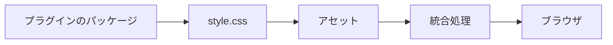
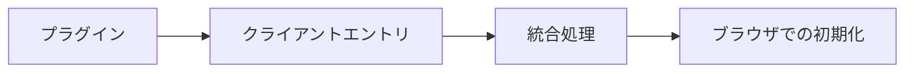
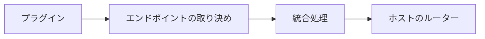
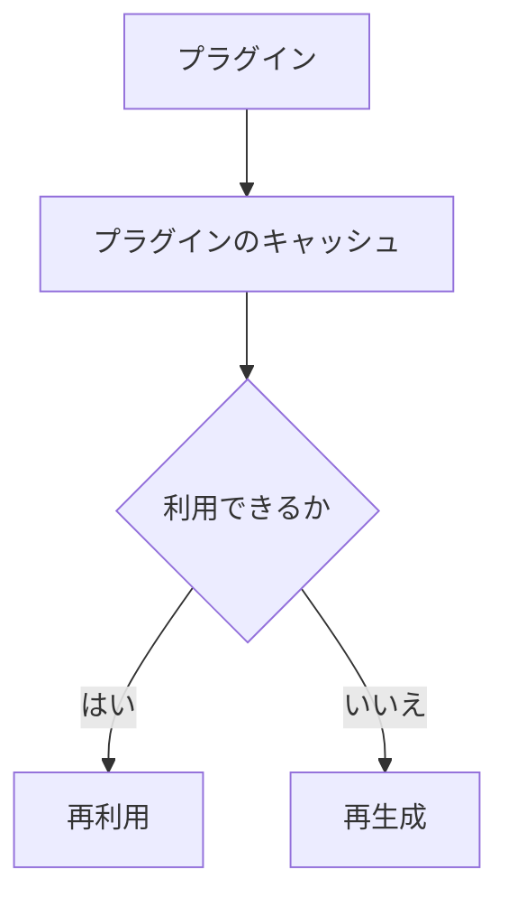

# UI・アセット・実行時連携

## UIコンポーネント

プラグインは、ファクトリから `PluginComponent<Props>` と `PluginDataHelper<Input, Model>` をエクスポートできます。データヘルパーは `PublicContentView` のような狭い入力を受け取り、型付きのモデルを返します。コンポーネントは読み取り専用の型付き props を受け取り、描画結果を返します。サイトは自身の TSX でこれらのコンポーネントを組み合わせ、表示するかどうか、位置、頻度を決めます。

典型的なエクスポートの形は次のとおりです。

```ts
// index.ts
export function example() {
  return definePlugin({
    name: "example",
    // ... factory hooks, assets, clientEntries, etc.
  });
}

export { MyComponent, getMyData };
```

より整理された構成にしたい場合は、プラグインの `./components/` の下に置けます。

```text
packages/plugins/example/
├─ index.ts
├─ components/
│  ├─ my-component.tsx   // <MyComponent /> と getMyData を export
│  └─ types.ts
├─ style.css
└─ client.ts
```

サイト側では、これをインポートして描画します。

```tsx
import { getMyData } from "@riebeckite/plugin-example";
import { MyComponent } from "@riebeckite/plugin-example/components";

const model = getMyData({ view, frontmatter: entry.frontmatter });
<MyComponent model={model} />
```

コンポーネントは、内部で使う CSS やクライアントコードを選択してエクスポートすることもできます。登録は既存の連携処理を通じて行われます。アセットとクライアントコードの登録は、引き続きプラグインのファクトリが担当します。コンポーネントをインポートしただけでは、CSS やクライアントランタイムは登録されず、プラグインの機能も有効になりません。CSS のツリーシェイキングは、既存のパッケージの `sideEffects` メタデータに従います。

### SPAナビゲーション時の配置

コンポーネントはサーバーのリクエストに対して描画するもので、どこに配置するかや、ブラウザ上でいつ置き換えるかは決めません。ページの内容に属するコンポーネントは、Site が `main#main-content` に置きます。シェルの出力が現在の URL、言語、ページデータに依存する場合は、相互に遷移するすべてのルートで、安定して一意な `data-spa-region` で囲みます。

```tsx
<aside data-spa-region="docs-navigation">
  <DocsSidebar />
</aside>
```

クライアントの動作はコンポーネントの所有ではなく DOM の寿命に従います。`main` 内のコンテンツ用の[[glossary/client-entry|クライアントエントリ]]は既定の `page` scope を使います。置き換わるシェル region 用のクライアントエントリは `app` scope で実行し、`spa:navigation` の後に初期化し直すか、イベント委譲を使います。Plugin はコンポーネントがどちらに置かれるかを前提にしてはいけません。

[[framework/honox-integration|HonoX]]の描画プリミティブとして、`Article`、`ArticleHeader`、`ArticleContent`、`ArticleBody`、`ArticleFooter`、`Sidebar`、`ThemeRoot` があります。これらは記事の構造とレイアウトのための意味的な部品です。プラグインのコンポーネントはプラグインのパッケージに置き、モデルの型やヘルパーとともに公開エントリーポイントからエクスポートします。サイトの TSX はアプリケーションの `app/` に置きます。HonoX は描画のプリミティブだけを所有し、プラグインのコンポーネントを集めたり、順序を決めたりしません。

```tsx
// サイト route にある最小 UI composition
import { getBacklinks } from "@riebeckite/plugin-backlinks";
import { MyComponent } from "@riebeckite/plugin-example";

const view = createPublicContentView(manifest);
const entry = view.findRoutableBySlug(slug);
const backlinks = await getBacklinks({ view, slug });
<article>
  <MyComponent backlinks={backlinks} />
</article>
```

## Markdown コンポーネント

通常の Markdown から自己完結した UI を描画するプラグインには `components` を使います。コンポーネントは Markdown AST の処理中に描画され、対話型コンポーネントのブラウザモジュールは、そのコンポーネントを含むページでだけ読み込まれます。

```tsx
import { definePluginComponent } from "@riebeckite/core";
import { renderToString } from "hono/jsx/dom/server";

components: [
  definePluginComponent({
    name: "Counter",
    parseProps: (props) => ({ initial: Number(props.initial ?? 0) }),
    render: (props) => renderToString(<Counter {...props} />),
    client: { moduleSpecifier: "@example/plugin/counter" },
  }),
];
```

MDX を有効にしなくても、Markdown では次のように書けます。

````md
```riebeckite-component Counter
initial: 3
```
````

props は YAML のマッピングでなければならず、JSON として安全にシリアライズできる公開データだけが使われます。コンポーネント名はプラグイン全体で一意にしてください。重複はプラグイン解決時に失敗します。静的コンポーネントでは `client` を省略します。対話型コンポーネントは既定 export の Hono JSX コンポーネント（または `exportName` で指定した export）を公開し、生成されたクライアントエントリが hydration します。イベント委譲、任意の DOM を管理するウィジェット、ページ全体の動作には引き続き `clientEntries` が適しています。

フェンスは Markdown を HTML に変換する前の通常のコードブロックとして処理されるため、素の Markdown で動作し、MDX は不要です。MDX はページ全体で JSX が必要な場合の別のコンテンツ形式として残ります。このコンポーネントは HonoX の Island ではありません。HonoX は `app/islands` だけを走査し、Riebeckite の生成クライアントがコンポーネントのマーカーを見つけて、宣言されたモジュールを Vite 経由で読み込みます。HonoX がクライアントバンドルを出力できるようレンダラーで `__importing_islands = true` を維持し、`clientEntries` のモジュールと同じようにクライアントのビルド成果物をパッケージの manifest から公開してください。すべての Markdown を MDX にせず、フェンスの構文を小さく保つための選択です。

`parseProps` はコンテンツ由来の値を検証する境界です。コンポーネントのサーバー出力は通常の Markdown サニタイザーを通り、props は属性に渡す前にエスケープと検証を行います。コンポーネントは処理済み Markdown を変えるため、永続キャッシュを有効にする場合はプラグインの `processedContentCache` 契約に含めてください。含めない場合、古い HTML を返さず、そのプラグインのキャッシュをバイパスします。コンポーネントの描画を変えたときは契約の `version` を更新してください。

`resolveProps` は `parseProps` の後に `{ sourceSlug, resolveAssetUrl, manifest, diagnostics }` を受け取って実行されます。コンテンツからの相対パスに依存する props に使ってください。解決後の props もハイドレーション境界を越えるため、JSON 安全でなければなりません。`resolveAssetUrl` は未対応のパスや外部 URL では `null` を返すので、描画前に結果を検証してください。manifest の確定後に解決が必要な場合は `deferUntilManifest: true` を指定します。コンポーネントは manifest フック後に描画され、`diagnostics` と `renderError` を使ってアクセシブルなエラー状態を保てます。

HAST 段階のコンポーネントは `defineHastComponent` と `hastComponents` を使います。生 HTML と Markdown のサニタイズ後、さらにプラグインの Rehype 変換後に実行されるため、`match` が見るのは信頼済みのノードだけです。`render` はシリアライズ済みのノードと、すでにサニタイズされた子 HTML を受け取ります。既存の文書構造を包む、グループ化する用途に使い、サニタイザーを迂回する目的では使わないでください。

## オーバーレイホスト

テーマは `@riebeckite/ui/overlay` の `<OverlayHost name="…" />` で、クライアント用オーバーレイの SSR ホストを用意できます。クライアントの初期化処理は `findOverlayHost(name)` でホストを探し、テーマが用意していない場合は自前でホストを作ってかまいません。オーバーレイ名ごとにホストを1つにし、クライアントエントリの終了時はコンポーネントだけをアンマウントして、アプリが持つホストは残してください。

アプリ全体の配置には同じモジュールの `<AppSlot name="bodyStart" />` を使います。名前は `head`、`bodyStart`、`articleAfter`、`app` で、必要なら `as` でセマンティック要素を選べます。クライアントからは `findAppSlot(name)` で配置を解決できます。スロットのマークアップはテーマやサイトのレンダラーに置き、プラグインコンテンツ内へページ固有のラッパーを増やさないでください。

MDX ページは別のコンポーネント実装ではなく、同じレジストリを使います。登録したコンポーネントは MDX レンダラーへ JSX コンポーネントとして渡されます。

```mdx
<Counter initial={3} />
```

`mdx({ components })` で同じ名前のコンポーネントを渡した場合、そのページではプラグインコンポーネントより優先されます。props はハイドレーション境界を越えるため JSON 安全でなければなりません。内容は JSX の children ではなく、明示的な文字列 prop で渡してください。`parseProps` による検証は同じように働き、ハイドレートされるのは対話型コンポーネントだけです。MDX はコンポーネントを直接描画するため、`render` の出力は信頼済みのプラグインコードとして扱われ、Markdown サニタイザーを通りません。信頼できない内容は props に置き、コンポーネント側でエスケープしてください。

## アセット

プラグイン固有の CSS はプラグインのパッケージ内に置き、`assets` で公開します。

```ts
assets: [
  {
    pluginName: "example",
    kind: "style",
    moduleSpecifier:
      "@riebeckite/plugin-example/style.css",
  },
]
```

プラグインの CSS を `website` へコピーしたり、ブラウザから `/node_modules` を直接参照させたりしないでください。

`createStyleAsset()` と `createClientEntry()` には、プラグイン名と、パッケージが `exports` で公開するモジュール指定子を明示します。そのため、`@riebeckite/plugin-<name>`、サイト内のプラグイン、任意の名前の第三者パッケージで同じ API を利用できます。



## CSSフック

プラグイン固有の CSS はプラグインのパッケージ内に置き、最も外側の要素に安定した CSS フックを付けます。

フック名には `rr-<feature>` の形式を使います。たとえば `rr-search`、`rr-callout`、`rr-query`、`rr-code` です。

内部の要素には BEM 形式を使えます。

```text
rr-search
rr-search__input
rr-search__result
rr-search--loading
```

新しいプラグインの出力を `rb-*` の名前空間に置かないでください。一部の組み込みプラグインは互換性のため、文書化された `rb-*` ルートを引き続き公開しています。テーマは各プラグインが文書化しているルートを対象にしてください。

| 名前空間 | 用途 |
| --- | --- |
| `rb-*` | フレームワークの構造フック。一部の組み込みプラグインも文書化されたルートとして使用 |
| `--rb-*` | フレームワークの意味的な[[glossary/design-token|デザイントークン]] |
| `rr-*` | プラグインと機能のフック |
| `--rr-*` | プラグイン固有のトークン |

出力には `rr-*` のフックだけを使い、プラグインの CSS と[[glossary/theme|テーマ]]も `rr-*` のフックを対象にします。テーマに公開する必要があるフックだけを、安定した取り決めとして文書化してください。

プラグインの既定の CSS はテーマの CSS より先に読み込まれるため、テーマはプラグインのパッケージを変更せずに見た目を上書きできます。

ダークモードへの対応では、`--rb-*` の意味的なトークンを参照するのが基本です。これらのトークンは、ライト、明示的なダーク、システム設定によるダークのいずれでも正しく解決されます。状態そのもので分岐する必要があるのは、ビルド済みの画像を反転する場合などに限られます。その場合は、HTML のルート要素でも埋め込みテーマの `.rb-theme-root` でも効くように、テーマのルートへスコープしてください。

セレクターは `:is(:root, .rb-theme-root)[data-rb-mode="dark"] <hook>` です。システム設定によるダークモードには `@media (prefers-color-scheme: dark) { :is(:root, .rb-theme-root):not([data-rb-mode]) <hook> { ... } }` を使います。`html[data-rb-mode="dark"]` や `:root:not([data-rb-mode])` だけに依存すると、埋め込みテーマのルートを取りこぼします。フレームワークは `.dark` クラスを付与しないため、`.dark` を前提にしないでください。

詳しくは [テーマ API](../theme-api.ja.md#安定した css フック) を参照してください。

## クライアントエントリ

ブラウザ上で JavaScript を実行する必要がある場合だけ、`clientEntries` を使います。

```ts
clientEntries: [
  {
    pluginName: "example",
    moduleSpecifier:
      "@riebeckite/plugin-example/client",
    exportName: "initExample",
    publicConfig: {
      selector: ".example",
    },
  },
]
```



サーバー側の描画やビルドだけで完結するプラグインに、クライアントの JavaScript を追加しないでください。

`publicConfig` はブラウザへ渡される公開情報です。そのため、次の情報を含めてはいけません。

- トークン
- 認証情報
- 非公開のサービス URL
- 秘密情報

プラグインの `options` が自動的にブラウザへ渡されることもありません。

クライアント側が所有するUIはHono JSXで書き、`hono/jsx/dom/client` の `createRoot()` でホスト要素へ描画してください。フォーカス、サイズ測定、ポインターキャプチャ、メディア再生など、ブラウザでしか行えない処理は初期化関数に残します。特定のマーカーを含むページだけで初期化すればよい場合は、`createClientEntry()` の第7引数へpresence selectorを渡し、他のページでチャンクを読み込まないようにしてください。

## HTTPエンドポイント

再利用できる HTTP エンドポイントを提供する場合は、`endpoints` を使います。



HonoX など特定のルーター実装をプラグイン本体へ直接埋め込まず、エンドポイントの取り決めは統合処理がホストのルーターへ接続します。

## SEO

メタデータやフィードなどの SEO 処理に参加する場合は、`seo` 拡張ポイントを使います。プラグイン固有の SEO 処理を、アプリケーションのルート側へ実装し直さないでください。

## 診断

プラグイン固有の問題を報告する場合は、`addDiagnostics` を使います。

```ts
addDiagnostics(context) {
  return [
    {
      // Diagnostic contract
    },
  ];
}
```

診断結果は、可能な限り構造化されたデータとして返してください。CLI 向けのメッセージを `console.log(...)` で直接出力するのではなく、診断の仕組みか Logger を使ってください。

## プラグインのキャッシュ

`context.cache` は、プラグインごとに分離されたビルド時のキャッシュです。保存する値は、次の条件を満たす必要があります。

- 再生成できる
- JSON として保存できる
- プラグインの名前空間内で完結する

`cacheVersion` を使うと、キャッシュ形式の互換性を管理できます。壊れたキャッシュを安全にキャッシュの未命中として扱えるように設計してください。書き込みは不可分に行います。



このキャッシュは、Cloudflare Workers などの実行時データベースではありません。

## ログとトレース

プラグインは、フレームワークの可観測性の仕組みを利用できます。

```ts
context.logger.info("...");
await context.tracer.span(
  "plugin.example.work",
  {
    plugin: "example",
  },
  async () => {
    // work
  },
);
```

Logger は「何が起きたか」を、Tracer は「どこに時間がかかったか」を記録します。Profiler はこの構造化されたトレースを利用するため、プラグインが独自のストップウォッチや[[glossary/profiler|プロファイラ]]を作る必要はありません。
