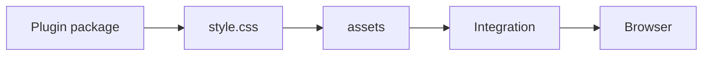
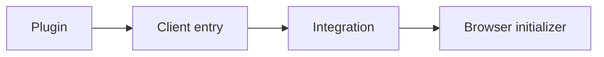
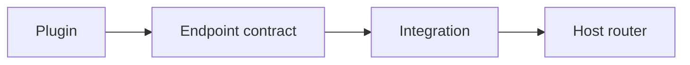
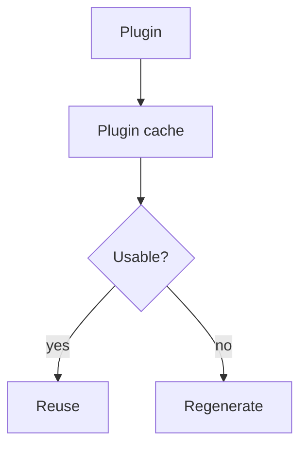

# UI, assets, and runtime

## Extension mechanisms

Riebeckite separates three ways a Plugin can add UI or change rendered output:

| Feature | Site | Markdown | HAST |
| --- | --- | --- | --- |
| Placed from site TSX | Yes | No | No |
| Usable from a Markdown fence or MDX | No | Yes | No |
| Transforms the document AST | No | No | Yes |
| SSR | JSX rendering | HTML generation | AST transformation |
| Client entry | Depends on implementation | Optional | None |
| Hydration | Depends on implementation | Optional | None |

The pipeline order is:

1. Markdown components render during the Markdown AST pass, before `remark-rehype`.
2. The generated HTML passes through raw HTML parsing and Markdown sanitizers.
3. Plugin Rehype transforms run.
4. HAST transforms run on the sanitized tree.
5. Table wrapping, math rendering, formatting, slugs, and HTML serialization finish the document.

Site components are rendered by the site's own TSX outside this pipeline. Markdown component output is sanitized as part of Markdown, while HAST transform output is inserted after sanitization and is therefore trusted plugin output. HAST transforms must not inject untrusted strings or bypass the sanitizer.

## Site components

Plugins may export a `PluginSiteComponent<Props>` and a `PluginDataHelper<Input, Model>` in addition to their factory. Data helpers receive narrow inputs such as `PublicContentView` and return typed models; components accept readonly typed props and return rendered output. The Site composes these components in its own TSX, choosing whether, where, and how often to render each one.

Typical plugin export shape:

```ts
// index.ts
export function example() {
  return definePlugin({
    name: "example",
    // ... factory hooks, assets, clientEntries, etc.
  });
}

export { MyComponent, getMyData };
```

Or more conventionally, a plugin may place its component and helper under `./components/`:

```text
packages/plugins/example/
├─ index.ts
├─ components/
│  ├─ my-component.tsx   // exports <MyComponent /> and getMyData
│  └─ types.ts
├─ style.css
└─ client.ts
```

The Site then imports and renders:

```tsx
import { getMyData } from "@riebeckite/plugin-example";
import { MyComponent } from "@riebeckite/plugin-example/components";

const model = getMyData({ view, frontmatter: entry.frontmatter });
<MyComponent model={model} />
```

Components may also optionally export internal CSS and a client entry, registered through the integration as usual. Existing asset and client-entry registration remains factory-owned; importing a component alone neither registers CSS/client runtime nor enables a plugin capability.

### Placement during SPA navigation

A component renders for the server request; it does not own its placement or
choose when it is replaced in the browser. The Site places it in
`main#main-content` when it belongs to page content. When shell output depends
on the current URL, language, or page data, the Site wraps it in a stable,
unique `data-spa-region` on every route that can navigate between it:

```tsx
<aside data-spa-region="docs-navigation">
  <DocsSidebar />
</aside>
```

Client behavior follows DOM lifetime, not component ownership. A client entry
for content in `main` uses the default `page` scope. A client entry for a
replaceable shell region uses `app` scope and reinitializes after
`spa:navigation`, or uses event delegation. Plugins must not assume that
their component is placed in either location.

HonoX primitives such as `Article`, `ArticleHeader`, `ArticleContent`, `ArticleBody`, `ArticleFooter`, `Sidebar`, and `ThemeRoot` remain as semantic primitives for article structure and layout. Components belong in plugin packages and are exported from their public entry points with their model types and helpers. Site TSX belongs under the application's `app/`. HonoX owns rendering primitives only; it does not collect plugin components or select their order.

```tsx
// Minimal UI composition in a site route
import { getBacklinks } from "@riebeckite/plugin-backlinks";
import { MyComponent } from "@riebeckite/plugin-example";

const view = createPublicContentView(manifest);
const entry = view.findRoutableBySlug(slug);
const backlinks = await getBacklinks({ view, slug });
<article>
  <MyComponent backlinks={backlinks} />
</article>
```

## Markdown components

Use `markdownComponents` when a Plugin renders a self-contained UI from ordinary
Markdown. A Markdown component is a string renderer: `render` returns HTML, and
`parseProps`/`resolveProps` validate and resolve the values from content. It
renders during the Markdown AST pass, and its browser module is loaded only when
the rendered page contains that interactive component.

```tsx
import { defineMarkdownComponent } from "@riebeckite/core";
import { renderToString } from "hono/jsx/dom/server";

markdownComponents: [
  defineMarkdownComponent({
    name: "Counter",
    parseProps: (props) => ({ initial: Number(props.initial ?? 0) }),
    render: (props) => renderToString(<Counter {...props} />),
    client: { moduleSpecifier: "@example/plugin/counter" },
  }),
];
```

Write it in Markdown without enabling MDX:

````md
```riebeckite-component Counter
initial: 3
```
````

Props must be a YAML mapping and are serialized as JSON-safe public data. Give
each Markdown component a unique name within that namespace; duplicate Markdown
component names fail during plugin resolution. A HAST transform may reuse the
same name because the two namespaces are separate. Omit `client` for static
components. Interactive components must
export the default Hono JSX component (or set `exportName`) and hydrate through
the generated client entry. `clientEntries` remain appropriate for delegated
events, widgets that manage arbitrary DOM, and page-level behavior.

The fence is an ordinary fenced code block handled before Markdown is converted
to HTML, so it works with plain Markdown and does not require MDX. MDX remains a
separate content format for pages that need full JSX. These components are not
HonoX islands: HonoX scans only `app/islands`, while Riebeckite's generated
client finds component markers and loads the declared module through Vite. Keep
`__importing_islands = true` in the renderer so HonoX emits its client bundle,
and export the client build from the plugin package manifest as you would for a
`clientEntries` module. The fence stays deliberately small instead of turning
every Markdown page into MDX.

MDX pages use the same registry rather than a second component implementation.
The registered components are passed into the MDX renderer as JSX components:

```mdx
<Counter initial={3} />
```

A `components` option passed to `mdx({ components })` overrides a Plugin
component with the same name for those pages. Props cross the hydration
boundary, so they must be JSON-safe; pass content through an explicit string
prop instead of JSX children. `parseProps` still validates the values, and
only interactive components hydrate. MDX renders the component directly, so
its `render` output is trusted plugin code and does not pass through the
Markdown sanitizer; keep untrusted content in props and escape it in the
component.

`parseProps` is the validation boundary for values that come from content. The
component's server output passes through the normal Markdown sanitizer, and
props are escaped and validated before they reach an attribute. Components
change processed Markdown, so include them in the plugin's
`processedContentCache` contract when persistent caching is enabled; otherwise
caching is bypassed for that plugin instead of serving stale HTML. Bump the
contract's `version` when component rendering changes.

`resolveProps` runs after `parseProps` and receives
`{ sourceSlug, resolveAssetUrl, manifest, diagnostics }`. Use it when props
depend on content-relative assets; the resolved props still cross the hydration
boundary and must remain JSON-safe. `resolveAssetUrl` returns `null` for
unsupported or external paths, so validate the result before rendering. When
resolution needs the final manifest, set `deferUntilManifest: true`; the
component renders after manifest hooks and can use `diagnostics` and
`renderError` to keep an accessible error state.

### Choosing JSX or SSR output

Pick the smallest mechanism that produces the markup. Use Hono JSX when
component state changes the rendered markup, or when an external renderer needs
a loading/ready/error lifecycle; keep SSR HTML plus a small behavior controller
when the markup is static and only event wiring is interactive (code tabs,
table of contents, navigation). The JSX runtime is loaded only on pages that
contain a hydrated component, so a behavior controller is still the cheaper
choice for simple UI. Do not convert already-sanitized HTML into JSX to "make it
declarative": the component contract ends at serialized props.

### External renderers

Route external renderer lifecycles through `renderPendingDiagrams` from
`@riebeckite/diagram/client`. The shared wrapper finds pending figures, sets
`aria-busy` and `data-diagram-status` to `rendered` or `error`, opens the SSR
fallback element, cancels work through `signal`, ignores detached figures with
`isConnected`, and returns the cleanup that disposes instances on unmount.
Import the library lazily so it keeps its own chunk, check `signal.aborted`
after each `await`, and leave the Canvas/SVG/DOM output to the library. Mermaid,
Graphviz, and Chart.js follow this contract; a renderer with a genuinely
different lifecycle may keep its own initializer.

## HAST transforms

Use `hastTransforms` with `defineHastTransform` to transform sanitized HTML
nodes. A HAST transform is not a UI component: it has no `client` entry, does
not hydrate, and cannot own browser state.

```ts
import { defineHastTransform } from "@riebeckite/core";

hastTransforms: [
  defineHastTransform({
    name: "WrapSection",
    match: (node) => node.tagName === "section",
    render: ({ children }) => `<div class="rr-section">${children}</div>`,
  }),
];
```

Transforms run after raw HTML and Markdown sanitization and after Plugin Rehype
transforms, so `match` only sees trusted nodes and `render` receives the
serialized node and its already-sanitized children. The returned HTML is
inserted without another sanitizer pass: escape any value that did not come
from the sanitized tree, and never use a transform to inject content from
frontmatter, props, or another untrusted source.

Markdown components and HAST transforms can be combined. A Markdown component
runs first and produces HTML; the document is parsed and sanitized; then a HAST
transform can group or wrap the resulting nodes. A Markdown component cannot run
inside a HAST transform, and a HAST transform cannot register a client entry.
See [Writing a Plugin](../../plugins/writing-a-plugin.md#providing-ui-or-output)
for choosing between the three mechanisms.

## Overlay hosts

A theme can provide an SSR-owned host for client overlays with
`<OverlayHost name="…" />` from `@riebeckite/ui/overlay`. A client initializer
may look it up with `findOverlayHost(name)` and fall back to creating its own
host when the theme does not render one. Keep one host per overlay name and let
the client entry unmount its component without removing the app-owned host.

Use `<AppSlot name="bodyStart" />` from the same module for application-level
placement. The names are `head`, `bodyStart`, `articleAfter`, and `app`; choose
a semantic element with `as` when needed. `findAppSlot(name)` resolves the
placement from client code. Keep slot markup in the theme or site renderer
rather than adding page-specific wrappers inside plugin content.

## Assets and client entries

[[glossary/plugin|Plugin]] CSS remains in the plugin package and is declared through
`assets`. Browser initialization is declared through `clientEntries`
only when browser JavaScript is genuinely required. Do not copy plugin
CSS into `website` or expose `/node_modules` directly.

Use the Core helpers to register the plugin name and the package exports
together. The module specifier is explicit, so the same API works for official,
third-party, and site-local packages:

``` ts
import {
  createClientEntry,
  createStyleAsset,
  definePlugin,
} from "@riebeckite/core";

export function example() {
  return definePlugin({
    name: "example",
    assets: [createStyleAsset("example", "@riebeckite/plugin-example/style.css")],
    clientEntries: [
      createClientEntry("example", {
        moduleSpecifier: "@riebeckite/plugin-example/client",
        exportName: "initExample",
        publicConfig: { selector: ".example" },
      }),
    ],
  });
}
```

The same declarations written out explicitly:

``` ts
assets: [
  {
    pluginName: "example",
    kind: "style",
    moduleSpecifier: "@riebeckite/plugin-example/style.css",
  },
]
```



The module specifier is resolved by the host bundler. It can be a subpath exposed
by the plugin package's `exports` map, a site-local absolute path (e.g.
`/extensions/plugin.css`), or a path the bundler can resolve. For example, a
third-party package can use `createStyleAsset("example", "@example/plugin/style.css")`
and `createClientEntry("example", { moduleSpecifier: "@example/plugin/client" })`.

Omit `assets` or `clientEntries` when the plugin does not need them. The client
entry's export name is optional and defaults to the module default export.
`exportName`, `publicConfig`, `scope`, `initializerArguments`,
`presenceSelector`, and `root` configure the generated initializer.
`publicConfig` is an optional JSON value passed to that initializer. It is the
only plugin configuration exposed to browser code (and recorded in the
manifest for static hosts); `options` are never copied to the client. Register
only deliberately public values—never tokens, credentials, or private service
URLs. An initializer without public config continues to receive no arguments.

Client-owned UI should be written in Hono JSX and mounted into its host with
`createRoot()` from `hono/jsx/dom/client`. Keep browser-only work such as focus,
measurement, pointer capture, and media playback in the initializer. When an
entry is needed only on pages that contain a marker, set `presenceSelector` so
the chunk is not loaded on other pages.

The selector is evaluated against the whole current DOM, so the marker must be
in the SSR HTML or added before the SPA commit; client-created content cannot
trigger the load. The page-scoped root remains `main#main-content` by default.
When the marker lives in a shell region outside that root, set
`root: "document"`; the matched element is also available as `context.marker`.
Entries that must always run because they implement site-wide behavior
(analytics, color mode, text fragment, UX) omit the selector. The selector only
gates loading: the initializer must still look for its own elements, and
page-scoped work must return cleanup so an aborted load does not leave
listeners behind. App-scoped entries with a selector are re-evaluated on each
page commit, so a marker introduced by SPA navigation can still load them.

A client entry can also be declared explicitly:

``` ts
clientEntries: [
  {
    pluginName: "example",
    moduleSpecifier: "@riebeckite/plugin-example/client",
    exportName: "initExample",
    publicConfig: { selector: ".example" },
  },
]
```



Do not add client JavaScript to a plugin that completes entirely at SSR or
build time.

## CSS hooks

Plugin CSS stays in the plugin package and reaches the browser through
`assets`. When a plugin renders a distinct, reusable feature, put a stable
root hook on its outermost element:

- Name plugin/feature hooks `rr-<feature>` (`rr-search`, `rr-callout`,
  `rr-query`, `rr-code`, ...). Use BEM structure under the root:
  `rr-<feature>`, `rr-<feature>__element`, `rr-<feature>--modifier`.
- New plugins emit only `rr-*` hooks; plugin CSS and site themes should target
  the `rr-` hook. Some built-in plugins still expose documented `rb-*` roots
  for compatibility, so target the root each plugin documents.
- Do not put new plugin output in the `rb-` namespace. `rb-*` classes and
  `--rb-*` tokens belong to framework structural hooks and semantic design
  tokens. Plugin-local tokens use `--rr-*` and may fall back to `--rb-*`.
- `rr-<feature>__*` and `rr-<feature>--*` are internal implementation
  details. Document any descendant a theme is expected to target.

| Namespace | Use |
| --- | --- |
| `rb-*` | Framework structural hooks |
| `--rb-*` | Framework semantic design tokens |
| `rr-*` | Plugin / feature hooks |
| `--rr-*` | Plugin-local tokens |

Themes target these root hooks. Plugin default CSS loads before theme CSS, so
a theme restyles a feature without editing the plugin. See
[Stable CSS hooks](../../framework/theme-system/css.md#stable-css-hooks-and-the-cascade).

For dark mode, consume the semantic `--rb-*` tokens: they resolve correctly in
light, explicit dark, and system dark. Only when a plugin must branch on the
mode itself (for example to invert a build-time asset) should it scope the
override to the theme root so it works both at the document root and inside an
embedded `.rb-theme-root`:
`:is(:root, .rb-theme-root)[data-rb-mode="dark"] <hook>` and, for system dark,
`@media (prefers-color-scheme: dark) { :is(:root, .rb-theme-root):not([data-rb-mode]) <hook> { ... } }`.
Do not key a dark override on `html[data-rb-mode="dark"]` or
`:root:not([data-rb-mode])` alone; those miss embedded theme roots. The
framework never adds a `.dark` class, so do not depend on one.

## Endpoints and SEO

`endpoints` lets an Integration connect reusable plugin HTTP behavior to
the host router without embedding HonoX-specific routing in Core. `seo`
lets plugins participate in metadata/feed-related behavior through the
framework contract.



Do not embed a specific router implementation (such as HonoX) in the plugin
itself; the integration connects the endpoint contract to the host router.
Do not reimplement plugin-specific SEO logic in application routes.

Use `defineEndpoint` to declare an endpoint. Pass `cacheControl` only when the
response is safe to cache; the helper applies the header without duplicating
response plumbing.

``` ts
import { defineEndpoint } from "@riebeckite/core";

const searchEndpoint = defineEndpoint(
  "/search-data.json",
  ({ config, manifest }) => ({ json: buildSearchItems({ config, manifest }) }),
  { cacheControl: "public, max-age=300" },
);
```

## Diagnostics

Return structured diagnostics rather than printing ad-hoc CLI messages.
Use the injected Logger for operational logging.

``` ts
addDiagnostics(context) {
  return [
    {
      // Diagnostic contract
    },
  ];
}
```

Return diagnostics as structured data rather than calling `console.log(...)`
for CLI messages; use diagnostics or the logger.

## Plugin Cache

`context.cache` is a plugin-scoped, regenerable **build-time** cache.

- Store only regenerable, JSON-serializable values.
- Reference only your own plugin namespace.
- Use `cacheVersion` when compatibility changes.
- Treat a corrupt cache as a safe miss.
- Writes are atomic.



It is not a database or Cloudflare Workers runtime storage.

## Observability (Logger / Tracer)

Use `context.logger` and `context.tracer`:

``` ts
context.logger.info("...");
await context.tracer.span("plugin.example.work", { plugin: "example" }, async () => {
  // work
});
```

The [[glossary/profiler|Profiler]] consumes structured tracing, so plugins do not need their own
timing/reporting system.
