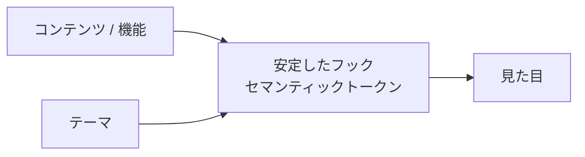
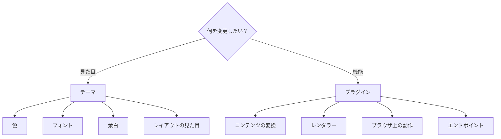
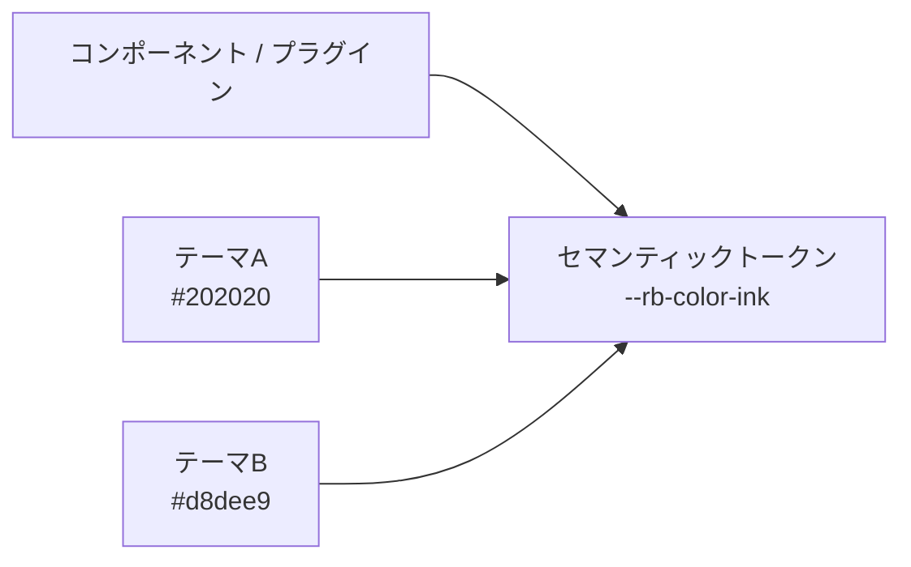
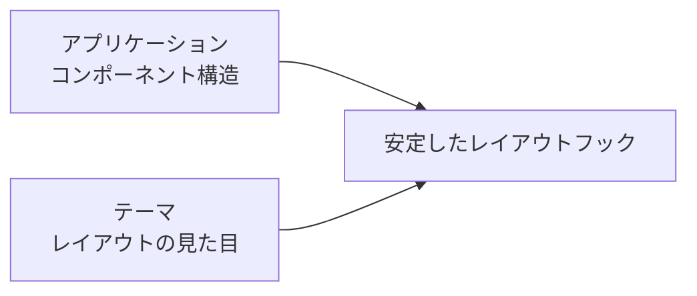
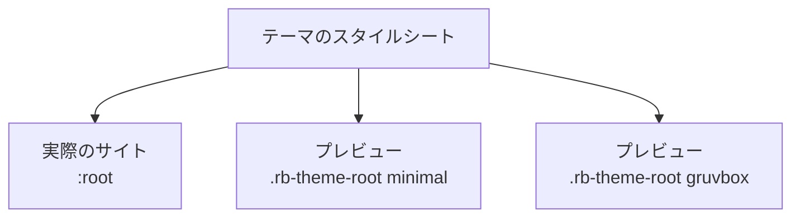
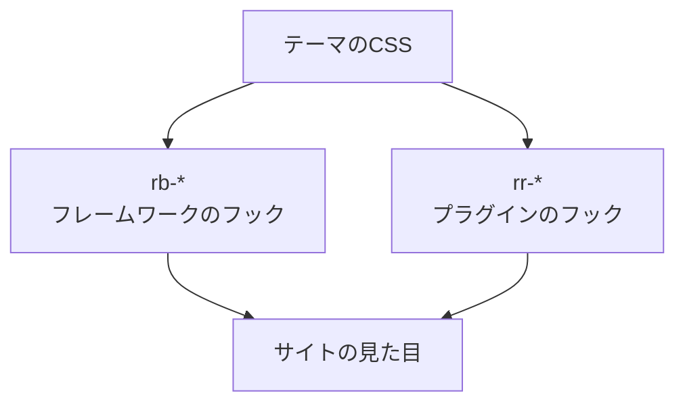
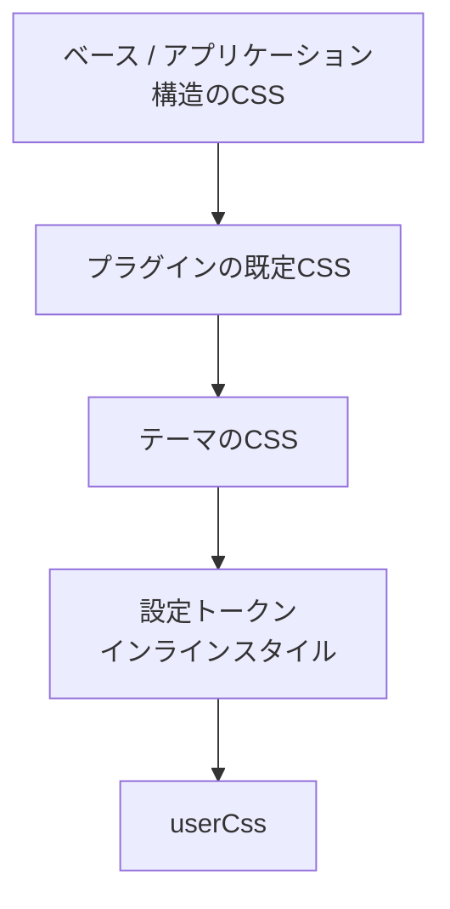
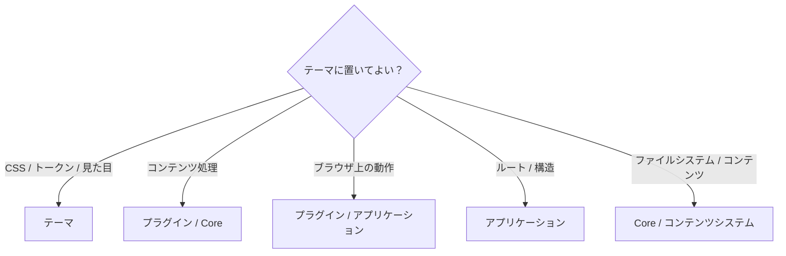
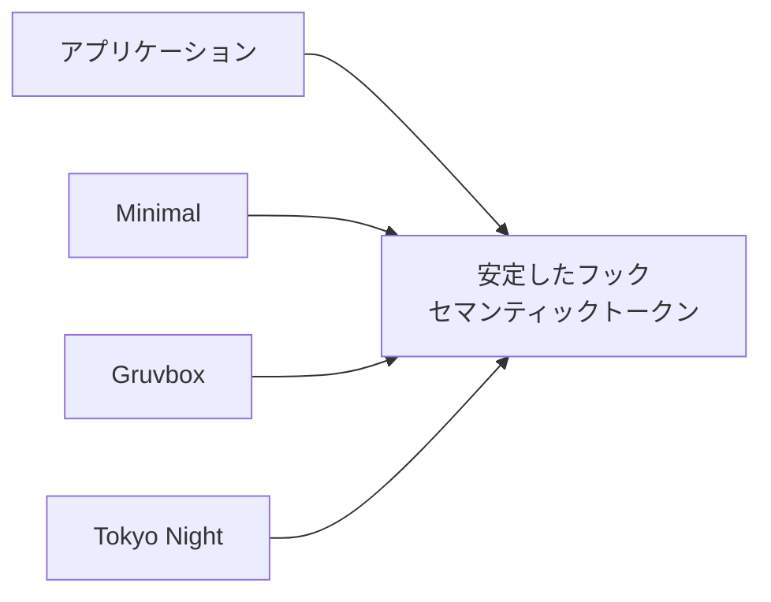
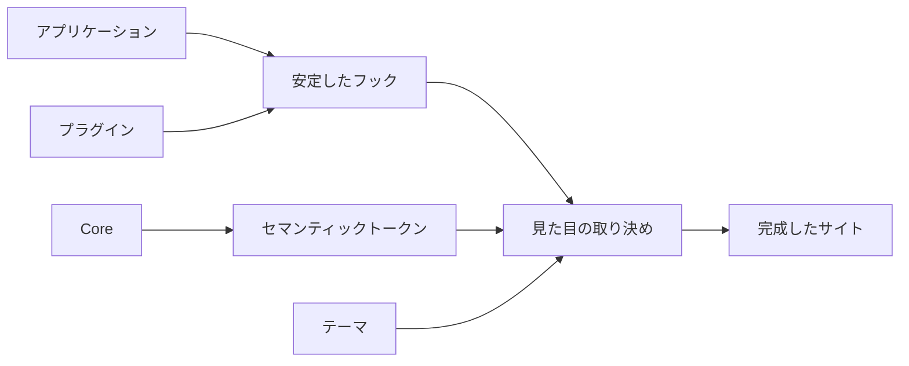

# テーマシステム

Riebeckiteのテーマは、サイトの見た目を担当する層です。アプリケーションやプラグインの機能を置き換えるのではなく、共通の設計上の取り決めを通じて外観だけを変更します。

たとえば、色、フォント、余白、記事やサイドバーの装飾、プラグインUIの見た目を変えられます。一方で、コンテンツの意味、ルート、コンポーネントの構造、ブラウザ上での動作、プラグインの機能は変更しません。



この境界があるため、アプリケーションやプラグインの機能に手を入れずにテーマを交換できます。

## テーマで変えられること

テーマのコードが変更できるのは、トークン、スタイルシートの規則、テーマが所有する`data-*`属性です。コンテンツの意味やアプリケーションの構造は変更できません。

操作や動きを伴う処理はプラグインかアプリケーションに置き、見た目の調整だけをテーマに置きます。この分担により、ルート、マニフェスト、コンテンツグラフ、クライアント側の動作を変えずにテーマを差し替えられます。

## テーマとプラグインの使い分け

どちらを作るか迷ったときは、機能を変えたいのか、見た目を変えたいのかを先に決めます。



見た目だけを変えるためにプラグインを作ったり、機能を追加するためにテーマを拡張したりしないでください。

## 最小のテーマ

テーマは`defineTheme()`で作成します。

```ts id="z0z78e"
import { defineTheme } from "@riebeckite/core";

export function minimalTheme() {
  return defineTheme({
    name: "minimal",

    styles: [
      {
        moduleSpecifier:
          "@riebeckite/theme-minimal/style.css",
      },
    ],
  });
}
```

作成したテーマは、サイトの設定で`theme`に指定します。

```ts id="ps7zv1"
export default defineConfig({
  theme: minimalTheme(),
});
```

これだけでテーマのスタイルシートがサイトに組み込まれます。

## テーマが提供する設定

テーマが扱える主な設定は次のとおりです。

| 分類 | 主な設定 |
| --- | --- |
| 識別情報 | `name` |
| テーマ固有の設定 | `options` |
| CSS | `styles[].moduleSpecifier` |
| カラーモード | `colorMode` |
| タイポグラフィ | `typography` |
| 記事レイアウト | `articleLayout` |
| デザイントークン | `tokens` |
| 利用者のCSS | `userCss` |
| テーマ固有の属性 | `data-*`属性 |

共通のプリセットには次の種類があります。

```ts id="csm5c6"
type ThemeColorMode =
  | "light"
  | "dark"
  | "system";

type ThemeTypographyPreset =
  | "system"
  | "serif"
  | "sans";

type ThemeArticleLayoutPreset =
  | "article"
  | "sidebar"
  | "full-width";
```

## デザイントークン

Riebeckiteでは、コンポーネントやプラグインが特定のテーマの色を直接参照するのではなく、意味に基づく**セマンティックデザイントークン**を利用します。

```css id="vp9a0g"
.rr-example {
  color: var(--rb-color-ink);
  background: var(--rb-color-surface);
}
```

テーマ固有の色を直接書く方法は避けます。

```css id="ucsgx9"
.rr-example {
  color: #171717;
  background: #f6efe2;
}
```

直接指定すると、テーマを変えるたびにプラグイン側も修正する必要が生じるためです。



コンポーネントは「文字色」という意味だけを参照し、実際の色はテーマが決めます。

`ThemeDesignTokens`は、色、タイポグラフィ、レイアウトの値をまとめたものです。テーマはこれらを共通の`--rb-*` CSSカスタムプロパティとして公開します。

### 色

`paper`、`ink`、`muted`、`accent`、`border`、`borderStrong`、`surface`、`surfaceHover`、`overlay`、`danger`、`success`、`codeBackground`があります。

### タイポグラフィ

`bodyFont`、`headingFont`、`monoFont`があります。

### レイアウト

`pageMaxWidth`、`articleMaxWidth`、`sidebarWidth`、`contentGap`があります。

CSSでは次のように使用します。

```css id="m3xggn"
@layer base {
  :is(:root, .rb-theme-root)
    [data-theme-name="minimal"] {
    --rb-color-paper: #fafafa;
    --rb-color-ink: #202020;
    --rb-color-accent: #555;

    --rb-font-body:
      system-ui, sans-serif;

    --rb-layout-article-max: 48rem;
  }
}
```

`--rb-*`はフレームワークが提供するセマンティックトークンです。プラグイン固有の意味を持つトークンはプラグインが`--rr-*`として所有し、必要に応じて`--rb-*`をフォールバックとして利用できます。

## カラーモード

テーマは3種類のカラーモードを扱えます。

| モード | 動作 |
| --- | --- |
| `light` | ライト用の配色を使用する |
| `dark` | ダーク用の配色を使用する |
| `system` | OSの設定に従う |

テーマは`data-theme`とセマンティックトークンを使って配色を切り替えます。個々のコンポーネントにライト用・ダーク用の色を直接書き込まないでください。

### 配色を切り替えるCSS

ライト、ダーク、システムの3状態は、CSSでは次のように表します。

```css id="nw1xrv"
/* ライト */
:is(:root, .rb-theme-root)
[data-theme-name="<name>"] {
  /* ... */
}

/* ダーク */
:is(:root, .rb-theme-root)
[data-theme-name="<name>"]
[data-theme="dark"] {
  /* ... */
}

/* システム */
@media (prefers-color-scheme: dark) {
  :is(:root, .rb-theme-root)
  [data-theme-name="<name>"]
  :not([data-theme]) {
    /* ... */
  }
}
```

`system`のときは、`data-theme`を付けないことが重要です。

```text id="em0o5z"
light
  → data-theme="light"

dark
  → data-theme="dark"

system
  → data-theme を削除
```

空文字を設定するのとは異なります。

```html id="7jpx2k"
<html data-theme="">
```

この場合も`[data-theme]`に一致するため、システム用のメディアクエリが正しく機能しません。実行時に`system`へ戻すときも、属性そのものを削除します。

```ts id="0tw3aa"
delete document.documentElement.dataset.theme;
```

`@riebeckite/plugin-color-mode`はこの取り決めの参照実装です。`ColorModeScript`は描画前に実行されるインラインスクリプト、`ColorModeToggle`は切り替え用のUI、`initColorMode`は選択を`localStorage`へ保存するクライアントエントリです。詳しくはパッケージのREADMEを参照してください。

ダーク配色を生むCSSの仕組みは、次の2つだけです。

- テーマルート上の明示的な`[data-theme="dark"]`
- `data-theme`が無いときの`@media (prefers-color-scheme: dark)`（システム）

フレームワークは`.dark`クラスを付与しないため、`.dark`に依存したセレクタは取り決めの対象外です。どちらの状態でも同じ`--rb-*`セマンティックトークンが解決されるため、これらのトークンだけを参照するコンポーネントは、明示的なダークとシステムのダークを区別する必要がありません。

## タイポグラフィ

テーマはタイポグラフィのプリセットを提供できます。

```ts id="kyyomq"
type ThemeTypographyPreset =
  | "system"
  | "serif"
  | "sans";
```

プリセットは、本文、見出し、コードなどのセマンティックなフォントトークンに反映されます。テーマは個々のコンポーネントへフォントを直接設定するのではなく、可能な限りセマンティックトークンを通してタイポグラフィを統一します。

## 記事レイアウト

テーマは記事レイアウトの見た目を変更できます。

```ts id="c69dlz"
type ThemeArticleLayoutPreset =
  | "article"
  | "sidebar"
  | "full-width";
```

ただし、テーマが変更するのは**レイアウトの見た目**だけです。ルートやコンポーネントツリーそのものをテーマが差し替えるわけではありません。



## テーマの適用範囲

テーマのCSSは、文書全体へ無条件に適用しません。各テーマは**テーマルート**の内側だけを対象にします。

基本のセレクタは次の形です。

```css id="l84p42"
:is(:root, .rb-theme-root)
[data-theme-name="<name>"]
```

`<name>`はテーマの`name`です。既定テーマは`riebeckite`、それ以外には`minimal`、`gruvbox`、`sakura`、`tokyonight`、`rerurate`などがあります。

### テーマルートが必要な理由

通常のサイトでは、アプリケーションが`<html>`へテーマ名を設定します。

```html id="4v4fpo"
<html data-theme-name="minimal">
```

この場合は`:root`が一致します。

一方、テーマギャラリーのように1ページで複数のテーマを並べたい場合があります。

```html id="5yyh67"
<div
  class="rb-theme-root"
  data-theme-name="minimal"
>
  ...
</div>

<div
  class="rb-theme-root"
  data-theme-name="gruvbox"
>
  ...
</div>
```

同じスタイルシートをプレビュー内でも利用できるため、複数のテーマを1つの文書に同時に表示できます。



そのため、テーマのCSSを裸の`:root`に書かないことが重要です。

### セレクタの書き方

テーマが定義するルールは、テーマルートの内側に限定します。

```css id="33dppk"
/* ライト */
:is(:root, .rb-theme-root)
[data-theme-name="<name>"] {
  /* ... */
}

/* ダーク */
:is(:root, .rb-theme-root)
[data-theme-name="<name>"]
[data-theme="dark"] {
  /* ... */
}

/* タイポグラフィ */
:is(:root, .rb-theme-root)
[data-theme-name="<name>"]
[data-typography="serif"] {
  /* ... */
}

/* テーマ固有のオプション */
:is(:root, .rb-theme-root)
[data-theme-name="<name>"]
[data-tokyonight-neon="on"] {
  /* ... */
}
```

子要素や擬似要素も同じルートに閉じ込めます。

```css id="fepgnc"
:is(:root, .rb-theme-root)
[data-theme-name="<name>"]
:focus-visible {
  /* ... */
}

:is(:root, .rb-theme-root)
[data-theme-name="<name>"]
::selection {
  /* ... */
}
```

これにより、テーマプレビューのCSSがページの他の部分へ漏れることを防げます。`data-theme-name`を出力するのはフレームワークです。プレビュー側は`.rb-theme-root`と一致するテーマ名を用意するだけで済みます。

## スタイルシート

テーマのスタイルシートは、ホスト側のバンドラーが解決できるモジュール指定子として宣言します。

```ts id="kz2hpi"
styles: [
  {
    moduleSpecifier:
      "@riebeckite/theme-example/style.css",
  },
]
```

これは「CSSファイルをアプリケーションのディレクトリへコピーする」という取り決めではありません。インテグレーションがモジュール指定子を解決し、サイトのスタイルシートとして組み込みます。

## サイト内だけのテーマ

テーマはnpmパッケージとして公開しなくても利用できます。サイトの中だけで使うテーマも作成できます。

既存のテーマを組み合わせることも、`defineTheme`で直接定義することもできます。

```ts id="pzvj0n"
// site/extensions/local-theme.ts
import { defineTheme } from "@riebeckite/core";
import { defaultTheme } from "@riebeckite/theme-default";

export function localTheme() {
  const base = defaultTheme({ colorMode: "dark" });

  return defineTheme({
    name: "site-local",

    styles: [
      ...(base.styles ?? []),
      {
        moduleSpecifier:
          "/extensions/theme.css",
      },
    ],

    config: {
      ...base.config,
      tokens: {
        color: {
          accent: "#c2410c",
        },
      },
    },

    attributes: {
      "data-site-local": "on",
    },
  });
}
```

サイト内のテーマも、パッケージとして配布するテーマと同じ`resolveThemeConfig`の経路で解決・サニタイズ・適用されます。独自のスタイルシートと`data-*`属性も同様に扱われます。

## テーマ固有の属性

テーマ固有の設定をCSSへ渡したい場合は、安全な`data-*`属性を利用できます。

```ts id="dhy9s4"
return defineTheme({
  name: "newspaper",

  attributes: {
    "data-newspaper-density":
      "compact",
  },
});
```

CSSでは次のように参照します。

```css id="ym84dm"
:is(:root, .rb-theme-root)
[data-theme-name="newspaper"]
[data-newspaper-density="compact"] {
  /* ... */
}
```

テーマAPIから`class`、`style`、`id`、`lang`などを自由に変更できる設計にはしません。フレームワークが所有する属性と、テーマ固有の属性は名前空間を分けて扱います。

## テーマ属性をHTMLへ反映する

フレームワークは`ThemeRoot`というUIプリミティブを提供し、`<html>`要素へのテーマ属性の付与を担当します。

```tsx
import { ThemeRoot } from "@riebeckite/honox/ui";

<ThemeRoot
  theme={config.theme}
  lang={c.get("htmlLanguage") ?? config.site.locale}
>
  {children}
</ThemeRoot>
```

`ThemeRoot`は次の属性を持つ`<html>`要素を描画します。

```html
<html
  lang="ja"
  data-theme-name="minimal"
  data-theme="dark"
  data-typography="system"
  data-article-layout="article"
>
```

フレームワークは`themeRootAttributes(theme)`を使い、テーマ自身の`attributes`に加えて次の予約属性を出力します。

- `data-theme`: カラーモードの状態（`"light"` / `"dark"`、`system`では省略）
- `data-theme-name`: テーマの識別子
- `data-typography`: タイポグラフィプリセットの値
- `data-article-layout`: 記事レイアウトプリセットの値

独自の`<html>`属性を追加したい場合は、`ThemeRoot`の代わりに`themeRootAttributes`を直接使えます。

```tsx
import { themeRootAttributes } from "@riebeckite/honox/ui";

<html
  lang={c.get("htmlLanguage") ?? config.site.locale}
  {...themeRootAttributes(config.theme)}
  data-custom-attr="..."
>
  ...
</html>
```

ただし、`data-theme`、`data-theme-name`、`data-typography`、`data-article-layout`は予約済みです。テーマ側の`attributes`では上書きできません。

プラグインやテーマが独自に`themeAttributes()`を実装していた場合は、フレームワークが提供する`ThemeRoot`または`themeRootAttributes()`への移行を検討してください。フレームワークが所有する名前空間と、テーマ固有の名前空間を明確に分けられます。

## テーマ固有のオプション

テーマ固有の機能は、テーマのファクトリ関数が受け取るオプションとして定義し、テーマパッケージの内側で解決します。

```ts id="i7yem2"
type NewspaperOptions = {
  density?:
    | "compact"
    | "comfortable";
};

export function newspaperTheme(
  options: NewspaperOptions = {},
) {
  return defineTheme({
    name: "newspaper",

    options,

    attributes: {
      "data-newspaper-density":
        options.density ?? "comfortable",
    },

    styles: [
      {
        moduleSpecifier:
          "@riebeckite/theme-newspaper/style.css",
      },
    ],
  });
}
```

テーマ固有の概念をCoreの`ThemeConfig`へ追加しないでください。たとえば、`newspaperTheme`の`density`は`newspaperTheme`が所有し、`tokyonightTheme`の`neon`は`tokyonightTheme`が所有します。Coreは個別テーマの機能を知りません。

## 安定したCSSフック

テーマは、アプリケーションやプラグインの内部マークアップに依存するのではなく、文書化された**安定したCSSフック**を利用します。Riebeckiteでは主に2つの名前空間を使います。

| 名前空間 | 所有者 | 用途 |
| --- | --- | --- |
| `rb-*` | フレームワーク | サイトの構造 |
| `rr-*` | プラグイン / 機能 | プラグインUI |

### フレームワークのフック

フレームワークの代表的なフックは次のとおりです。

```text id="fahf95"
.rb-theme-root
.rb-site
.rb-article
.rb-article-layout
.rb-article-header
.rb-article-body
.rb-article-content
.rb-article-meta
.rb-article-footer
.rb-sidebar
.rb-site-header
.rb-nav
.rb-nav__list
.rb-nav__item
.rb-nav__link
.rb-nav__link--active
.rb-nav__children
.rb-nav__mobile
.rb-nav__toggle
.rb-site-footer
```

`.rb-article-content`は、レンダリングされたMarkdown本文のラッパーです。リストのマーカーと字下げ、見出し、段落とブロックの余白、表、図、定義リスト、インラインコード、整形済みブロックという、Markdownの意味的な基準を持ちます。この基準はレイヤー化されているため、テーマは構造を再宣言するのではなく、`--rb-*`トークンとレイヤー外の個性付けの規則で見た目を表現します。

`.rb-article-body`は、そのラッパーを含む記事本文のシェルです。`.rb-article-content`を出力するのは公開プリミティブの`ArticleBody`です。プラグインのコンポーネントは、どこに置かれても独自の見出し構造を保ちます。

### プラグインのフック

プラグインは次のようなルートフックを提供できます。

```text id="jvm00r"
.rr-search
.rr-callout
.rr-table-of-contents
.rr-backlinks
.rr-local-graph
.rr-code
.rr-code-tabs
.rr-lightbox
.rr-excalidraw
.rr-mermaid
.rr-query
.rr-cardlink
.rr-diff-history
.rr-attachment
.rr-media
.rr-recent-posts
.rr-garden-explorer
```

テーマは`.rr-<feature>`と、文書化された子孫要素を対象にすることで、機能の見た目を変更できます。



### 内部クラスとの区別

プラグインがBEMを使って次のようなクラスを持つ場合があります。

```text id="cf1uz0"
.rr-search
.rr-search__input
.rr-search__result
.rr-search--loading
```

この場合、テーマ向けの公開フックは`.rr-search`です。`__input`や`--loading`のような内部クラスは、プラグインが明示的に文書化していない限り実装の詳細として扱います。`.sr-only`のような一般的なヘルパークラスもプラグインフックではありません。

公開される出力に含まれるのは`.rr-<feature>`のルートフックだけです。テーマは旧来のクラス名に依存しないでください。プラグインは`--rr-*`のカスタムプロパティを公開し、セマンティックな`--rb-*`トークンへフォールバックできます。プラグイン側の規則は[プラグインシステム](./plugin-api.ja.md#cssフック)を参照してください。

## 見た目に個性を加える

テーマはトークンの値だけを変えるものではありません。安定したフックを使って、サイトに視覚的な個性を与えられます。たとえば、記事の境界線、ヘッダーの装飾、サイドバーの背景、コードブロックの形、プラグインカードの見た目などを調整できます。

```css id="0r1pvg"
[data-theme-name="example"]
.rb-article {
  /* 視覚的な個性 */
}

[data-theme-name="example"]
.rr-callout {
  /* 視覚的な個性 */
}
```

対象にするのは安定したフックだけです。テーマ側で新しい`rb-*`や`rr-*`クラスを定義し、フレームワークの取り決めであるかのように扱わないでください。

個性付けの規則も見た目のためだけに使います。コンテンツ、構造、動作を変更するものではありません。

## CSSの適用順

Riebeckiteでは、CSSの読み込み順も取り決めの一部です。



優先順位は次のとおりです。

```text id="qq3vby"
フレームワークの構造CSS
        ↓
ベース / アプリケーションのCSS
        ↓
プラグインの既定CSS
        ↓
テーマのCSS
        ↓
設定トークンのインラインスタイル
        ↓
userCss
```

これは偶然の読み込み順ではなく、見た目の拡張に関する取り決めです。

`@riebeckite/honox`は次のファイルを生成します。

```text id="49ck0i"
.riebeckite/framework-styles.css
.riebeckite/plugin-styles.css
.riebeckite/theme-styles.css
```

サイトは、フレームワークのスタイルシート、プラグインのスタイルシート、テーマのスタイルシートの順に読み込みます。そのため、プラグインの既定の見た目をテーマが変更し、最後に`userCss`で利用者が調整できます。

生成されたスタイルシートを直接編集したり、読み込み順を入れ替えたりしないでください。各ファイルには、適用順の中でどの位置にあるかを示すヘッダーコメントが付きます。通常は`!important`に依存せず、この適用順で上書きします。

## フォントの同梱

テーマパッケージは、必要に応じて自前でホストするWebフォントを含められます。たとえば、次のようにパッケージ内の`styles/fonts/`へ配置し、CSSの相対`url()`で参照します。

```text id="mtpf4x"
theme/
└─ styles/
   └─ fonts/
```

フォントを同梱する場合は、ライセンスファイルも含めてください。Latinのサブセットのような比較的小さいWebフォントは同梱できます。日本語などのCJKフォントはサイズが大きいため、基本的にはシステムフォントのスタックへフォールバックします。

## テーマに置かないもの

テーマの責務は見た目です。そのため、次の処理はテーマに置きません。

- コンポーネントの置き換え
- JSXの注入
- ルートの追加
- プラグインの追加・削除
- クライアントスクリプトの実行
- DOMの変換
- アイランドの登録
- ファイルシステムへのアクセス
- ContentManagerへのアクセス



見た目を実現するためにJavaScriptやDOM操作が必要になった場合、その部分はテーマではなく、プラグインかアプリケーションの責務です。見た目だけを変えるためにプラグインを作ったり、機能を追加するためにテーマを拡張したりしないでください。

## テーマパッケージの構成

公開するテーマは、たとえば次のように構成できます。

```text id="4hx4zz"
packages/themes/example/
├─ index.ts
├─ package.json
├─ style.css
├─ README_ja.md
└─ README.md
```

フォントなどを含める場合は、必要に応じて`styles/fonts/`を追加します。

```text id="hs5y9a"
packages/themes/example/
├─ index.ts
├─ package.json
├─ style.css
├─ styles/
│  └─ fonts/
├─ README_ja.md
└─ README.md
```

## リポジトリ外への配布

外部のテーマは、Riebeckiteのmonorepo内部へ依存させません。基本的には`@riebeckite/core`の公開APIだけに依存し、`defineTheme()`を使います。

スタイルシートはテーマパッケージ自身のエクスポートとして公開します。たとえば、`package.json`の`exports`へ`./style.css`を定義します。

monorepo内部のパスや、`@riebeckite/core/src/**`のような内部APIを参照しないでください。利用できるパッケージの範囲と現在の制約は、[公開パッケージとインポートパス](./README.ja.md#公開パッケージ)を参照してください。

## テーマを交換できる理由

テーマシステムの最も重要な目的は、**アプリケーションのロジックを変更せずにテーマを交換できること**です。



アプリケーションとプラグインは、安定したCSSフックとセマンティックデザイントークンという共通の取り決めを提供します。テーマはその取り決めに対してCSSを適用します。取り決め自体は変わらないため、別のテーマへ交換しても、同じルート、コンテンツ、プラグイン、アプリケーションロジックをそのまま利用できます。

テーマ固有のオプションは、そのテーマを選択したときだけ意味を持ち、Coreや他のテーマへ漏れません。

## テーマシステムの全体像

テーマシステム全体は次のようになります。



テーマはサイトの機能を所有するのではなく、フレームワークとプラグインが公開した**見た目の取り決め**に対して外観を与えます。基本原則は、**機能はプラグインかアプリケーション、構造はフレームワークかアプリケーション、見た目はテーマ**です。

この境界を維持することで、同じコンテンツ、プラグイン、ルート、アプリケーションロジックを保ったまま、テーマを自由に交換できます。

### 関連

- [アーキテクチャ](../framework/architecture.ja.md)
- [プラグインシステム](./plugin-api.ja.md)
- [設定](./configuration.ja.md)
- [フレームワークリファレンス](./README.ja.md)
