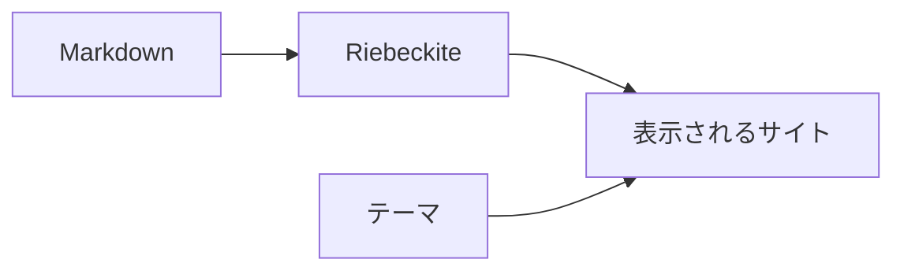
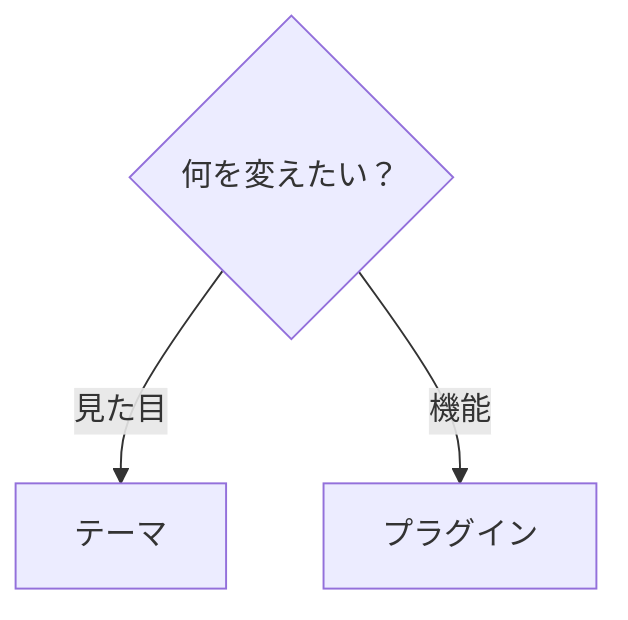
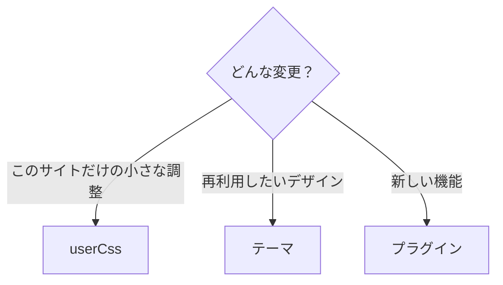
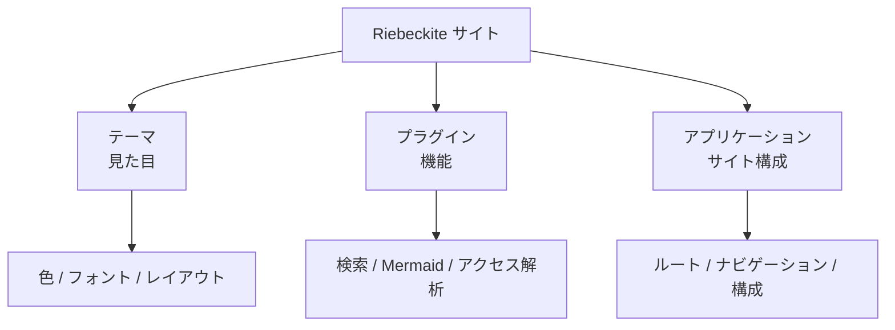

# テーマ

テーマは、Riebeckite サイトの**見た目を変える仕組み**です。

テーマを変えると、次のような点を変更できます。

- 色
- フォント
- 文字サイズ
- 余白
- 記事幅
- サイドバーの幅
- ライト / ダークモード
- 記事全体の視覚的な雰囲気



テーマはコンテンツの意味やサイトの機能を変えるものではありません。

検索や図表、WikiLink、アクセス解析などの**機能を追加したい場合は[プラグイン](../plugins/README.ja.md)**を利用します。

### テーマとプラグインの違い

迷ったときは、「見た目を変えたいのか」「機能を追加したいのか」で考えます。

| やりたいこと | 使うもの |
| --- | --- |
| 色を変える | テーマ |
| フォントを変える | テーマ |
| 記事幅を変える | テーマ |
| ダークモードに対応する | テーマ |
| サイト全体のデザインを変える | テーマ |
| Mermaid を表示する | プラグイン |
| 検索を追加する | プラグイン |
| アクセス解析を追加する | プラグイン |
| Markdown の処理を拡張する | プラグイン |



## テーマは最初から設定されている

`create-riebeckite` で生成したサイトには、通常すでにテーマが設定されています。

プリセットによって既定のテーマが異なります。

| プリセット | テーマ |
| --- | --- |
| `minimal` | `@riebeckite/theme-minimal` |
| `starter` | `@riebeckite/theme-default` |
| `showcase` | `@riebeckite/theme-default` |

そのため、テーマを追加しなくてもサイトを使い始められます。

見た目を変えたくなったら、別のテーマに切り替えるだけで十分です。

## テーマを変更する

別のテーマを使う場合、手順は大きく2つに分かれます。

```text id="2ktbhc"
1. Theme Packageをインストール

2. riebeckite.config.tsでThemeを指定
```

### 1. テーマをインストールする

たとえば Minimal テーマを利用する場合は、次のコマンドを実行します。

```bash id="a50wvc"
npm install @riebeckite/theme-minimal
```

### 2. テーマを設定する

テーマのファクトリをインポートし、`riebeckite.config.ts` の `theme` に指定します。

```ts id="etjv95"
import { defineConfig } from "@riebeckite/core";
import { minimalTheme } from "@riebeckite/theme-minimal";

export default defineConfig({
  theme: minimalTheme(),
});
```

これでサイト全体に Minimal テーマが適用されます。

```text id="1eek1b"
@riebeckite/theme-minimal
        ↓
minimalTheme()
        ↓
riebeckite.config.ts
        ↓
Site
```

## テーマのオプション

テーマによってはオプションを指定できます。

たとえば Default テーマでは、次のように設定できます。

```ts id="z6x59h"
import { defineConfig } from "@riebeckite/core";
import { defaultTheme } from "@riebeckite/theme-default";

export default defineConfig({
  theme: defaultTheme({
    colorMode: "system",
    typography: "system",
    articleLayout: "article",
    userCss: ["/extensions/custom.css"],
  }),
});
```

テーマごとに使えるオプションは異なる場合があります。

正確なファクトリ名とオプションは、それぞれのパッケージの README を確認してください。

## カラーモード

テーマは共通設定としてカラーモードを扱えます。

たとえば、次のように指定します。

```ts id="i6fj09"
defaultTheme({
  colorMode: "system",
});
```

Riebeckite のテーマの取り決めでは、`light`、`dark`、`system` の3つのカラーモードを扱います。

```text id="svx24i"
light
dark
system
```

`system` はブラウザまたは OS の設定に合わせるモードです。

カラーモードの詳しい取り決めは[テーマ API](../reference/theme-api.ja.md)を参照してください。

## タイポグラフィ

文字の雰囲気もテーマの一部です。

たとえば、次のように設定します。

```ts id="02tw4s"
defaultTheme({
  typography: "system",
});
```

テーマの取り決めでは、タイポグラフィのプリセットとして `system`、`serif`、`sans` を扱えます。

```text id="tsjddr"
system
serif
sans
```

実際のフォントや細かなタイポグラフィはテーマが決めます。

## 記事レイアウト

記事部分のレイアウトもテーマから設定できます。

```ts id="7cczqi"
defaultTheme({
  articleLayout: "article",
});
```

テーマの取り決めでは、`article`、`sidebar`、`full-width` のレイアウトプリセットを扱えます。

```text id="n1pwde"
article
sidebar
full-width
```

サイトの用途や記事の種類に合わせて選んでください。

## `userCss` で小さく見た目を変える

テーマを丸ごと作るほどではない小さな変更には `userCss` を利用できます。

```ts id="cmf9rk"
defaultTheme({
  userCss: [
    "/extensions/custom.css",
  ],
});
```

たとえば、次のようなサイト固有の調整を追加できます。

```css id="z91hlo"
.rb-article {
  font-size: 1.05rem;
}
```

`userCss` はテーマのスタイルより後に適用されるため、サイト固有の調整に向いています。

## `userCss` とテーマの使い分け

目安は次のとおりです。



| 変更 | 向いている方法 |
| --- | --- |
| 記事の余白を少し変える | `userCss` |
| 特定の要素の文字サイズを変える | `userCss` |
| サイト固有の装飾を加える | `userCss` |
| 色・文字・レイアウトを一式まとめる | テーマ |
| 複数のサイトで同じデザインを使う | テーマ |
| 他の利用者へ配布する | テーマ |
| JavaScript の機能を追加する | プラグイン |

最初は `userCss` で調整し、変更が大きくなったらテーマとして整理する方法もあります。

## 公式テーマ

Riebeckite には複数の公式テーマがあります。

| テーマ | パッケージ | ファクトリ | 特徴 |
| --- | --- | --- | --- |
| [Default](./default.ja.md) | `@riebeckite/theme-default` | `defaultTheme()` | 標準の出発点。読みやすさと設定のしやすさを重視 |
| [Minimal](./minimal.ja.md) | `@riebeckite/theme-minimal` | `minimalTheme()` | 装飾を抑えた小さなテーマ |
| [Gruvbox](./gruvbox.ja.md) | `@riebeckite/theme-gruvbox` | `gruvboxTheme()` | Gruvbox 風の暖かくコントラストの高い配色 |
| [Rerurate](./rerurate.ja.md) | `@riebeckite/theme-rerurate` | `rerurateTheme()` | Rerurate の視覚文法に基づくテーマ |
| [Sakura](./sakura.ja.md) | `@riebeckite/theme-sakura` | `sakuraTheme()` | 桜をモチーフにした配色 |
| [Tokyo Night](./tokyonight.ja.md) | `@riebeckite/theme-tokyonight` | `tokyonightTheme()` | Tokyo Night 風の暗色でエディタ風のテーマ |

各テーマの正確なエクスポート名とオプションは、それぞれのページを参照してください。パッケージの README は各ページから生成されます。

### Default

[Default](./default.ja.md) は、Riebeckite の標準テーマです。

```ts id="vms7th"
import { defaultTheme } from "@riebeckite/theme-default";

export default defineConfig({
  theme: defaultTheme(),
});
```

特定のデザインに大きく寄せることなく、Riebeckite サイトの出発点として利用できます。

`starter` と `showcase` プリセットでは Default テーマが利用されます。

### Minimal

[Minimal](./minimal.ja.md) は、装飾を抑えたテーマです。

```ts id="vdwwym"
import { minimalTheme } from "@riebeckite/theme-minimal";

export default defineConfig({
  theme: minimalTheme(),
});
```

`minimal` プリセットではこのテーマが利用されます。

### Gruvbox

[Gruvbox](./gruvbox.ja.md) は、Gruvbox をもとにした暖色系のテーマです。

```ts id="w7gdho"
import { gruvboxTheme } from "@riebeckite/theme-gruvbox";

export default defineConfig({
  theme: gruvboxTheme(),
});
```

暖かくコントラストの高い配色を利用します。

### Rerurate

[Rerurate](./rerurate.ja.md) は、Rerurate の視覚文法に基づくテーマです。

```ts id="htrd9r"
import { rerurateTheme } from "@riebeckite/theme-rerurate";

export default defineConfig({
  theme: rerurateTheme(),
});
```

### Sakura

[Sakura](./sakura.ja.md) は、桜をモチーフにしたテーマです。

```ts id="czj6ks"
import { sakuraTheme } from "@riebeckite/theme-sakura";

export default defineConfig({
  theme: sakuraTheme(),
});
```

### Tokyo Night

[Tokyo Night](./tokyonight.ja.md) は、Tokyo Night をもとにした暗色系のテーマです。

```ts id="suxi7w"
import { tokyonightTheme } from "@riebeckite/theme-tokyonight";

export default defineConfig({
  theme: tokyonightTheme(),
});
```

エディタのような暗色の見た目になります。

## テーマを切り替える

テーマは `riebeckite.config.ts` の `theme` を変更して切り替えます。

たとえば Default テーマから Minimal テーマに変える場合は、次の指定を

```ts id="ql7x6k"
// Before
theme: defaultTheme(),
```

次のように変更します。

```ts id="85hdqx"
// After
theme: minimalTheme(),
```

新しいテーマのパッケージがまだ入っていない場合は、先にインストールしてください。

変更後は、次のコマンドで実際の表示を確認します。

```sh id="3p2sgb"
npm exec riebeckite dev
```

## テーマが変えるもの

テーマの責任範囲は**プレゼンテーション**です。

```text id="33th07"
Theme

├─ Color
├─ Typography
├─ Spacing
├─ Layout
├─ Design Token
└─ CSS
```

一方、次のようなことはテーマの責任ではありません。

```text id="8ocgkk"
検索機能
Markdown変換
WikiLink
Analytics
新しいPage
Browser上のInteractiveな処理
```

これらにはプラグインやアプリケーションを利用します。



## テーマを自作する

既存テーマの `userCss` だけでは足りず、再利用できるデザインとしてまとめたい場合は、自分でテーマを作成できます。

まず[はじめてのテーマ作成](./writing-a-theme.ja.md)を参照してください。

```text id="8d9b1f"
Themeを使いたい
  → このページ

Themeを作りたい
  → Writing a Theme

正確なAPIを確認したい
  → Theme API

内部の仕組みを知りたい
  → Framework / Theme System
```

テーマの公開取り決めを確認したい場合は[テーマ API](../reference/theme-api.ja.md)を、Riebeckite 内部でテーマがどのように扱われるかを知りたい場合は[フレームワーク / テーマシステム](../framework/theme-system.ja.md)を参照してください。

## まとめ

テーマは Riebeckite サイトの**見た目を担当する仕組み**です。

```text id="x4a0p4"
見た目を変える
  → Theme

小さなSite固有調整
  → userCss

機能を追加する
  → Plugin

SiteのPageや構成を作る
  → Application
```

既存のテーマを使う場合は、次の流れになります。

```text id="4u2l5e"
Packageをinstall
      ↓
Factoryをimport
      ↓
config.themeに指定
      ↓
devで確認
```

テーマごとの正確なファクトリ名とオプションは、それぞれのページを確認してください。

### 次に読むページ

- [はじめてのテーマ作成](./writing-a-theme.ja.md)：テーマを自作する
- [テーマ API](../reference/theme-api.ja.md)：テーマの公開取り決め
- [フレームワーク / テーマシステム](../framework/theme-system.ja.md)：テーマの内部設計
- [プラグイン](../plugins/README.ja.md)：サイトに機能を追加する
