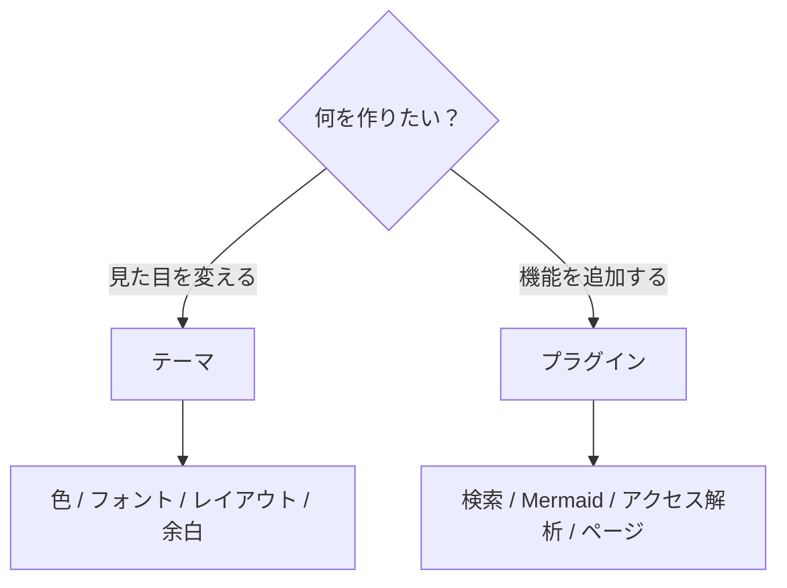
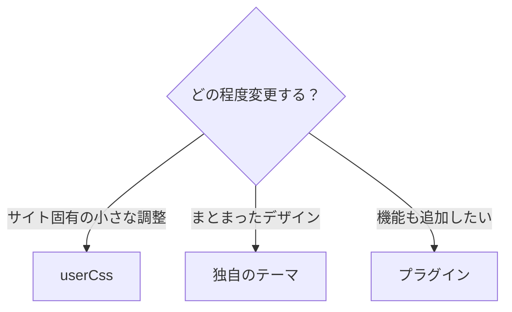
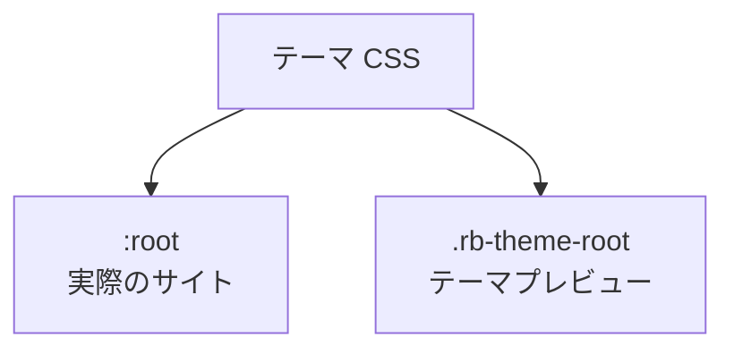
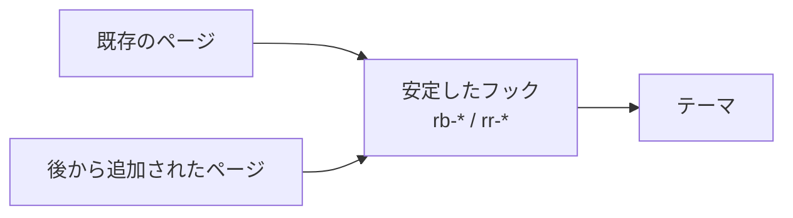
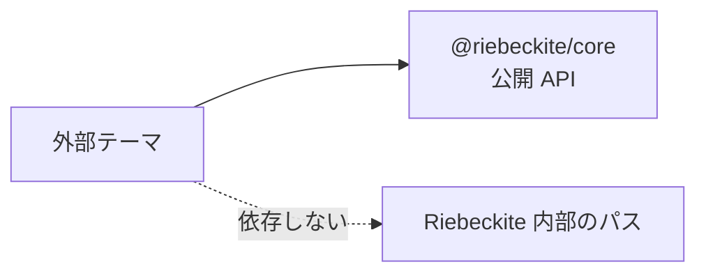
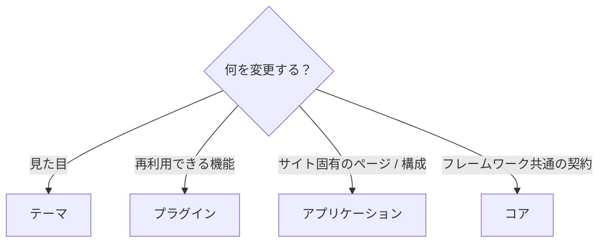

# はじめてのテーマ作成

Riebeckite のテーマは、**サイトの見た目を変える仕組み**です。

ローカルでテーマを実装する場合は、雛形として[テーマジェネレーター](./generator.ja.md)を利用できます。

たとえば、次のような点を変更できます。

- 配色
- フォント
- 文字サイズ
- 余白
- 記事幅
- レイアウト
- ライト / ダークモード

一方、テーマから新しい機能を追加することはできません。



検索や図表、Markdown の拡張などを追加したい場合は、[はじめてのプラグイン作成](../plugins/writing-a-plugin.ja.md)を参照してください。

このガイドは、次の順に進めます。

```text id="br3nd6"
既存Themeを少し調整
        ↓
Site内にThemeを作る
        ↓
CSSを書く
        ↓
Light / Darkに対応
        ↓
必要ならPackageとして配布
```

## テーマを作る必要があるか確認する

少しだけ見た目を変えたい場合は、新しいテーマを作る必要はありません。

たとえば次の程度の変更なら、既存のテーマの `userCss` で対応できます。

```text id="b83ut7"
記事幅を少し変えたい
文字サイズを調整したい
Site固有のCSSを追加したい
```

一方、次のような場合はテーマとして作るのが向いています。

```text id="71uv2w"
独自の配色を作りたい
Typographyを一式設計したい
複数Siteで再利用したい
他の利用者へ配布したい
```



## 1. 組み込みテーマを調整する

最も簡単な方法は、既存のテーマにオプションと `userCss` を渡すことです。ここでは Default テーマを例に調整します。

```ts id="ih0etb"
// riebeckite.config.ts
import { defaultTheme } from "@riebeckite/theme-default";

export default defineConfig({
  theme: defaultTheme({
    colorMode: "light",
    typography: "system",
    userCss: ["/extensions/custom.css"],
  }),

  // ...
});
```

この例では、次の3つの値を指定しています。

```text id="14l98v"
colorMode
  → light

typography
  → system

userCss
  → /extensions/custom.css
```

`userCss` はテーマの CSS より後に読み込まれるため、サイト固有の小さな上書きに利用できます。

たとえば、次のような調整ができます。

```css id="q11q8v"
.rb-article {
  font-size: 1.05rem;
}
```

これだけで目的を達成できるなら、独自のテーマを作る必要はありません。

## 2. 最小構成のテーマを作る

独自のテーマは `defineTheme` で定義します。

`defineTheme` は `@riebeckite/core` からインポートします。

最初から npm パッケージを作る必要はありません。

まずはサイトの中に、次のような構成でファイルを置きます。

```text id="byvcr1"
my-site/
├─ extensions/
│  ├─ local-theme.ts
│  └─ theme.css
│
├─ riebeckite.config.ts
└─ package.json
```

### テーマを定義する

`extensions/local-theme.ts` を作成します。

```ts id="bs4dkd"
// extensions/local-theme.ts
import { defineTheme } from "@riebeckite/core";

export function localTheme() {
  return defineTheme({
    name: "local",
    styles: [
      {
        moduleSpecifier: "/extensions/theme.css",
      },
    ],
  });
}
```

最小構成では、次の2つを指定します。

```text id="dbwgoq"
name
  → Themeの識別子

styles
  → Themeが使うStylesheet
```

`styles[].moduleSpecifier` には、ホストバンドラが解決できるモジュール指定子を指定します。

サイト内のテーマなら、`/extensions/theme.css` のように指定できます。

```text id="42dg5e"
/extensions/theme.css
```

## 3. サイトでテーマを使う

作成した `localTheme` を `riebeckite.config.ts` から読み込みます。

```ts id="91cdvs"
// riebeckite.config.ts
import { defineConfig } from "@riebeckite/core";
import { localTheme } from "./extensions/local-theme";

export default defineConfig({
  theme: localTheme(),

  // ...
});
```

これで、次の流れで独自のテーマが使われます。

```text id="kpcf2q"
local-theme.ts
      ↓
localTheme()
      ↓
defineTheme()
      ↓
riebeckite.config.ts
      ↓
Site
```

## 4. テーマの CSS を書く

次に、テーマのスタイルを書きます。対象は次のファイルです。

```text id="mx8gdm"
extensions/theme.css
```

テーマの CSS では、Riebeckite が提供する次の仕組みを利用します。

- セマンティックトークン
- 安定した CSS フック

最小の例は次のとおりです。

```css id="j5jkvb"
:is(:root, .rb-theme-root)[data-theme-name="local"] .rb-site {
  background: var(--rb-color-paper);
  color: var(--rb-color-ink);
}

:is(:root, .rb-theme-root)[data-theme-name="local"] .rb-article {
  max-width: var(--rb-layout-article-max);
}
```

一見長く見えますが、それぞれに役割があります。

```text id="ehn64e"
[data-theme-name="local"]
  → このThemeだけに適用する

.rb-site / .rb-article
  → Riebeckiteの安定したCSS Hook

--rb-*
  → RiebeckiteのSemantic Token
```

## テーマルートのセレクタ

テーマのスタイルは、テーマルートの内側に限定します。

基本形は次のとおりです。

```css id="5t9k0r"
:is(:root, .rb-theme-root)[data-theme-name="<name>"]
```

`<name>` には `defineTheme` で指定した `name` を入れます。

今回は `name: "local"` と指定しています。

```ts id="2ukjvx"
name: "local"
```

したがって、セレクタは次のようになります。

```css id="u27p4e"
:is(:root, .rb-theme-root)[data-theme-name="local"]
```

### `:root` と `.rb-theme-root` の両方が必要な理由

このセレクタは、実際のサイトとテーマプレビューの両方で同じ CSS を使うためのものです。



実際のサイトでは、アプリケーションがドキュメントルートに次のようなテーマ情報を付けます。

```html id="tfjfs9"
<html data-theme-name="local">
```

テーマプレビューでは、次のような任意のコンテナの中でテーマを表示できます。

```html id="xwskmw"
<div
  class="rb-theme-root"
  data-theme-name="local"
>
```

そのため、テーマの CSS は `:is(:root, .rb-theme-root)[data-theme-name="local"]` をルートとして書きます。

```css id="7xf9zn"
:is(:root, .rb-theme-root)[data-theme-name="local"]
```

## セマンティックトークンを使う

テーマでは、色やレイアウトの値をあちこちに直接書くのではなく、[[semantic-token|セマンティックトークン]]を使います。

Riebeckite の共通トークンは、`--rb-*` という名前です。

```text id="f0yh64"
--rb-*
```

たとえば、次のように利用します。

```css id="m5h77c"
color: var(--rb-color-ink);
background: var(--rb-color-paper);
```

```text id="w2v0ss"
paper
  → 背景

ink
  → 主な文字

accent
  → 強調

border
  → 境界線
```

このように、トークンは具体的な色ではなく**役割**を表します。これがセマンティックトークンです。

テーマ全体で同じ意味の色を共有できるため、各コンポーネントに次のような値を直接書き散らすより、テーマを管理しやすくなります。

```text id="bcv48d"
#ffffff
#111111
#888888
```

トークンの正確な一覧は[テーマ API](../reference/theme-api.ja.md)を参照してください。

## 安定したフックを使う

Riebeckite の共通 UI には、`rb-*` という安定したフックがあります。

```text id="lq35s3"
rb-*
```

たとえば、`.rb-site` や `.rb-article` です。

```css id="2jhw92"
.rb-site
.rb-article
```

プラグインが提供する UI では、`rr-<feature>` 形式の安定したフックを利用します。

```text id="qg0kb3"
rr-<feature>
```

テーマは、特定のルートやページタイプ ID に依存するのではなく、こうした安定したフックを対象にスタイルを書きます。

```text id="v5o69k"
避ける

特定Route
特定Page Type ID
内部Component構造

        ↓

使う

rb-* Stable Hook
rr-<feature> Stable Hook
--rb-* Semantic Token
```

これによって、テーマを作った時点では存在していなかったページタイプにも、共通のデザインを適用しやすくなります。

## ページタイプごとに CSS を書かない理由

プラグインは独自のページタイプを追加できます。

そのため、テーマ側で次のようにページタイプを列挙してしまうと、新しいプラグインがページを追加するたびにテーマを変更する必要があります。

```text id="70qh6b"
home
article
explore
tags
...
```

代わりに、次の関係にします。

```text id="myo7di"
Page Type
     ↓
Framework / PluginのStable Hook
     ↓
Theme
```



テーマがページの種類ではなくセマンティックなフックを見ることで、新しいページタイプとも疎結合に保てます。

## 5. ライト / ダークモードに対応する

カラーモードに対応する場合は、ライト、ダーク、システムの3つの状態を考えます。

```text id="k24wdk"
light
dark
system
```

基本形は次のとおりです。

```css id="c9pm84"
:is(:root, .rb-theme-root)[data-theme-name="local"] {
  /* light */
}

:is(:root, .rb-theme-root)[data-theme-name="local"][data-theme="dark"] {
  /* dark */
}

@media (prefers-color-scheme: dark) {
  :is(:root, .rb-theme-root)[data-theme-name="local"]:not([data-theme]) {
    /* system でOSがdark */
  }
}
```

### ライト

通常のライトモードです。

```css id="6s0kr3"
:is(:root, .rb-theme-root)[data-theme-name="local"] {
  /* light */
}
```

### ダーク

ダークモードが明示的に選択されている場合は、次のセレクタで扱います。

```css id="khq4ec"
:is(:root, .rb-theme-root)[data-theme-name="local"][data-theme="dark"] {
  /* dark */
}
```

### システム

`system` では `data-theme` を付けず、OS またはブラウザの設定に従います。

```css id="4nrvxb"
@media (prefers-color-scheme: dark) {
  :is(:root, .rb-theme-root)[data-theme-name="local"]:not([data-theme]) {
    /* system dark */
  }
}
```

システムモードでは、`data-theme` に次のような空の値が入るのではなく、**`data-theme` 属性自体が存在しません**。

```html id="k8uz2d"
data-theme=""
```

そのため、`:not([data-theme])` で判定します。

```css id="dh4axr"
:not([data-theme])
```

## 6. アクセシビリティを確認する

テーマは見た目を変えるため、アクセシビリティにも影響します。

特に、次の点を確認してください。

- 本文と背景のコントラスト
- リンクが本文と区別できるか
- キーボード操作中のフォーカスが見えるか
- ライトモードとダークモードの両方で読めるか
- ホバーだけに情報を依存していないか

テーマは単に見た目を整えるだけでなく、コンテンツを読みやすい状態に保つ必要があります。

詳しくは[アクセシビリティ](../accessibility.ja.md)を参照してください。

## 7. CSS の読み込み順を理解する

Riebeckite では CSS の読み込み順が決まっています。

テーマの CSS は `userCss` より前に適用されます。

概念的には、次の順になります。

```text id="tl3h0p"
Framework / Application
        ↓
Plugin Style
        ↓
Theme Style
        ↓
ConfigによるToken
        ↓
userCss
```

そのため、次のような役割分担になります。

```text id="8i6rvp"
Theme
  → 再利用できる基本Design

userCss
  → Site固有の最終調整
```

テーマ側でサイト固有の上書きまで抱え込む必要はありません。

正確なカスケードは[テーマ API](../reference/theme-api.ja.md)を参照してください。

## 8. ブラウザで確認する

テーマを作ったら、開発サーバーを起動します。

```sh id="p90emf"
npm exec riebeckite dev
```

実際の記事を開いて、次の点を確認します。

- 本文
- 見出し
- リンク
- コードブロック
- テーブル
- リスト
- 画像
- プラグイン UI
- ライトモード
- ダークモード

デモページだけでなく、実際の記事でも確認してください。

## 9. Riebeckite の検証を実行する

設定に問題がないか確認します。

```sh id="mbllje"
npm exec riebeckite check
npm exec riebeckite doctor
npm exec riebeckite inspect config
npm exec riebeckite build
```

各コマンドの役割は次のとおりです。

| コマンド | 確認すること |
| --- | --- |
| `check` | 設定とテーマが正しく解決されるか |
| `doctor` | サイト全体に問題がないか |
| `inspect config` | 解決済みのテーマ設定 |
| `build` | 実際にサイトを生成できるか |

`check`、`doctor`、`inspect` は読み取り専用です。

テーマのファイルを自動で修正することはありません。診断の内容に従って修正してください。

## 10. 配布用のパッケージにする

サイト内のテーマとして問題なく動作したら、必要に応じてパッケージとして配布できます。

Riebeckite リポジトリ内では、`packages/themes/minimal/` が構成例になります。

```text id="c7gzq8"
packages/themes/minimal/
```

```text id="5j0p0f"
packages/themes/minimal/
├─ src/
│  └─ index.ts
├─ styles/
│  └─ theme.css
├─ package.json
├─ README_ja.md
└─ README.md
```

`src/index.ts` ではテーマのファクトリを公開します。

```ts id="a6e4vn"
import { defineTheme } from "@riebeckite/core";

export function myTheme() {
  return defineTheme({
    name: "my-theme",
    styles: [
      {
        moduleSpecifier: "@example/riebeckite-theme/style.css",
      },
    ],
  });
}
```

パッケージでは、スタイルシートを `./style.css` のような公開エクスポートとして公開します。

```text id="hhg9pd"
./style.css
```

## 外部テーマの依存関係

配布するテーマは、次のパッケージの公開 API に依存します。

```text id="n1cn77"
@riebeckite/core
```

Riebeckite モノレポ内部の、`packages/...`、`src/...`、`../../...` のようなパスには依存させないでください。

```text id="ohs3aa"
packages/...
src/...
../../...
```



外部の利用者が npm からテーマをインストールした場合でも動作する構成にしてください。

## テーマ固有のオプション

テーマ固有の設定が必要な場合は、そのテーマのファクトリのオプションとして定義します。

たとえば、次のような形です。

```ts id="w8b3zk"
myTheme({
  // Theme固有Option
});
```

テーマ固有の都合だけでコアの共通設定を増やすのは避けます。境界は次のように考えます。

```text id="bwrfbx"
Riebeckite全体で共通
  → Core Contract

そのThemeだけで必要
  → Theme Factory Option
```

## テーマがしてはいけないこと

テーマの責任はプレゼンテーションです。

そのため、次のような処理はテーマに入れません。

```text id="1txwn9"
Routeを追加する
Pageを追加する
Pluginを追加・削除する
JavaScriptの機能を追加する
DOMを変換する
Islandを追加する
ContentManagerを操作する
Filesystemを読む
```

必要な責務に応じて、次のように分担します。



## 最小の完成形

最小のサイト内テーマは2ファイルで作れます。

```text id="wub30o"
extensions/
├─ local-theme.ts
└─ theme.css
```

`local-theme.ts` の中身は次のとおりです。

```ts id="f2e0yg"
import { defineTheme } from "@riebeckite/core";

export function localTheme() {
  return defineTheme({
    name: "local",
    styles: [
      {
        moduleSpecifier: "/extensions/theme.css",
      },
    ],
  });
}
```

`theme.css` の中身は次のとおりです。

```css id="0nvzz5"
:is(:root, .rb-theme-root)[data-theme-name="local"] .rb-site {
  background: var(--rb-color-paper);
  color: var(--rb-color-ink);
}

:is(:root, .rb-theme-root)[data-theme-name="local"] .rb-article {
  max-width: var(--rb-layout-article-max);
}
```

そして `riebeckite.config.ts` から、次のように指定します。

```ts id="hcg2hm"
import { localTheme } from "./extensions/local-theme";

export default defineConfig({
  theme: localTheme(),
});
```

これが Riebeckite テーマの最小構成です。

## まとめ

テーマを作るときは、最初からパッケージ化する必要はありません。

```text id="ypbhk"
少しだけ変更
  → userCss

独自Designを作る
  → Site内Theme

再利用・配布したい
  → Theme Package
```

テーマの CSS では、次の仕組みを利用します。

```text id="doxcc6"
--rb-*
  → Semantic Token

rb-*
  → Framework Stable Hook

rr-<feature>
  → Plugin Stable Hook

Theme Root Selector
  → ThemeのStyleを適用する範囲
```

そして、**テーマがページタイプや内部コンポーネントの構造を知りすぎない**ことが最も重要です。

```text id="3p18me"
Page Type
     ↓
Stable Hook / Semantic Token
     ↓
Theme
```

この境界を保つことで、新しいプラグインやページタイプが追加されても使い続けられるテーマを作れます。

### 関連ページ

- [テーマ](./README.ja.md)：テーマの選択と利用方法
- [テーマ作成の詳細](../framework/theme-system.ja.md)：オプション、トークン、フック、カスケード、配布を含む詳しい設計
- [テーマ API](../reference/theme-api.ja.md)：`defineTheme` とテーマの公開取り決め
- [はじめてのプラグイン作成](../plugins/writing-a-plugin.ja.md)：機能を追加する場合
- [プラグイン API](../reference/plugin-api.ja.md)：プラグインの公開取り決め
- [アクセシビリティ](../accessibility.ja.md)：テーマ作成時のアクセシビリティ
