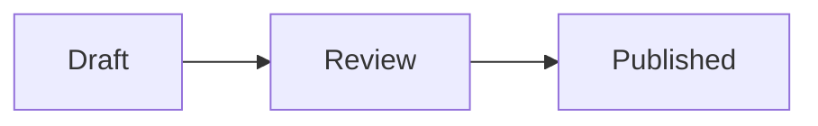

# @riebeckite/plugin-mermaid-pele

<!-- Generated from docs/docs/plugins/mermaid-pele.ja.md. Edit the canonical documentation in docs/docs/plugins and run `pnpm docs:sync`. -->

[Pele](https://pele.run/) を使い、`mermaid` コードブロックを静的 SVG に変換するプラグインです。

[English](./README.md)

## インストール

```sh
npm install @riebeckite/plugin-mermaid-pele
```

## 使い方

```ts
import { defineConfig } from "@riebeckite/core";
import { mermaidPele } from "@riebeckite/plugin-mermaid-pele";

export default defineConfig({
  plugins: [mermaidPele({ theme: "auto" })],
});
```

`theme` に指定できる値は既定値でもある `"auto"` だけです。Pele の SVG は CSS 変数で配色するため、Riebeckite の明暗テーマを切り替えても SVG を作り直す必要がありません。

## 図を書く

````md

````

コードブロックは静的な `<figure class="rr-mermaid-pele">` に置き換わります。クライアント JavaScript、Puppeteer、Chromium は不要で、HonoX の SSG でも動きます。無効な図はビルド全体を止めず、アクセシブルなエラー表示に置き換わり、エスケープ済みのソースは折りたたみで確認できます。

## 実行例

~~~mermaid
flowchart LR
  A[Note] --> B{Published?}
  B -->|yes| C[Site]
  B -->|no| D[Draft]
~~~

## テーマとレイアウト

プラグインが `rr-mermaid-pele` の構造、オーバーフロー時の挙動、Pele の CSS 変数への対応を担当します。テーマは公開済みの `--rb-color-*` と `--rb-font-*` トークンを提供し、Site はページ上の配置を決めます。SVG は自然な縦横比を維持して親幅に収まり、それでも収まらない場合だけ横スクロールします。

## 互換性と安全性

Pele は Mermaid 12.1.0 の組み込み図表に対応します。対象はフローチャート、シーケンス、クラス、状態、ER、Gantt、各種チャート、C4、新しい beta 図表です。ただしレイアウトと見た目は Mermaid と意図的に異なります。ZenUML など Mermaid の外部プラグインと任意 HTML ラベルには対応しません。

Pele はテキストをエスケープし、スタイルと URL をフィルタリングし、script、イベントハンドラ、`foreignObject`、`javascript:` URL を拒否します。このプラグインは図の中の画像を無効にし、危険な SVG 出力も追加で拒否します。通常の安全なリンクはそのまま使えます。

`@riebeckite/plugin-mermaid` と同時に有効化しないでください。プラグイン実行順で描画方式を決めるのではなく、明確な設定エラーを出します。移行するときは `mermaid()` を `mermaidPele()` に置き換えます。Markdown のフェンスは変更不要です。

## キャッシュ

通常の処理済みコンテンツキャッシュに生成した SVG を保存します。キャッシュキーには Markdown のソース、プラグイン設定、キャッシュの契約が含まれます。増分ビルドで Mermaid フェンスに変更がなければ再描画しません。テーマの CSS 変更は CSS 変数だけを変えるため、SVG の再生成は不要です。

## トラブルシューティング

- **図がエラー表示になる:** [Pele Playground](https://pele.run/playground) で記法を確認してください。構文エラーでは Pele がソース位置を報告します。
- **Mermaid と見た目が異なる:** Pele は独自の決定的なレイアウトエンジンを使います。Mermaid 固有のレイアウトや外部プラグインが必要な場合は `@riebeckite/plugin-mermaid` を使ってください。
- **両方の Mermaid プラグインを有効にした:** どちらか一方を削除してください。同じフェンスを共有することは意図的にできません。
